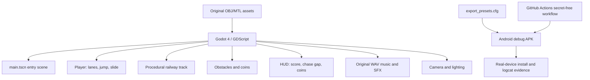
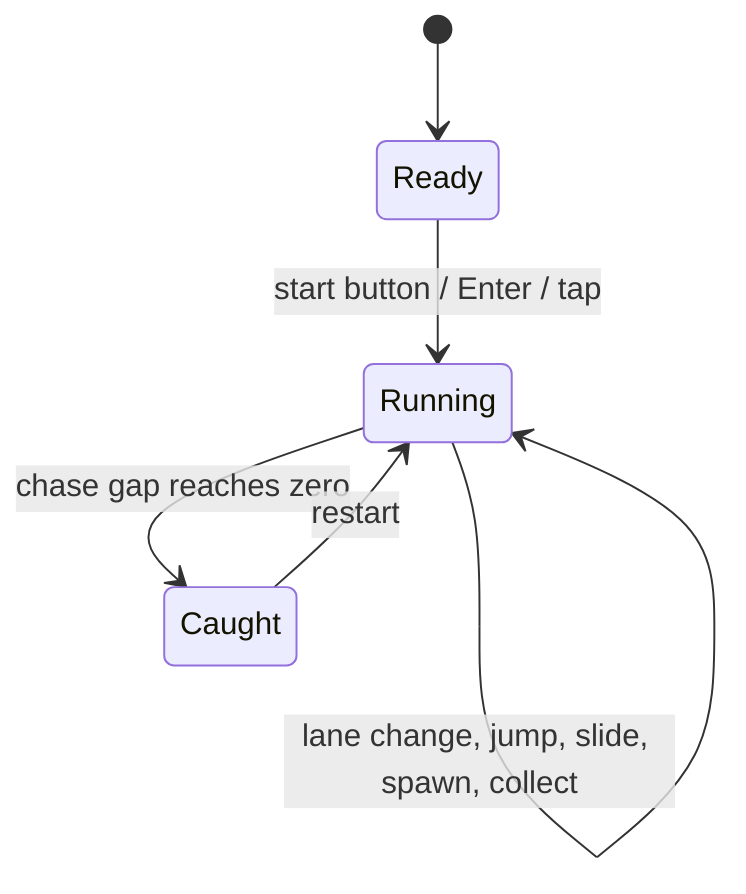

# Architecture

> **Last updated:** 2026-11-25  
> **Status:** In progress — active Godot/GDScript prototype; no Godot import, export, APK artifact, or device evidence yet.

This document is the top-level system design for **Indian Subway Runner**. [ADR-0004](docs/decisions/architecture-decisions.md) is the active binding decision: Godot 4, GDScript, Android debug APK, and a preserved Unity project retained only as history.

## System shape



Rules:

- Active gameplay is GDScript under `godot/scripts/**`.
- The active scene root is `godot/main.tscn`.
- Engine-neutral assets live under `godot/assets/`; originals under the preserved Unity project are not edited.
- The Android export preset produces a debug APK with a CI-generated debug keystore.
- No Unity credential, GitHub secret, or release signing key is part of the active path.
- Status only rises when source exists (Implemented), headless import/export passes (Tested), or device evidence is recorded (Verified).

## Runtime shape



The criminal always escapes in v1. The chase gap is a continuous pressure value: it recovers slowly during clean running and drops on collisions. Reaching zero ends the run without depicting a permanent capture.

## Script responsibilities

| Script area | Responsibility |
| --- | --- |
| `godot/scripts/main.gd` | Builds world, player, pursuer, camera, HUD, audio, procedural chunks, obstacles, coins, input arbitration, scoring, restart |
| `godot/project.godot` | Project settings, main scene, Android-friendly rendering, viewport, orientation |
| `godot/export_presets.cfg` | Android debug export preset, package ID, version, ARM64 architecture |
| `.github/workflows/godot-android.yml` | Free secret-free Godot download, export templates, Android SDK setup, debug keystore, import, export, artifact upload |

## Asset strategy

| Concern | Approach |
| --- | --- |
| Characters, barriers, coins, stations, trains | Original OBJ/MTL files copied into `godot/assets/models/` with primitive fallbacks in code |
| Music and SFX | Original WAV files copied into `godot/assets/audio/` |
| Textures | No third-party textures; future work must use original or clearly licensed material |
| Voice packs | Future ADR; no voice cloning or scraped audio |
| Save format | Future ADR; no format is implemented or claimed |

## Active folder structure

```text
indian-subway-runner/
├─ godot/
│  ├─ assets/
│  │  ├─ audio/{music,sfx}/
│  │  └─ models/
│  ├─ scripts/
│  │  └─ main.gd
│  ├─ .gitignore
│  ├─ export_presets.cfg
│  ├─ icon.svg
│  ├─ main.tscn
│  ├─ project.godot
│  └─ README.md
├─ .github/workflows/godot-android.yml
├─ docs/
├─ Assets/
├─ Packages/
├─ ProjectSettings/
└─ Tools/
```

`Assets/`, `Packages/`, and `ProjectSettings/` are preserved Unity history. They are not edited or deleted by active Godot work.

## Verification position

The architecture is an active design target with an implemented prototype. No Godot import, GDScript runtime, resource import, APK artifact, install, rendering, input, audio, performance, or device evidence is verified in this shell. See [docs/godot-android-build.md](docs/godot-android-build.md) for the export workflow and [TESTING.md](TESTING.md) for evidence gates.
