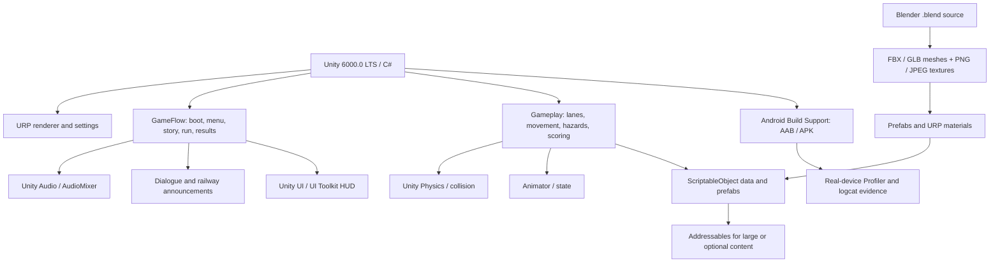
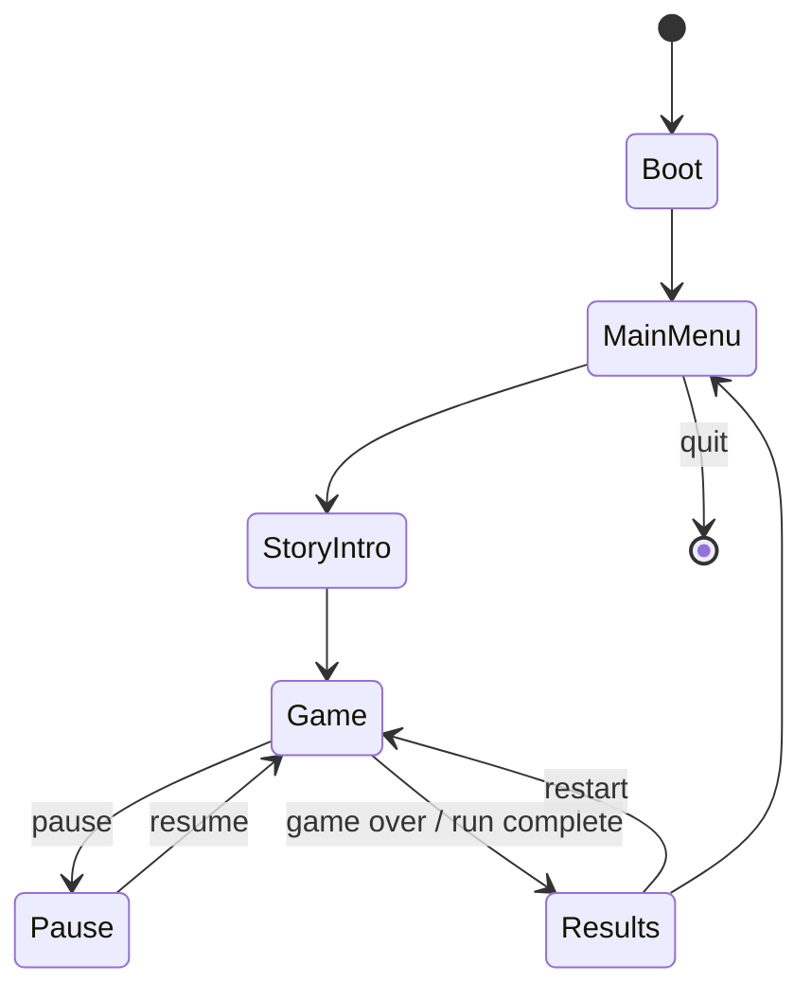
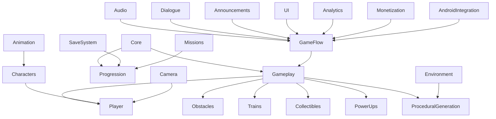

# Architecture

> **Last updated:** 2026-11-25  
> **Status:** In progress — target Unity/URP architecture; no scene, assembly, prefab, or gameplay code is verified in Unity yet.

This document is the top-level system design for **Indian Subway Runner**. [ADR-0003](docs/decisions/architecture-decisions.md) is the final binding decision: Unity 6000.0.86f1+ LTS, C#, URP, Android. Older Kotlin/libGDX module trees (`:core`, `:game`, `:android`, `:desktop`, `MainActivity`, `SpriteBatch`, Scene2D, Gradle gameplay builds) are **non-authoritative** and are not described here.

## System shape



Rules:

- Gameplay is C# under `Assets/Scripts/**`; Kotlin only in specialized Android-native Unity plugins.
- Game and UI state are separated from rendering and platform integration.
- Content is data-driven via ScriptableObjects; large or optional content uses Addressables.
- Every isolated subsystem gets an `.asmdef` so dependencies are explicit and tests stay fast.
- Status only rises when source exists (Implemented), Unity tests pass (Tested), or device/build evidence is recorded (Verified).

## Scene flow

Scene-generator source exists, but scene assets are **not created or Unity-verified**. The target flow is:



`Boot` initializes settings, data, and Addressables; `MainMenu` starts a run and settings; `StoryIntro` delivers chapters; `Game` hosts the 3-lane chase, HUD, and audio; `Results` reports distance/coins/score and restarts. The criminal always escapes; there is no permanent capture state in v1. Build Settings order must match `docs/unity-project-setup.md`.

## Assemblies



Assembly definitions are named `IndianSubwayRunner.<Area>` for: Core, GameFlow, Gameplay, Player, Characters, Environment, ProceduralGeneration, Obstacles, Trains, Collectibles, PowerUps, Camera, Animation, Audio, Dialogue, Announcements, UI, Progression, Missions, SaveSystem, Analytics, Monetization, and AndroidIntegration.

Dependency rules:

1. `Core` holds pure models, rules, and contracts; no scene objects, platform SDKs, or UI.
2. `GameFlow` owns scene lifecycle and coordinates systems; it does not own detailed gameplay math.
3. `AndroidIntegration` depends on `GameFlow`, never the reverse.
4. `Analytics` and `Monetization` stay passive and disabled until explicitly enabled.
5. Test assemblies reference the assembly under test plus `Core`.

## Data, prefabs, and Addressables

| Concern | Approach |
| --- | --- |
| Tuning and content | ScriptableObjects under `Assets/Data/` for config, dialogue, missions, and progression; imported and validated in Unity. |
| Runtime entities | Prefabs under `Assets/Prefabs/` for characters, trains, environment, obstacles, collectibles, and UI; pooled where spawned repeatedly. |
| Large / optional content | Addressables groups; keep startup and memory pressure low. |
| Save format | Future ADR-0004; no format is implemented or claimed. |
| Android plugins | `Assets/Plugins/Android/` only for genuine native needs; rebuild all native plugins for 16 KB page size. |

## Target folder structure

```text
indian-subway-runner/
├─ Assets/
│  ├─ Art/{Characters,Trains,Stations,Props,Environments,UI,Materials,Textures}/
│  ├─ Audio/{Music,Sfx,Voice,Announcements}/
│  ├─ Data/{Config,Dialogue,Missions,Progression}/
│  ├─ Editor/
│  ├─ Plugins/Android/
│  ├─ Prefabs/{Characters,Trains,Environment,Obstacles,Collectibles,UI}/
│  ├─ Scenes/{Boot,MainMenu,StoryIntro,Game,Results}.unity
│  ├─ Scripts/{Core,GameFlow,Gameplay,Player,Characters,Environment,
│  │          ProceduralGeneration,Obstacles,Trains,Collectibles,PowerUps,
│  │          Camera,Animation,Audio,Dialogue,Announcements,UI,Progression,
│  │          Missions,SaveSystem,Analytics,Monetization,AndroidIntegration}/
│  ├─ Settings/URP/
│  └─ Tests/{EditMode,PlayMode}/
├─ Packages/manifest.json
├─ ProjectSettings/
├─ Tools/Blender/
├─ docs/
└─ .github/
```

This is the final Unity layout, not a claim that every asset exists. Unity-generated files must be created and verified in the pinned Editor; empty folders are documented, not filled with fake assets.

## Verification position

The architecture is a design target. No Unity compilation, URP asset, scene, prefab, Animator controller, Physics behaviour, AudioMixer, Addressables group, Test Framework result, or Android build is verified in this shell. Deeper Unity notes are in [docs/unity-project-setup.md](docs/unity-project-setup.md), Android targets in [docs/android-build-instructions.md](docs/android-build-instructions.md), and evidence gates in [TESTING.md](TESTING.md).
