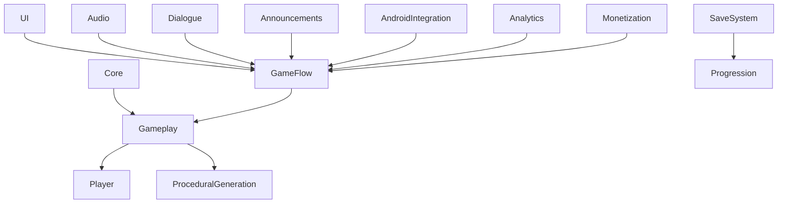

# Development Guide

> **Last updated:** 2026-11-25  
> **Status:** active Godot 4 implementation; the Unity Editor guidance below is preserved history. Godot smoke, gameplay capture, Android export, and debug APK release have CI evidence; device and human visual verification remain pending.

This guide originally described **Indian Subway Runner** as a Unity project, with source of truth in `Assets/`, `Packages/manifest.json`, and `ProjectSettings/`. That stack is historical under ADR-0003. The active source of truth is `godot/`, the Godot workflows in `.github/workflows/`, and [PROJECT_STATUS.md](PROJECT_STATUS.md). See ADR-0004 and [docs/godot-android-build.md](docs/godot-android-build.md) for active work.

## Historical Unity Editor and packages

- Pin **Unity 6000.0.86f1 or a newer 6000.0 LTS patch**.
- Install modules: Android Build Support, Android SDK & NDK Tools, OpenJDK 17 (Unity 6000.0 uses JDK 17 and NDK r27c).
- Required packages: `com.unity.render-pipelines.universal` and `com.unity.test-framework`.
- UI: Unity UI and/or UI Toolkit as verified by the pinned Editor.
- Optional after compatibility verification: Addressables, Cinemachine, Input System, TextMeshPro.

## Opening the project

1. Open this directory as a Unity project in the pinned Editor.
2. Let Unity import packages and recompile assemblies; resolve package and `.asmdef` errors first.
3. Confirm the active render pipeline is the URP asset under `Assets/Settings/URP/`.
4. Verify Android Player Settings from [docs/android-build-instructions.md](docs/android-build-instructions.md): package `com.indiansubwayrunner.game`, minimum API 24, target API 36, ARM64, IL2CPP, linear colour, URP, 16 KB-compatible native plugins only.
5. Confirm assembly definitions compile (names in [ARCHITECTURE.md](ARCHITECTURE.md)).
6. Create/verify scenes in `Assets/Scenes/` in this order and add them to Build Settings: `Boot`, `MainMenu`, `StoryIntro`, `Game`, `Results`.
7. Run EditMode tests, then PlayMode smoke tests; record results in [PROJECT_STATUS.md](PROJECT_STATUS.md) and change status only with evidence.

None of these steps has been executed in the current shell.

## Assembly direction

`Core` stays free of scene objects and platform SDKs; `GameFlow` owns scene lifecycle; `AndroidIntegration` depends on `GameFlow`, never the reverse; analytics and monetization stay disabled until approved.

## C# and content workflow

1. Put gameplay in the owning `.asmdef`; expose narrow commands/events rather than mutable internals.
2. Keep tuning, dialogue, missions, and progression in ScriptableObjects under `Assets/Data/`; do not scatter constants.
3. Use prefabs under `Assets/Prefabs/` and pool trains, obstacles, collectibles, chunks, and VFX; avoid `Instantiate`/`Destroy` churn in frame-critical loops.
4. Use Addressables for large or optional content; keep startup and memory bounded.
5. Map player state to Animator and emit audio/dialogue events through `GameFlow`; do not put gameplay rules in UI, animation, or platform code.
6. Place any genuine Android-native plugin in `Assets/Plugins/Android/` and rebuild it for 16 KB page size.
7. Add EditMode/PlayMode tests for changed behaviour and update docs plus [CHANGELOG.md](CHANGELOG.md) in the same milestone.

## PlayMode / EditMode workflow

| Mode | Use | Current state |
| --- | --- | --- |
| EditMode | Pure rules: lane math, scoring, difficulty data, pool accounting, save-format validation (future ADR-0004). | Planned — no results recorded. |
| PlayMode | Scene flow, input, collision, chunk streaming, HUD, audio and dialogue triggers, restart. | Planned — no results recorded. |
| Manual device run | Touch latency, readability, interruption/background-resume, thermal and frame pacing. | Planned — blocked by missing `adb` and device. |

Run the full test set after any assembly, scene, prefab, or URP setting change; attach results to the milestone under [TESTING.md](TESTING.md).

## Current shell limitations

| Item | Observation |
| --- | --- |
| Architecture | `aarch64` Termux |
| Unity Editor / Blender | Not found; scenes, prefabs, URP assets, imports, models, and builds cannot be created or verified here |
| `dotnet` / `csc` | Not found; C# cannot be compiled here |
| Android SDK path | `/data/data/com.termux/files/home/android-sdk` exists; `aapt`, `aapt2`, `zipalign` available |
| `ANDROID_HOME` / `ANDROID_SDK_ROOT` | Unset |
| `adb` / `sdkmanager` | Not found; no device install or profiling |
| Git / GitHub CLI | Git installed; `gh` authenticated as `inzyhere`; `origin` is public `inzyhere/indian-subway-runner`; active Godot CI/release evidence is in `PROJECT_STATUS.md` |

Markdown, JSON, XML, and directory structure can be statically checked here; nothing above should be read as a Unity build or test result. Legacy Gradle/Kotlin/libGDX commands do not apply to this project.

## Definition of done

**Planned → In progress:** accepted scope. **In progress → Implemented:** real files/assets in the active Godot project with docs updated. **Implemented → Tested:** smoke/capture/build evidence and logs recorded. **Tested → Verified:** build hash, device/Profiler evidence, licensing and privacy checks, and reviewer acceptance. The Unity EditMode/PlayMode wording above was historical. See [TESTING.md](TESTING.md) and [PROJECT_STATUS.md](PROJECT_STATUS.md).
