# Roadmap

> **Last updated:** 2026-11-25  
> **Status:** In progress — research and ADR-0003 are recorded; no Unity milestone beyond foundation is verified.

This roadmap follows [ADR-0003](docs/decisions/architecture-decisions.md): Unity 6000.0.86f1+ LTS, C#, URP, Android. Kotlin/libGDX gameplay, Three.js, WebView gameplay, React Native, and Flutter are out of scope. v1 is the original 3D chase in which the criminal always escapes. Monetization, analytics, cloud save, leaderboards, and larger voice packs remain future work behind passive boundaries.

## Milestone sequence

```mermaid
flowchart LR
    M0[M0 Research<br/>In progress] --> M1[M1 Foundation<br/>Implemented]
    M1 --> M2[M2 Unity verification<br/>Planned]
    M2 --> M3[M3 Core flow<br/>Planned]
    M3 --> M4[M4 Core gameplay<br/>Planned]
    M4 --> M5[M5 Procedural world<br/>Planned]
    M5 --> M6[M6 Story / Hindi / audio<br/>Planned]
    M6 --> M7[M7 Original 3D art<br/>Planned]
    M7 --> M8[M8 Android build<br/>Planned]
    M8 --> M9[M9 Device verification<br/>Planned]
    M9 --> M10[M10 Polish / release<br/>Planned]
```

## Milestones

| ID | Milestone | Deliverables and exit criteria | Status | Notes |
| --- | --- | --- | --- | --- |
| M0 | Public research | Engine-neutral, citation-based public gameplay record with explicit unknowns. | In progress | Record exists; findings are inputs, not project evidence. |
| M1 | Research + foundation | ADR-0003 final; environment assessment; truthful status; Unity setup and folder/package direction documented. | Implemented | Unity-unverified: no Editor import or compile has occurred. Legacy Kotlin/libGDX work is superseded. |
| M2 | Unity Editor verification | Open in pinned LTS with zero import/compiler errors; URP asset active; asmdefs compile; Android Player Settings checked. | Planned | Blocked by missing Unity Editor in this shell. |
| M3 | Core flow | Boot → MainMenu → StoryIntro → Game → Results scenes, pause/resume/restart, EditMode and PlayMode smoke tests. | Planned | No scene or test exists yet. |
| M4 | Core gameplay | 3 lanes, swipe left/right, jump, slide, trains, obstacles, collision, coins, power-ups, score/distance, difficulty; tests pass. | Planned | C# systems are not implemented. |
| M5 | Procedural world | Pooled chunk generation, safe escape path, spawn fairness, difficulty curve; automated and playtest evidence. | Planned | Depends on M4; no chunk code exists. |
| M6 | Story / Hindi / audio | Intro and chapters, contextual Hindi dialogue, railway announcements, original/licensed audio, AudioMixer, subtitles. | Planned | No dialogue or audio asset exists; voice-pack delivery is a future ADR. |
| M7 | Original 3D art | Blender `.blend` sources, FBX/GLB imports, PNG/JPEG textures, URP materials, prefabs, Animator controllers. | Planned | Blocked by missing Blender and asset workstation. |
| M8 | Android build | API 36 AAB (primary) and APK; IL2CPP/ARM64; 16 KB-compatible native plugins; APK handoff to `/sdcard/Download` when buildable. | Planned | Blocked by Unity, build modules, and signing setup. Old legacy APK is not this milestone. |
| M9 | Device verification | Real-device launch, input, lifecycle, memory, thermal, 60 FPS Profiler evidence, logcat, screenshots. | Planned | Blocked by `adb` and devices. |
| M10 | Polish / release | Final QA, licensing and privacy review, store metadata, release checklist and evidence archive. | Planned | Requires all prior gates; no release exists. |

## Scope boundaries

- **In v1:** offline 3D chase, three lanes, swipe/jump/slide, trains and obstacles, coins, power-ups, score/distance, rising difficulty, procedural chunks, game over/restart, story intro/chapters, contextual Hindi lines, railway announcements, URP visuals, Android build and device verification.
- **Not v1:** permanent capture, copied Subway Surfers content, voice cloning, scraped audio, monetization SDKs, online play, cloud save, leaderboards, daily missions.
- **Future ADRs:** save format and migration (0004), voice-pack delivery (0005), monetization (0006), analytics/telemetry (0007). Reserved, not implemented.

## Rules and blockers

A milestone cannot close by relabeling: **In progress** needs accepted scope; **Implemented** needs real files or assets; **Tested** needs passing Unity EditMode/PlayMode results; **Verified** needs recorded build/device/profiler evidence and review. See [TESTING.md](TESTING.md).

Current blockers: no Unity Editor or Blender, no `dotnet`/`csc`, no `adb`/`sdkmanager`, `ANDROID_HOME`/`ANDROID_SDK_ROOT` unset, `gh` unauthenticated with no remote. Nothing here is described as built, tested, or shipped. Authoritative context: [PROJECT_STATUS.md](PROJECT_STATUS.md), [docs/environment-assessment.md](docs/environment-assessment.md), and [docs/android-build-instructions.md](docs/android-build-instructions.md).
