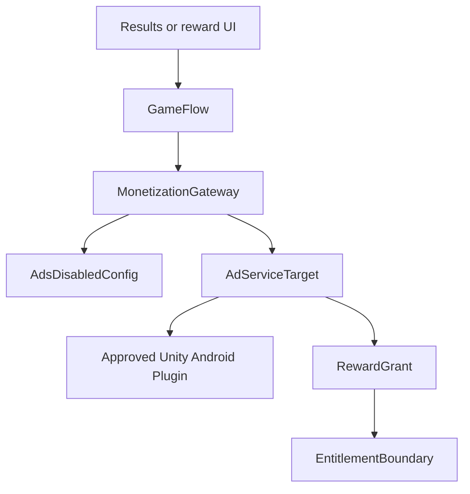

# Advertising Integration

> **Last updated:** 2026-11-25  
> **Status:** Planned; no ad SDK, ad network, placement, impression, reward callback, or ad request is implemented.  
> **Authority:** subordinate to [ADR-0003](../decisions/architecture-decisions.md) and the deferred monetization boundary in [monetization-architecture.md](monetization-architecture.md).  
> **Scope:** future, optional advertising only.

## 1. Current truth

Advertising is disabled by design. There is no ad media, no ad unit ID, no network package, no consent flow, no revenue claim, and no verified revenue event.

## 2. Placement principles

If advertising is ever approved:

| Placement | Candidate status | Constraint |
| --- | --- | --- |
| Optional rewarded continue after results | Deferred | Explicit player action; no forced viewing. |
| Optional rewarded cosmetic token | Deferred | Must not gate core progression. |
| Banner ads | Not planned | Interruptive for a mobile runner. |
| Interstitial ads | Not planned | Must not delay first run or gameplay. |
| Personalised ads | Not planned | Requires explicit approval and privacy review. |

## 3. Target architecture

`AdServiceTarget` is a design boundary only. It must remain inactive until an accepted ADR names the SDK, plugin version, data collection, consent rules, Android permissions, and revenue verification method.

## 4. Safety rules

- No automatic ad load during boot, menu, or active gameplay.
- No ad call when offline unless the SDK has been explicitly reviewed for offline behaviour.
- Reward grants are idempotent and applied only after a verified reward callback.
- Ad failure never blocks restart, progression, or offline play.
- No child-directed or personalised profiling without explicit owner approval.
- No secrets, ad unit IDs, or credentials are committed.

## 5. Android requirements before adoption

- API 36 target compatibility.
- 16 KB page-size compatible native plugin builds.
- JDK 17 and Unity 6000.0-compatible NDK.
- Store data-safety disclosure and privacy policy alignment.
- Real-device tests for audio focus, lifecycle, back button, and resume behaviour.

## 6. Verification gates

| Status | Requirement |
| --- | --- |
| Planned | Current state. |
| Implemented | Disabled contracts, configuration, and tests exist; no live SDK. |
| Tested | Simulated success, failure, cancel, offline, duplicate callback, and app-background tests pass. |
| Verified | Approved SDK sandbox, device lifecycle, privacy review, and revenue evidence are recorded. |

## 7. Acceptance checklist

- [ ] No ad SDK or ad unit exists today.
- [ ] No forced ad blocks core play.
- [ ] Reward callbacks cannot duplicate grants.
- [ ] Offline play remains complete.
- [ ] Privacy and store declarations exist before launch.
