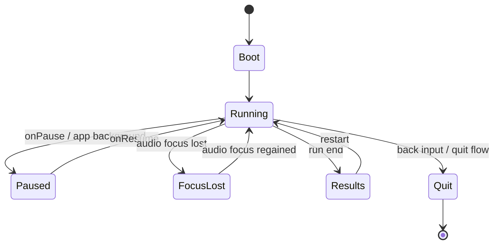

# Android Integration

> **Last updated:** 2026-11-25  
> **Status:** Planned and blocked in this shell; no Android build, device install, plugin, permission path, or runtime verification exists.  
> **Authority:** [ADR-0003](../decisions/architecture-decisions.md) and [environment-assessment.md](environment-assessment.md).  
> **Scope:** Unity 6000.0.86f1 or newer 6000.0 LTS patch Android build support.

## 1. Current truth

Unity Editor, Android Build Support, `adb`, `sdkmanager`, and a connected device are unavailable here. Unity-generated Gradle output is a build artefact, not gameplay source. Kotlin is allowed only in specialized Android-native Unity plugins when genuinely required.

## 2. Build target

| Setting | Target |
| --- | --- |
| Editor | Unity 6000.0.86f1 or newer 6000.0 LTS patch |
| Min API | 24 |
| Target API | 36 |
| Architecture | ARM64 primary |
| Page size | 16 KB compatible; rebuild every native plugin |
| JDK | 17 as required by Unity 6000.0 |
| NDK | r27c as required by Unity 6000.0 |
| Distribution | AAB primary; APK for local testing and owner delivery where required |
| Rendering | URP with mobile-appropriate settings |

## 3. Lifecycle boundary

Planned responsibilities:

| Concern | Unity-side rule |
| --- | --- |
| Back button | Confirm quit or close overlay before exiting; never skip results silently. |
| Pause | Freeze gameplay timing and scene audio cleanly. |
| Resume | Restore input state without applying stale swipe or touch. |
| Audio focus | Duck or pause audio on interruption; restore through AudioDirector. |
| Safe area | Respect cutouts and system bars; HUD stays readable. |
| Orientation | Verify intended orientation on device; do not claim until tested. |
| Touch input | Use Unity Input System actions; avoid Android View/Fragment gameplay. |

## 4. Permissions

Minimal policy:

| Permission | Position |
| --- | --- |
| `INTERNET` | Not required by offline core; add only with approved SDK. |
| `VIBRATE` | Optional if haptics are implemented. |
| Storage, location, contacts, camera, microphone, phone state | Not required. |

No permission may be requested "just in case".

## 5. Native plugins

- Place genuine native plugins only in `Assets/Plugins/Android/`.
- Require licence, version, hash, provenance, and API 36 compatibility.
- Rebuild all native libraries for 16 KB page size.
- Do not hand-maintain Unity-generated Gradle files as gameplay source.
- Do not add an SDK for ads, purchases, telemetry, or analytics without its ADR.

## 6. Build and verification checklist

- [ ] Open project in pinned Unity LTS and resolve import/compiler errors.
- [ ] Switch platform to Android with API 36 target.
- [ ] Verify URP settings and mobile quality tier.
- [ ] Confirm no Kotlin/libGDX gameplay source or dependency.
- [ ] Confirm all native plugins are 16 KB compatible.
- [ ] Build AAB and local APK.
- [ ] Install with `adb` on a real device.
- [ ] Capture logcat, Profiler, memory, FPS, thermal, and lifecycle evidence.
- [ ] Copy local APK to owner-requested delivery path only after build success.
- [ ] Store no signing credential in the repository.

## 7. Verification gates

| Status | Requirement |
| --- | --- |
| Planned | Current state. |
| Implemented | Unity Android settings, input/lifecycle adapters, and plugin records exist. |
| Tested | EditMode/PlayMode tests cover pause, resume, back handling, and safe fallback. |
| Verified | AAB/APK build and real-device evidence are recorded. |

## 8. Acceptance checklist

- [ ] No Android build is claimed in this shell.
- [ ] No fake device test result.
- [ ] No stale Gradle/Kotlin gameplay module.
- [ ] Minimal permissions.
- [ ] 16 KB page-size plan is explicit.
- [ ] Real-device evidence is required before Verified.
