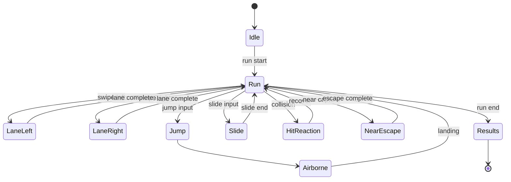
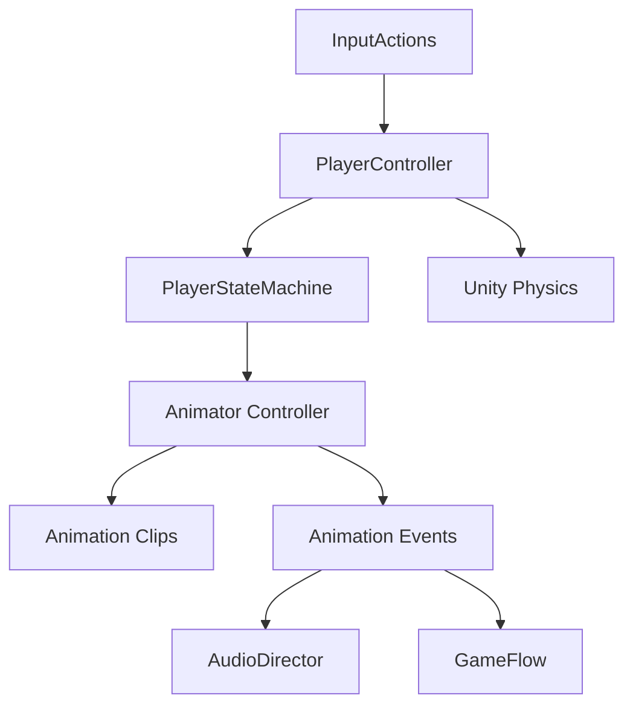

# Animation System

> **Last updated:** 2026-11-25  
> **Status:** Planned; no rig, clip, Animator Controller, blend tree, animation event, or prefab animation is claimed.  
> **Authority:** subordinate to [ADR-0003](../decisions/architecture-decisions.md).  
> **Scope:** Unity Animator for a genuine 3D Unity 6 LTS / C# / URP Android game.

## 1. Current truth

There is no atlas-frame animation, Scene2D animation, sprite batch, or libGDX animation path. Animation is defined in Unity terms: imported FBX/GLB clips, Animator Controllers, state machines, layers, blend trees, and animation events.

## 2. Authoring conventions

| Concern | Target convention |
| --- | --- |
| Source model | Original Blender `.blend` under `Tools/Blender/Source/` |
| Export | FBX or GLB into `Assets/Art/**` |
| Units | Metres, validated on Unity import |
| Axis | Y-up, single root per character or prop |
| Pivot | Predictable gameplay pivot recorded in asset documentation |
| Rig | Humanoid where Unity retargeting helps; generic for trains and props |
| Clips | Separate files or embedded clips only when import is verified |
| LOD | Planned per asset budget |

## 3. Player state machine

This is the target graph only. It must be created as an Animator Controller and verified in Unity before being marked Implemented.

## 4. Character and world animation

| Subject | Planned approach |
| --- | --- |
| Player | Scripted lane movement, Animator for body pose and reactions |
| ACP pursuer | Run, lean, gesture, and near-capture reactions |
| Criminal | Run, dodge, taunt, and escape flourish; never a permanent capture |
| Trains | Wheel rotation, suspension/body motion where appropriate |
| Station life | Loop clips with deterministic offsets |
| Obstacles | Minimal loops to protect frame budget |

Root motion is disabled for controlled lane movement unless a specific clip proves safe in PlayMode tests. Physics and input remain authoritative for position, collision, and lane state.

## 5. Animation events

Planned event uses:

- Footstep SFX selection.
- Jump apex cue.
- Slide start/end cue.
- Collision reaction timing.
- Near-escape dialogue trigger through GameFlow.
- Collectible pickup acknowledgement.

Events must call stable C# handlers and must not contain game logic embedded in clip names or brittle string lookups.

## 6. Integration boundary

## 7. Verification gates

| Status | Requirement |
| --- | --- |
| Planned | Current state. |
| Implemented | Blender sources, Unity imports, clips, Animator Controllers, handlers, and prefabs exist. |
| Tested | EditMode tests validate transitions; PlayMode tests validate input-to-clip mapping and event handling. |
| Verified | Device tests confirm smooth transitions, no T-pose, no root-motion drift, and frame budget compliance. |

## 8. Acceptance checklist

- [ ] No libGDX/SpriteBatch/Scene2D/atlas-frame wording remains active.
- [ ] No copied character rigs or animations.
- [ ] No primitive placeholders shipped as final animation.
- [ ] Animator events use stable handlers.
- [ ] Root motion policy is tested.
- [ ] Criminal never permanently captured.
