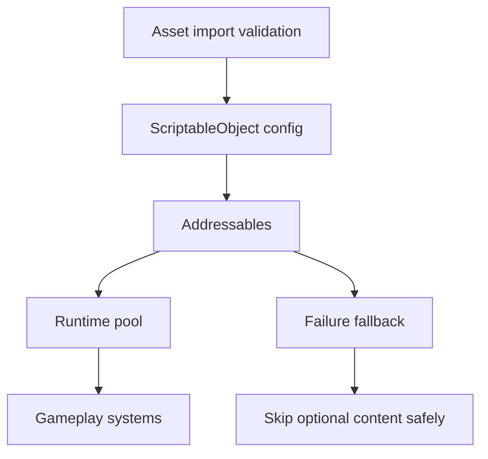

# Asset Management

> **Last updated:** 2026-11-25  
> **Status:** Policy in progress; no final art, audio, prefab, Addressables group, or imported Unity asset is verified.  
> **Authority:** subordinate to [ADR-0003](../decisions/architecture-decisions.md); Blender rules in [blender-workflow.md](blender-workflow.md).  
> **Scope:** Unity `Assets/`, Addressables, ScriptableObjects, and Blender source provenance.

## 1. Current truth

There is no libGDX `AssetManager`, `TextureAtlas`, Gradle asset module, or Kotlin asset loader. Unity is the source of truth through `Assets/`, `Packages/`, `ProjectSettings/`, ScriptableObjects, prefabs, and Addressables.

## 2. Folder taxonomy

```text
Assets/
├─ Art/
│  ├─ Characters/
│  ├─ Trains/
│  ├─ Stations/
│  ├─ Props/
│  ├─ Environments/
│  ├─ UI/
│  ├─ Materials/
│  └─ Textures/
├─ Audio/
│  ├─ Music/
│  ├─ Sfx/
│  ├─ Voice/
│  └─ Announcements/
├─ Data/
│  ├─ Config/
│  ├─ Dialogue/
│  ├─ Missions/
│  └─ Progression/
├─ Prefabs/
│  ├─ Characters/
│  ├─ Trains/
│  ├─ Environment/
│  ├─ Obstacles/
│  ├─ Collectibles/
│  └─ UI/
├─ Scenes/
├─ Settings/URP/
└─ Tests/
```

Empty folders are represented by documentation files, not fake assets.

## 3. Asset classes

| Class | Source of truth | Runtime form | Status |
| --- | --- | --- | --- |
| Characters | Blender `.blend` | FBX/GLB + prefab + Animator | Planned |
| Trains and stations | Blender `.blend` | FBX/GLB + URP materials + prefabs | Planned |
| Textures | Original image source | PNG/JPEG or optimized runtime format | Planned |
| UI art | Original source art | Sprite/UI Atlas where useful | Planned |
| Audio | Original/licensed source | Unity AudioClip | Planned |
| Tuning and content | ScriptableObject | Unity asset references | Planned |
| Optional content | Addressables | Loaded by key/label | Planned |

## 4. Addressables groups

Planned groups only:

| Group | Contents | Load policy |
| --- | --- | --- |
| `Boot` | Boot-required configuration | Synchronous or preloaded |
| `CoreGameplay` | Frequently used gameplay prefabs | Load at scene start |
| `Characters` | Character variants | Scene/chapter based |
| `Trains` | Train variants and chunks | Pooled by chapter |
| `Stations` | Station and environment chunks | Chunk streaming |
| `VoicePacks` | Original Hindi voice packs | Optional; ADR-0005 |
| `Cosmetics` | Optional cosmetic variants | Planned; monetization ADR |

No group, label, or key is verified until created in Unity.

## 5. Naming rules

| Asset | Pattern |
| --- | --- |
| Model source | `chr_player_runner.blend`, `trn_local_express.blend` |
| FBX/GLB import | `SM_Chr_Player_Runner`, `SM_Train_LocalExpress` |
| Material | `M_Chr_Player_Runner_URP` |
| Texture | `T_Station_Signage_Albedo` |
| Prefab | `PF_Chr_Player`, `PF_Train_LocalExpress` |
| Animator Controller | `AC_Player`, `AC_AcpPursuer` |
| ScriptableObject | `SO_Chapter_01`, `SO_Dialogue_Station_01` |
| Addressable key | `audio.voice.hindi.chapter01`, `env.station.platform_a` |

## 6. Import and validation policy

- Validate scale, pivot, normals, UVs, materials, rig, LODs, and clip boundaries in Unity.
- Use only URP-compatible materials.
- Compress textures for target Android formats.
- Keep source `.blend` files outside runtime `Assets/Art/**` unless intentionally imported by Unity.
- Record source-to-import mapping in [asset-production-plan.md](asset-production-plan.md).
- Do not use ripped, decompiled, scraped, or unlicensed assets.
- Temporary primitive placeholders must be named and tracked as temporary, never shipped as final art.

## 7. Runtime policy



Core gameplay must not depend on optional addressable content being available. Load failures for cosmetics, voice, or announcements must degrade safely.

## 8. Verification gates

| Status | Requirement |
| --- | --- |
| Planned | Current state. |
| Implemented | Assets, imports, prefabs, ScriptableObjects, Addressables groups, and provenance records exist in Unity. |
| Tested | Editor validation and PlayMode tests cover load, unload, pool reuse, and fallback. |
| Verified | Device build confirms memory, load time, asset integrity, and no unauthorized content. |

## 9. Acceptance checklist

- [ ] All assets are original or licensed.
- [ ] No protected game content.
- [ ] No stale libGDX wording.
- [ ] URP materials only.
- [ ] Source-to-import mapping recorded.
- [ ] Optional content fails safely.
