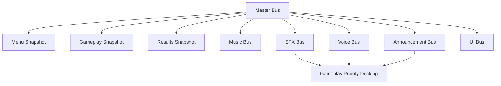
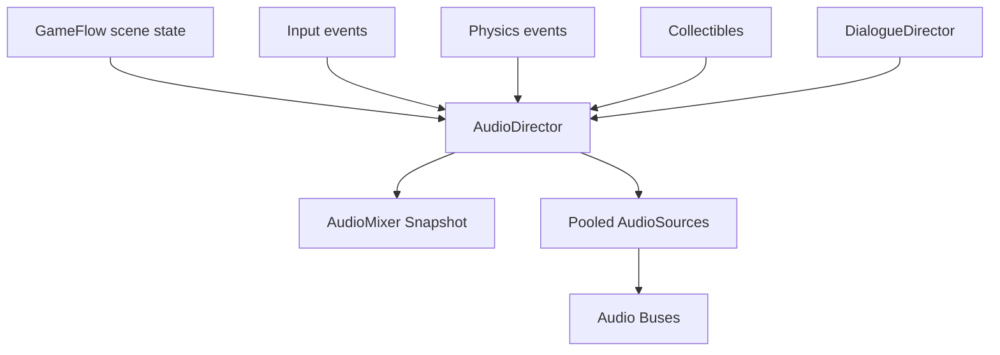

# Audio System

> **Last updated:** 2026-11-25  
> **Status:** Planned; no audio clip, AudioMixer, snapshot, subtitle, voice pack, or audio test result is claimed.  
> **Authority:** subordinate to [ADR-0003](../decisions/architecture-decisions.md). Voice delivery is reserved by ADR-0005.  
> **Scope:** Unity Audio / AudioMixer for a 3D Android endless chase.

## 1. Target structure

```text
Assets/Audio/
├─ Music/
├─ Sfx/
├─ Voice/
├─ Announcements/
└─ Mixers/
```

All audio must be original, licensed, or clearly marked temporary placeholder. Copyrighted meme audio, scraped clips, protected game audio, and cloned voices are prohibited.

## 2. Audio categories

| Category | Examples | Delivery target |
| --- | --- | --- |
| Music | Menu theme, chase score, results sting | Streaming or compressed clip depending on size |
| SFX | Footsteps, jumps, slides, collisions, coins, train horns | Short compressed clips in core build |
| Voice | Original ACP and character lines | Planned Addressables voice packs |
| Announcements | Original station and railway announcements | Addressables when optional |
| UI | Tap, confirm, pause, settings | Small core clips |

## 3. Mixer topology



Bus names, snapshots, ducking, and limits are targets only. No mixer settings exist until created and verified in Unity Editor.

## 4. Runtime rules



- Critical collision, train, and warning SFX take priority over voice and announcements.
- AudioSources are pooled for repeated one-shot events.
- Pause suspends gameplay audio without losing mixer state.
- Background interruption follows Android lifecycle handling in [android-integration.md](android-integration.md).
- A missing optional voice pack must not break playback or gameplay.
- Voice lines synchronize with subtitles from [contextual-voice-engine.md](contextual-voice-engine.md).

## 5. Performance targets

- Prefer compressed formats for long clips and short decoded clips for frequent SFX.
- Limit concurrent one-shots and deduplicate identical events within a frame.
- Avoid streaming many clips simultaneously.
- Addressables groups keep optional audio out of boot.
- Real-device Profiler evidence is required before any performance claim.

## 6. Verification gates

| Status | Requirement |
| --- | --- |
| Planned | Current state. |
| Implemented | Unity clips, mixer, buses, snapshots, director code, and provenance records exist. |
| Tested | PlayMode tests cover pause/resume, event routing, missing asset fallback, and no voice/SFX masking. |
| Verified | Device testing confirms mix clarity, lifecycle behaviour, loading, memory, and battery impact. |

## 7. Acceptance checklist

- [ ] All shipped audio has provenance.
- [ ] No scraped, copied, or cloned audio.
- [ ] Gameplay cues remain audible.
- [ ] Optional voice packs fail safely.
- [ ] Audio focus and pause behaviour are device-tested.
