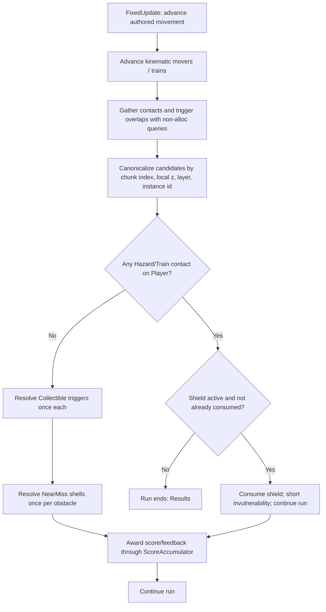

# Indian Subway Runner — Collision System

> **Status:** Planned — design specification only. No colliders, layers, triggers, hit arbitration code, or device tests are implemented or verified in this environment.
> **Last updated:** 2026-11-25
> **Authority:** [ADR-0003](decisions/architecture-decisions.md) is final/binding: Unity **6000.0.86f1+ LTS**, C#, URP, Android, with Unity 3D Physics as the collision substrate. Related contracts: [gameplay-mechanics.md](gameplay-mechanics.md), [procedural-generation.md](procedural-generation.md).

## 1. Physics boundary (Planned)

- Use Unity's built-in 3D Physics: `Collider`, `Rigidbody` (kinematic for movers), and the Project Settings layer collision matrix.
- Gameplay runs at a fixed timestep of 1/60; contact collection and hit arbitration happen in `FixedUpdate`. Presentation interpolation in `Update` does not decide hits.
- Do not use a custom swept solver or the DOTS `com.unity.physics` package in v1. A change of physics backend requires a new ADR.
- No physics impulse is applied to the player. Movement is authored and deterministic; physics reports overlap/contact only.
- Solver callback order is never treated as gameplay semantics. All reported candidates are gathered then sorted by an explicit key before resolution.

## 2. Layers and collision matrix (Planned)

| Layer | Contents | Intended interactions |
| --- | --- | --- |
| `Player` | Player body collider and state-dependent trigger shells | Contacts `Hazard`, `Train`; triggers `Collectible`, `NearMiss` |
| `Hazard` | Static low/high obstacles | Contact `Player`; no contact with `Scenery` |
| `Train` | Static and moving train volumes on kinematic Rigidbodies | Contact `Player`; no contact with `Collectible` |
| `Collectible` | Coins, score pickups, power-ups | Trigger `Player` only |
| `NearMiss` | Slightly larger one-shot shell around hazards/trains | Trigger `Player` only; never blocks movement |
| `Scenery` | Non-interactive dressing | No gameplay interactions |

The matrix disables all other pairs. `UI` is not a physics layer. Layer names, indices, and the final matrix are authored in Project Settings and checked by an EditMode test so a misconfigured matrix fails tests rather than silently changing gameplay.

## 3. Collider shapes by player state (Planned)

| Player state | Collider behaviour |
| --- | --- |
| Standing | Default upright body capsule/box in current lane |
| Lane changing | Volume spans source and target lanes during transition; no other lanes touched |
| Jumping | Body raised according to locomotion curve; low hazards pass beneath |
| Sliding | Body lowered; high hazards pass overhead |
| Shield-active | Same geometry; resolution changes, not the shape |
| Paused/Results | Collider disabled or contact processing suspended by `GameFlow` |

A visual clear must match the collider clear. Any mismatch (for example a visible jump that still hits a low obstacle) is a release-blocking defect.

## 4. Contact pipeline

Priority is fixed: **fatal contact → shield consumption → collectible → near miss → no event**. Only one run-ending hit is emitted per fixed step; duplicate contacts from the same obstacle are collapsed by stable id. Collectibles have a `consumed` flag reset on pool recycle. Near-miss shells award at most once per obstacle and require no actual contact.

## 5. Hit handling rules

| Event | Planned outcome |
| --- | --- |
| Unshielded hazard/train contact | Run ends; input locked; score committed per scoring doc |
| Shielded hazard/train contact | Shield consumed; brief invulnerability; no score credit for the hit |
| Coin / score trigger | Credit ledgers once; pooled object recycled |
| Power-up trigger | Apply definition from [gameplay-mechanics.md](gameplay-mechanics.md) once |
| Near miss | Small score bonus and feedback; no persistence side effect beyond score |
| Contact during invulnerability | Ignored, except a new collectible trigger which still applies if not consumed |
| Contact while paused | Not processed |

Collection by magnet still uses the same trigger path; pulling a coin does not grant an alternate credit route. Anti-cheat basics and ledger boundaries are in [scoring-and-rewards.md](scoring-and-rewards.md).

## 6. Debug gizmos (development only)

- `OnDrawGizmosSelected` on prefabs shows body colliders, trigger shells, lane extents, and near-miss bands.
- A development-build overlay can toggle collision visualization; this overlay is not shipped in the release UI.
- Logs include chunk id, candidate sort key, and resolution outcome when a debug flag is enabled. No player-facing diagnostics in release builds.
- Layer matrix and state-dependent collider dimensions are covered by EditMode assertions.

## 7. Evidence required to advance status

| Status gate | Evidence required |
| --- | --- |
| Implemented | C# colliders/triggers compile in pinned Unity Editor; prefabs wired |
| Tested | EditMode arbitration tests + PlayMode trigger/hit/both-lane tests pass |
| Verified | Device run with Profiler/log evidence showing no false hits on visually cleared obstacles, stable frame/allocation targets |

None of this evidence exists in the current shell. Per [PROJECT_STATUS.md](../PROJECT_STATUS.md), this subsystem remains **Planned**, with no Unity Editor, scenes, prefabs, or device available.
