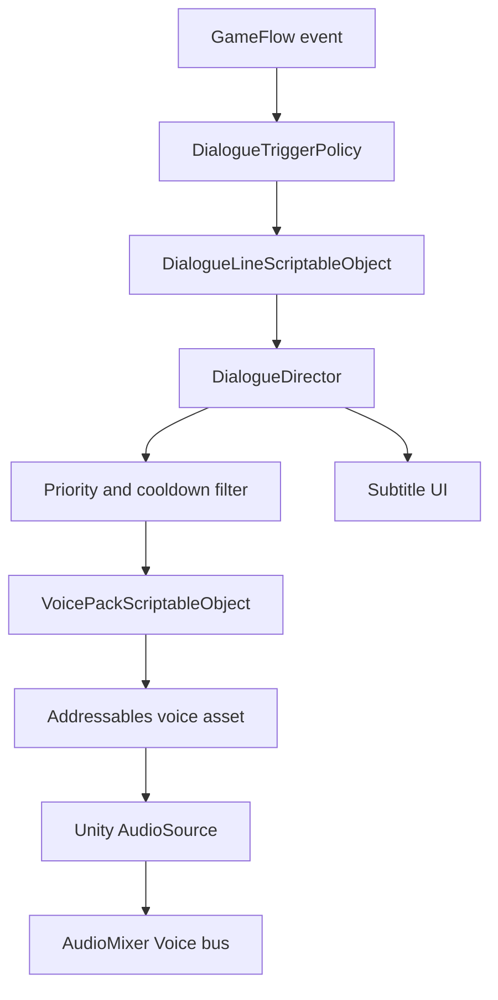
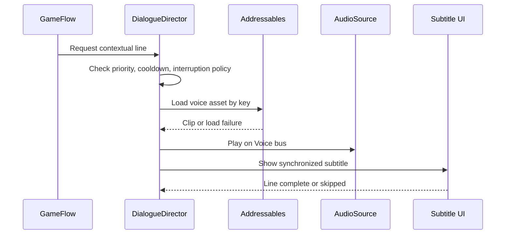

# Contextual Voice Engine

> **Last updated:** 2026-11-25  
> **Status:** Planned; no dialogue, voice asset, synthesised voice, or runtime delivery is implemented.  
> **Authority:** subordinate to [ADR-0003](../decisions/architecture-decisions.md). Delivery model reserved by ADR-0005.  
> **Scope:** original Hindi dialogue and railway announcements for a Unity 6 LTS / C# / URP Android game.

## 1. Purpose

This document defines how contextual spoken lines could be selected, packaged, delivered, mixed, and tested. It is a design target, not a claim that voice content exists.

The game identity is original and Indian: fictional ACP-style chase dialogue, station humour, and railway announcements. The criminal is never permanently caught in v1.

## 2. Non-negotiable rules

- Use only original scripts and original or explicitly licensed voice recordings.
- Do not clone, imitate, or impersonate a real person, celebrity, or protected character voice.
- Do not copy exact dialogue, mannerisms, or audio from any commercial game, film, or television programme.
- Do not scrape copyrighted meme audio, ringtones, or sound bites from the open web.
- Do not download voice packs at runtime unless a future ADR defines the service, consent model, privacy boundary, and offline fallback.
- Default delivery is offline and local to the installed game.

## 3. Target architecture

## 4. Data model

| Asset | Target fields | Status |
| --- | --- | --- |
| `DialogueLineSO` | `id`, `speaker`, `text`, `contextTags`, `chapter`, `locale`, `priority`, `cooldownSeconds`, `audioKey` | Planned |
| `DialogueTriggerPolicySO` | allowed tags, priority order, cooldown rules, skip rules, chapter gating | Planned |
| `VoicePackSO` | pack id, locale, speaker role, licence record, Addressable key, checksum | Planned |
| `SubtitleStyleSO` | font asset, timing, reading speed, contrast, reduced-motion behaviour | Planned |

Voice assets belong under `Assets/Audio/Voice/` and `Assets/Audio/Announcements/`. Metadata belongs under `Assets/Data/Dialogue/`. Large or optional packs belong in Addressables groups and must not be loaded during boot unless required for the first scene.

## 5. Trigger policy

Planned trigger families:

| Trigger | Example intent | Constraint |
| --- | --- | --- |
| Chapter start | Introduce the chase chapter | Once per chapter attempt |
| Near miss | Light ACP remark after a close dodge | Cooldown required |
| Train dodge | Short reaction line | Must not mask collision SFX |
| Coin streak | Playful acknowledgement | Rate-limited |
| Station archetype | Platform or station-life humour | One line per archetype per run |
| Results | Criminal escapes again | No permanent capture state |

Selection order is priority, then chapter eligibility, then cooldown, then deterministic tie-break. Random selection is allowed only where tests can inject a deterministic seed.

## 6. Playback rules

- Dialogue must never hide critical collision, train, or warning audio.
- The Voice bus ducking policy is planned, not configured.
- A failed load must skip the line silently and leave subtitles optional.
- Players must be able to finish a run without voice packs.

## 7. Provenance and rights

Each recording needs a record containing speaker consent, script source, recording date, licence scope, edit history, and shipped asset path. Synthetic voices are allowed only if the model and output are licensed, original, non-identifiable, and consented; real-person clones are prohibited.

Provenance records belong with the asset production documentation and must be reviewed before a voice asset is marked Implemented.

## 8. Verification gates

| Status | Requirement |
| --- | --- |
| Planned | Current state: design only. |
| Implemented | C# director, ScriptableObject data, Addressables keys, AudioMixer routing, and original or licensed assets exist in Unity. |
| Tested | EditMode tests cover trigger precedence, cooldown, fallback, and subtitles; PlayMode tests cover playback interruption. |
| Verified | Real-device run confirms audio clarity, no masked gameplay cues, correct loading, and complete provenance records. |

## 9. Acceptance checklist

- [ ] No unlicensed, scraped, cloned, or identifiable voice content.
- [ ] No exact copied lines from protected works.
- [ ] All lines are written as original Indian railway chase dialogue.
- [ ] Cooldowns prevent repetition.
- [ ] Subtitles remain readable.
- [ ] Voice failure does not break the run.
- [ ] ADR-0005 is written before any delivery model beyond offline local packs.
