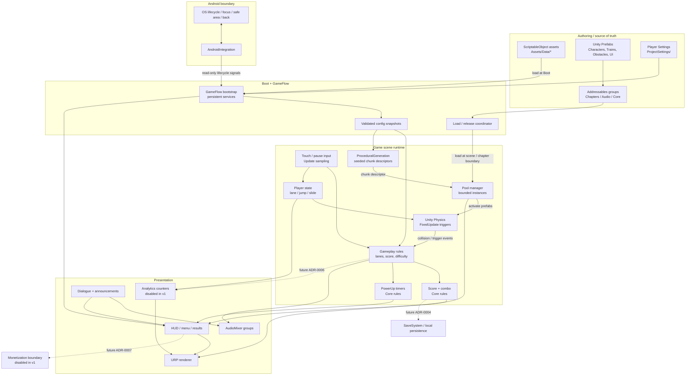
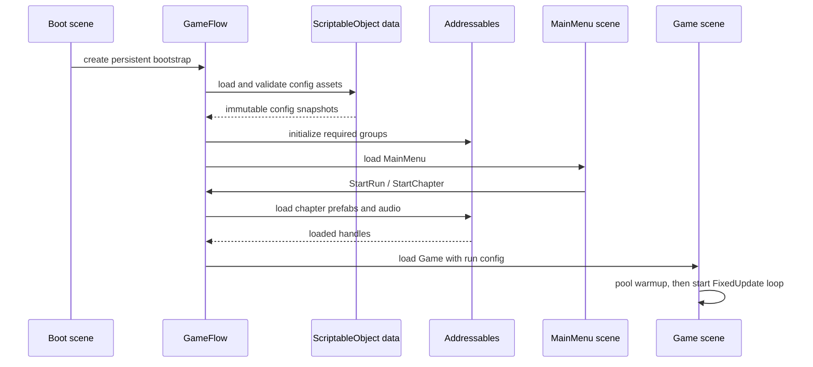
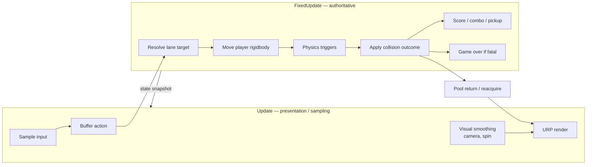

# Data Flow Diagram

> **Status:** Planned — target Unity runtime data flow. No runtime is running and no data has been verified in Unity.
> **Last updated:** 2026-11-25
> **Authority:** [ADR-0003](../decisions/architecture-decisions.md) — Unity 6000.0.86f1+, C#, URP, Android.

This diagram describes how data moves in the intended Unity implementation. It is a **design model**, not a trace of running code. Solid lines are planned v1 flows; dashed lines are reserved future boundaries that are not implemented or enabled.

## 1. Runtime data flow overview

## 2. Run-start sequence

## 3. Per-frame and per-fixed-step flow

`Update` never changes lane identity or collision results; it only samples input and smooths presentation. `FixedUpdate` owns authoritative movement and triggers.

## 4. Data ownership rules

| Data | Owner | Mutability during run |
| --- | --- | --- |
| Tuning configs | `Core` / `Gameplay` | Immutable snapshots |
| Chapter definitions | `Progression` | Immutable |
| Dialogue / announcement metadata | `Dialogue`, `Announcements` | Immutable; selection state only |
| Player run state | `Player` | Mutable within run |
| Chunk descriptors | `ProceduralGeneration` | Mutable within run, seeded |
| Pooled instances | Pool manager | Recycled, never duplicated |
| Score / combo | `Core` rules | Mutable within run |
| Save data | `SaveSystem` | Future ADR-0004; no format claimed |
| Analytics / monetization | Passive future boundaries | Disabled in v1 |

## 5. Cross-document index

- [technical-architecture.md](../technical-architecture.md) — assemblies, scenes, data assets, Android boundary
- [system-architecture.md](./system-architecture.md) — full Unity system graph
- [gameplay-flow.md](./gameplay-flow.md) — scene and run flow
- [game-design-document.md](../game-design-document.md) — gameplay rules
- [story-and-narrative-design.md](../story-and-narrative-design.md), [audio-system.md](../audio-system.md) — content metadata
