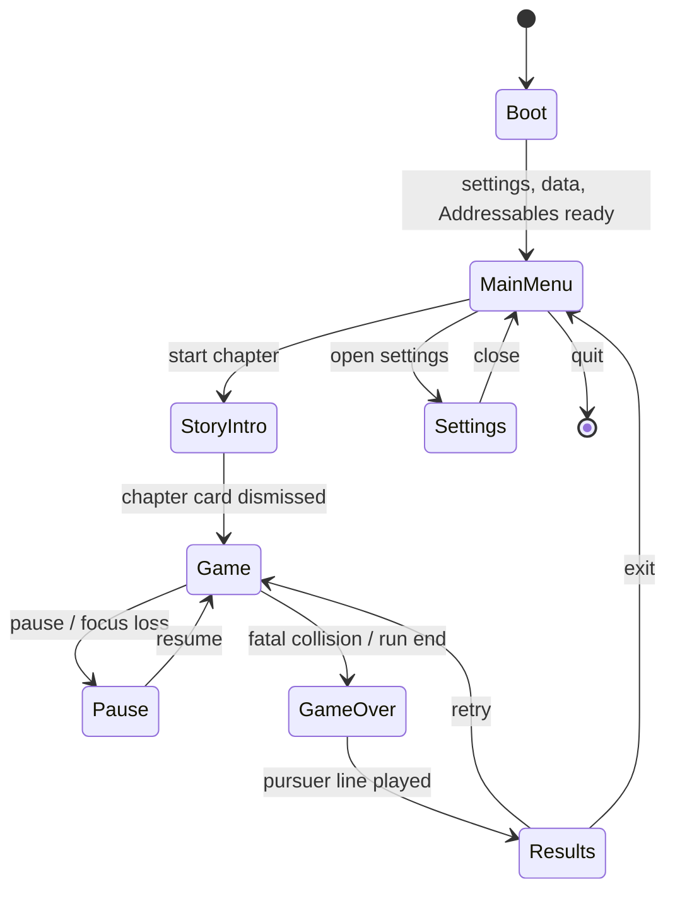
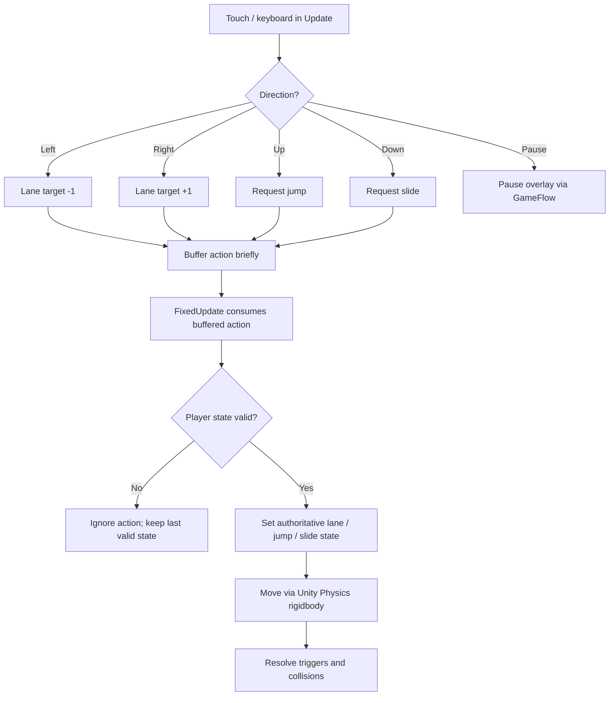
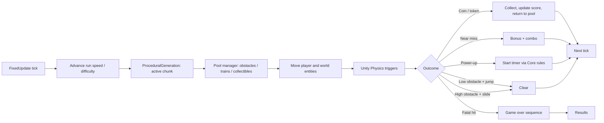
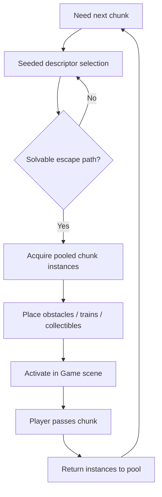
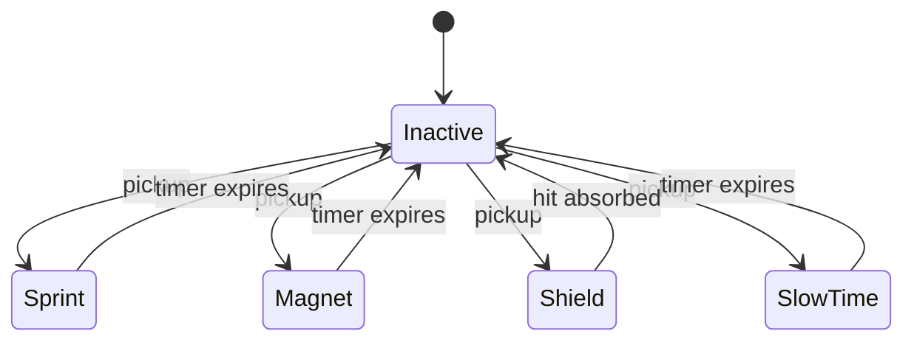

# Gameplay Flow Diagram

> **Status:** Planned — target Unity scene and run flow. No scene or gameplay has been verified in Unity.
> **Last updated:** 2026-11-25
> **Authority:** [ADR-0003](../decisions/architecture-decisions.md) — Unity 6000.0.86f1+, C#, URP, Android.

All flows below are design targets expressed in Unity terms: scenes, scene-local managers, `Update`/`FixedUpdate`, Animator, URP presentation, and the `GameFlow` bootstrap. The criminal is **never permanently caught in v1**; "game over" means the run ends and the escape continues into Results.

## 1. Scene and run lifecycle

Scene ownership matches [unity-project-setup.md](../unity-project-setup.md): `Boot` initializes, `MainMenu` starts runs/chapters/settings, `StoryIntro` delivers chapter cards, `Game` hosts the chase and HUD, `Results` reports distance/coins/score.

## 2. Input resolution

Rules:

- Three lanes only: left, centre, right. Visual interpolation never changes lane identity.
- Jump clears low obstacles; slide clears high obstacles; neither clears full blockers.
- Buffer is short and deterministic so inputs slightly before a boundary still feel fair.
- Pause freezes simulation; it never mutates run state.

## 3. Chase step (authoritative)

## 4. Procedural chunk lifecycle

Every chunk has at least one guaranteed escape path; impossible combinations are rejected before activation. Chunk pools are bounded and loading happens at boundaries, never mid-frame. See [procedural-generation.md](../procedural-generation.md).

## 5. Power-up state

Durations, cooldowns, and stacking are **to be balanced later** through ScriptableObject data and PlayMode tests. No power-up is implemented.

## 6. Game over and Results

On a fatal collision, `Game` stops the run, plays a short pursuer reaction line, and transitions to `Results` with distance, coins, and score. `Results` offers retry (reload `Game` with a fresh seeded run) or exit to `MainMenu`. There is no state in which the criminal is permanently caught.

## 7. Presentation-only note

Animator parameters, camera shake, URP post-processing, HUD updates, and audio cues are driven by authoritative state snapshots. They never feed back into lane identity, collision outcomes, or scoring. See [data-flow.md](./data-flow.md) and [rendering-engine.md](../rendering-engine.md).

## 8. Cross-document index

- [game-design-document.md](../game-design-document.md) — complete gameplay outline
- [technical-architecture.md](../technical-architecture.md) — assemblies and scene flow
- [data-flow.md](./data-flow.md) — runtime data flow
- [system-architecture.md](./system-architecture.md) — full system graph
