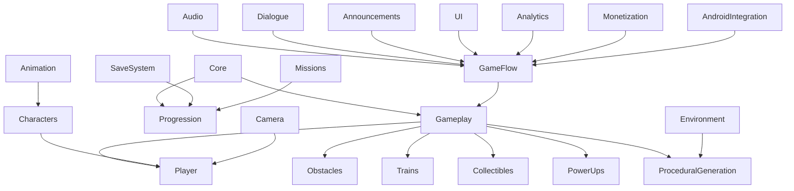
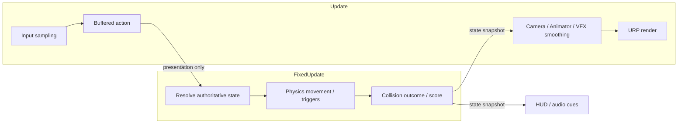

# System Architecture Diagram

> **Status:** Planned — target Unity/URP system architecture. No assembly, scene, or build is Unity-verified.
> **Last updated:** 2026-11-25
> **Authority:** [ADR-0003](../decisions/architecture-decisions.md) — Unity 6000.0.86f1+, C#, URP, Android.

This is the full Unity system graph. It replaces the superseded Kotlin/libGDX module diagram. Solid boxes are planned v1 systems; dashed boxes are deferred boundaries that are **not implemented or enabled**.

## 1. Full system graph

```mermaid
flowchart TB
    subgraph PLATFORM["Unity platform / Android"]
        UE["Unity 6000.0 LTS runtime"]
        IL["IL2CPP + ARM64<br/>min API 24 / target API 36"]
        UR["URP renderer"]
        PH["Unity Physics<br/>FixedUpdate"]
        AN["Animator"]
        AU["AudioMixer"]
        OS["Android OS<br/>lifecycle, focus, safe area, back"]
    end

    subgraph BOOT["Startup and coordination"]
        BOOTSC["Boot scene"]
        GF["GameFlow bootstrap<br/>persistent services"]
        SCENES["Scene managers<br/>Menu / Story / Game / Results"]
    end

    subgraph CORE["Core and data"]
        CORE["Core<br/>rules, seeded RNG, pooling contracts"]
        DATA["ScriptableObject config<br/>Assets/Data/*"]
        ADDR["Addressables<br/>Core / Chapters / Audio"]
        PROG["Progression + Missions"]
        SAVE["SaveSystem — future ADR-0004"]
    end

    subgraph GAME["Gameplay systems"]
        GAMEPLAY["Gameplay<br/>lanes, score, difficulty"]
        PLAYER["Player state<br/>lane / jump / slide"]
        CHAR["Characters"]
        ENV["Environment"]
        PROC["ProceduralGeneration<br/>seeded chunks, solvability"]
        OBS["Obstacles"]
        TRAIN["Trains"]
        COLL["Collectibles"]
        PWR["PowerUps<br/>sprint / magnet / shield / slow-time"]
        POOL["Bounded pool manager"]
    end

    subgraph PRES["Presentation"]
        CAM["Camera follow rig"]
        ANIM["Animation parameters"]
        AUDIO["Audio cues"]
        DIA["Dialogue + announcements"]
        UI["UI<br/>HUD / menu / results"]
    end

    subgraph EDGE["Android integration"]
        AI["AndroidIntegration<br/>only native plugin boundary"]
        PLUG["Assets/Plugins/Android<br/>specialized plugins only"]
    end

    subgraph FUTURE["Deferred — not enabled"]
        ANALYTICS["Analytics"]
        MONET["Monetization"]
        CLOUD["Cloud / network"]
    end

    BOOTSC --> GF
    DATA --> GF
    ADDR --> GF
    GF --> SCENES
    GF --> GAMEPLAY
    CORE --> GAMEPLAY
    CORE --> PROG
    PROG --> DATA

    GAMEPLAY --> PLAYER
    GAMEPLAY --> OBS
    GAMEPLAY --> TRAIN
    GAMEPLAY --> COLL
    GAMEPLAY --> PWR
    GAMEPLAY --> PROC
    ENV --> PROC
    CHAR --> PLAYER
    PROC --> POOL
    POOL --> PH
    PLAYER --> PH
    PH --> GAMEPLAY

    PLAYER --> ANIM
    ANIM --> AN
    GAMEPLAY --> AUDIO
    DIA --> AUDIO
    AUDIO --> AU
    PLAYER --> CAM
    CAM --> UR
    POOL --> UR
    UI --> UR
    GAMEPLAY --> UI

    UE --> IL
    UE --> UR
    UE --> PH
    UE --> AN
    UE --> AU
    OS <--> AI
    AI --> PLUG
    AI --> GF

    PROG -.-> SAVE
    UI -.-> ANALYTICS
    UI -.-> MONET
    GF -.-> CLOUD
```

## 2. Assembly dependency direction

Arrows mean **"depends on"**. This matches [technical-architecture.md](../technical-architecture.md) and [unity-project-setup.md](../unity-project-setup.md).



Rules:

- `Core` has no scene objects, UI, or platform SDKs.
- `GameFlow` owns scene lifecycle and coordination, not gameplay math.
- `AndroidIntegration` is the only assembly that touches Android-native plugin types.
- `Analytics`, `Monetization`, `SaveSystem`, and cloud boundaries are passive/deferred.

## 3. Runtime loop ownership



`FixedUpdate` owns movement, collision, and scoring. `Update` samples input and smooths presentation only. No presentation value feeds back into authoritative state.

## 4. Rendering and platform boundary

- Rendering is URP Forward with tier-gated quality; see [rendering-engine.md](../rendering-engine.md).
- `UI` and `AndroidIntegration` handle safe area, focus loss, back button, and orientation signals.
- Native plugins must be rebuilt for 16 KB page-size compatibility before Play submission.
- Kotlin is permitted only in specialized Android-native plugins; it is never gameplay code.
- Generated Unity Gradle output is a build artefact, not source of truth.

## 5. Testing seams

| Seam | Enables |
| --- | --- |
| Injectable seeded RNG | Reproducible procedural tests |
| ScriptableObject configs in memory | EditMode boundary tests without scenes |
| Isolated `Core` rules | EditMode lane/score/difficulty/solvability tests |
| Scene-scoped managers | PlayMode Boot → Menu → Story → Game → Results tests |
| Pooled factories | PlayMode leak/recycle tests |
| Physics trigger hooks | PlayMode collision and pickup tests |

No EditMode or PlayMode result exists yet. See [testing-strategy.md](../testing-strategy.md) and [TESTING.md](../../TESTING.md).

## 6. Cross-document index

- [technical-architecture.md](../technical-architecture.md) — assembly responsibilities and scene lifecycle
- [data-flow.md](./data-flow.md) — runtime data flow
- [gameplay-flow.md](./gameplay-flow.md) — scene and run flow
- [project-overview.md](../project-overview.md) — vision, stack, truthful status
- [game-design-document.md](../game-design-document.md) — design outline
- [ADR-0003](../decisions/architecture-decisions.md) — final binding engine decision
