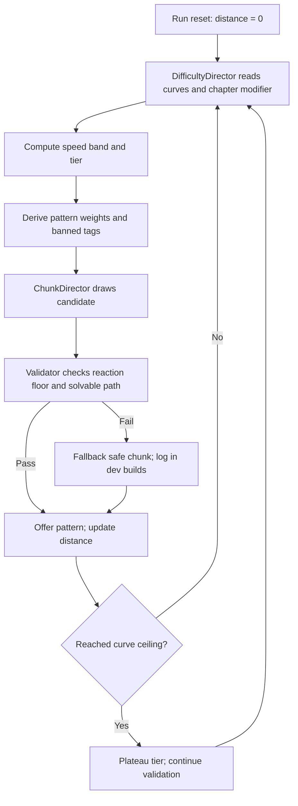

# Indian Subway Runner — Difficulty Progression

> **Status:** Planned — design specification only. No difficulty code, ScriptableObject assets, playtest telemetry, or tuning evidence are implemented or verified in this environment.
> **Last updated:** 2026-11-25
> **Authority:** [ADR-0003](decisions/architecture-decisions.md) is final/binding: Unity **6000.0.86f1+ LTS**, C#, URP, Android. Difficulty data feeds [procedural-generation.md](procedural-generation.md) and is bounded by [gameplay-mechanics.md](gameplay-mechanics.md).

## 1. Unity data shape (Planned)

| Asset / type | Purpose |
| --- | --- |
| `DifficultyCurveSO` | Authored animation curves: speed vs distance, spawn density vs distance, power-up cadence |
| `TierTableSO` | Named difficulty tiers with numeric bands and banned/allowed pattern tags |
| `ChapterModifierSO` | Per-chapter theme weights, banned tags, and narration/banter hooks |
| `DifficultyDirector` | Pure C# runtime calculator; no scene, MonoBehaviour, or URP dependency in `Core` |

Tuning lives in assets under `Assets/Data/Difficulty/`. Gameplay code consumes values through an interface so EditMode tests can inject fixed distance/seed inputs. No difficulty decision mutates prefabs or colliders directly.

## 2. Difficulty axes (Planned)

| Axis | Effect | Boundary |
| --- | --- | --- |
| Forward speed | Rises with distance along authored curve | Capped at a tuned plateau; not unbounded |
| Spawn density | Increases hazard and pattern complexity via generator weights | Must preserve a solvable path |
| Reaction window | Shortens as speed rises | Must stay above the chosen fairness floor |
| Power-up cadence | Slightly more frequent early, steadier later | Never required to survive a pattern |
| Theme complexity | More dressing and lighting variety by chapter | Cosmetic only |
| Chapter modifier | Changes weights and banned tags | Never overrides the fairness floor |

The criminal remains permanently ahead and the ACP pursuer remains a presentation presence; difficulty is expressed through the railway environment and run pace, never by catching the criminal.

## 3. Tier model (proposed, not measured)

| Tier | Role | Example constraints |
| --- | --- | --- |
| Warm-up | First seconds of every run | Single-hazard patterns, wide gaps, centre-lane start |
| Tier 1 | Early distance | Short patterns, generous reaction window |
| Tier 2 | Mid run | Mixed lane changes and jump/slide patterns |
| Tier 3 | Late run | Denser mixes, moving trains with validated gaps |
| Plateau | After authored ceiling | Highest sustained tier; no further speed growth |

Which numeric band belongs to which tier is data, not hardcoded thresholds. Tier boundaries must be covered by EditMode tests so boundary crossings are deterministic.

## 4. Reaction floor and fairness gate

- Public genre commentary often cites roughly **~250 ms** as a reaction reference; this is a design discussion point, **not a measured fact from this project**.
- The project must choose and validate its own floor through playtests and device latency data ([game-controls.md](game-controls.md)).
- A pattern offered at a speed whose available reaction time falls below the chosen floor is rejected by `ChunkValidator`; see [procedural-generation.md](procedural-generation.md).
- Speed increases never convert a previously valid solution into an impossible one. A speed change requires revalidation of all eligible patterns.

## 5. Chapter modifiers (Planned)

| Chapter | Planned modifier emphasis | Status |
| --- | --- | --- |
| Chapter 1 | Station/basic track theme, low complexity, tutorial-safe patterns | Planned |
| Chapter 2 | Platform and crossing variety, more lane changes | Planned |
| Chapter 3 | Bridge/countryside themes, jump/slide mixes | Planned |
| Chapter 4 | Night/rain atmosphere, moving train gaps | Planned |
| Chapter 5 | Dense finale mix at plateau, still solvable | Planned |

Chapter selection and story gating are future/production concerns; no chapter content or unlock state exists yet. Chapter modifiers only bias weights and cosmetics; they never grant or remove player abilities.

## 6. Difficulty flow

## 7. Testable rules (Planned)

Pure functions make the system testable without PlayMode:

| Function | Test expectation |
| --- | --- |
| `SpeedAt(distance, curve)` | Monotonic within authored bounds; clamped at ceiling |
| `TierFor(speed, table)` | Correct tier on both sides of every boundary |
| `CanOffer(pattern, tier, chapter, speed)` | False when reaction floor or safe path fails |
| `WeightsFor(chapter, tier)` | Banned tags removed; weights normalized |

EditMode tests use fixed RNG and fixed distance sequences. PlayMode and device tests then confirm that authored curves feel fair and that no generated pattern caused an unavoidable hit.

## 8. Explicitly out of scope

- Network, account-based, or cloud difficulty adjustment.
- Rubber-banding based on hidden telemetry.
- Adaptive personalization. A local-only future extension would require its own ADR (data/privacy boundary, referenced as ADR-0007 in [environment-assessment.md](environment-assessment.md)) before any telemetry is collected.
- Any claim that current difficulty has been tuned or playtested.

## 9. Validation policy

All values and behaviours are **Planned** per [PROJECT_STATUS.md](../PROJECT_STATUS.md). No Unity Editor, ScriptableObject assets, or playtest evidence are available here. The reaction floor and tier boundaries must be finalized only after recorded device playtests.
