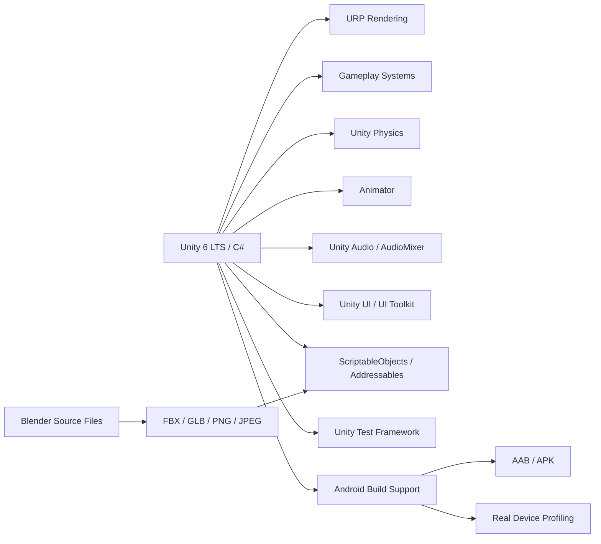

# Environment Assessment

> Last updated: 2026-11-25  
> Status: Implemented for the current shell. This is environment evidence, not a claim that Unity builds are verified.

## 1. Purpose

This document records the exact tooling available for Indian Subway Runner, the pinned Unity/Android direction, the final folder structure, and the milestones that can be attempted in the current environment.

The final stack is fixed by ADR-0003: **Unity 6 LTS, C#, URP, Android**. Do not switch engines without explicit owner approval.

## 2. Current shell facts

| Item | Observation |
| --- | --- |
| Date | 2026-11-25 |
| Architecture | `aarch64` |
| OS environment | Termux Linux |
| Working repository | `/data/data/com.termux/files/home/subwayRunner` |
| Git state before migration | Not a Git repository: `fatal: not a git repository (or any parent up to mount point /)` |
| Git executable | `/data/data/com.termux/files/usr/bin/git`, `git version 2.56.1` |
| GitHub CLI | `/data/data/com.termux/files/usr/bin/gh`, `gh version 2.105.0` |
| GitHub authentication | Initially not logged in; now authenticated as `inzyhere` with repo scope via `gh` |
| Java | `openjdk version "21.0.13.1"`; `javac 21.0.13.1` |
| Gradle | Present at `/data/data/com.termux/files/usr/bin/gradle`; not part of the active gameplay stack |
| Android SDK path | `/data/data/com.termux/files/home/android-sdk` exists |
| `ANDROID_HOME` | `UNSET` |
| `ANDROID_SDK_ROOT` | `UNSET` |
| Debug keystore | `/data/data/com.termux/files/home/.android/debug.keystore` exists; must never be committed |
| ARM64 Android tools | `aapt`, `aapt2`, `zipalign` available under `/data/data/com.termux/files/usr/bin/` |
| `adb` | `NOT_FOUND` |
| `sdkmanager` | `NOT_FOUND` |
| Unity Editor | `NOT_FOUND` for `unity-editor`, `Unity`, `unity`, `unityhub`; no `/opt/Unity`, `/opt/unity`, `/Applications/Unity`, or `/usr/local/Unity` |
| Blender | `blender NOT_FOUND` |
| .NET/C# compiler | `dotnet NOT_FOUND`, `csc NOT_FOUND`, `mono NOT_FOUND`, `msbuild NOT_FOUND` |
| Native compilers | `gcc`, `clang`, `make` present; not a Unity/C# substitute |

Consequences:

- Markdown, JSON, XML, YAML-like text, shell scripts, and directory structure can be authored and statically checked here.
- C# cannot be compiled here.
- Unity scenes, prefabs, URP assets, Animator controllers, Addressables groups, and builds cannot be created or verified here.
- Blender models cannot be authored here.
- GitHub remote creation and push are blocked until authentication is provided.
- Android installation/device profiling is blocked until `adb` and a device are available.

## 3. Pinned Unity and Android direction

### Unity

Pin the project to **Unity 6000.0.86f1 or a newer 6000.0 LTS patch**.

Rationale:

- Unity’s Android docs state that Unity 6000.0.46f1 and later support Android API level 36.
- Google Play requires new apps and updates to target Android API 36 from 2026-08-31.
- Unity 6000.0.86f1 is a November 2026 LTS patch with documented Android build-support fixes.
- Unity 6000.0.38f1 and later support 16 KB memory page sizes.
- Unity 6000.0 uses JDK 17 and NDK r27c.
- Unity 6000.0.86f1+ documents SDK Build Tools 36.0.0, Command-line Tools 21.0, and Platform Tools 37.0.1.

Sources:

- <https://unity.com/releases/unity-6/support>
- <https://unity.com/releases/editor/whats-new/6000.0.86f1>
- <https://docs.unity.com/en-us/engine/6000.0/manual/platform-specific/android/introducing/requirements-and-compatibility>
- <https://docs.unity.com/en-us/engine/6000.0/manual/platform-specific/android/getting-started/sdksetup/supported-dependency-versions>
- <https://developer.android.com/google/play/requirements/target-sdk>

### Android

| Setting | Target |
| --- | --- |
| Minimum API | 24 |
| Target API | 36 |
| Architecture | ARM64 primary; ARMv7 only if profiling and package cost justify it |
| Page size | 16 KB compatible; rebuild every native plugin for 16 KB |
| Rendering | URP with OpenGL ES 3.2 / Vulkan where supported |
| Distribution | AAB primary; APK for local testing and owner delivery requirement |
| Java/JDK | JDK 17 as required by Unity 6000.0 |
| NDK | r27c as required by Unity 6000.0 |

## 4. Final architecture overview



Architectural rules:

- Gameplay is C# in `Assets/Scripts/**`, never Kotlin.
- Kotlin is allowed only inside specialized Android-native Unity plugins when genuinely required.
- Unity-generated Gradle output is a build artefact, not the source of gameplay.
- Game and UI state are separated from rendering and platform integration.
- Content is data-driven through ScriptableObjects; large/optional content uses Addressables.
- Every isolated subsystem has an `.asmdef` to make dependencies explicit and tests fast.
- No subsystem is considered Implemented until it exists as compilable C# in Unity.
- No subsystem is Tested until EditMode or PlayMode tests exist and pass.
- No subsystem is Verified until device/profiler/build evidence is recorded.

## 5. Final Unity folder structure

```text
indian-subway-runner/
├─ Assets/
│  ├─ Art/
│  │  ├─ Characters/
│  │  ├─ Trains/
│  │  ├─ Stations/
│  │  ├─ Props/
│  │  ├─ Environments/
│  │  ├─ UI/
│  │  ├─ Materials/
│  │  └─ Textures/
│  ├─ Audio/
│  │  ├─ Music/
│  │  ├─ Sfx/
│  │  ├─ Voice/
│  │  └─ Announcements/
│  ├─ Data/
│  │  ├─ Config/
│  │  ├─ Dialogue/
│  │  ├─ Missions/
│  │  └─ Progression/
│  ├─ Editor/
│  ├─ Plugins/Android/
│  ├─ Prefabs/
│  │  ├─ Characters/
│  │  ├─ Trains/
│  │  ├─ Environment/
│  │  ├─ Obstacles/
│  │  ├─ Collectibles/
│  │  └─ UI/
│  ├─ Scenes/
│  │  ├─ Boot.unity
│  │  ├─ MainMenu.unity
│  │  ├─ StoryIntro.unity
│  │  ├─ Game.unity
│  │  └─ Results.unity
│  ├─ Scripts/
│  │  ├─ Core/
│  │  ├─ GameFlow/
│  │  ├─ Gameplay/
│  │  ├─ Player/
│  │  ├─ Characters/
│  │  ├─ Environment/
│  │  ├─ ProceduralGeneration/
│  │  ├─ Obstacles/
│  │  ├─ Trains/
│  │  ├─ Collectibles/
│  │  ├─ PowerUps/
│  │  ├─ Camera/
│  │  ├─ Animation/
│  │  ├─ Audio/
│  │  ├─ Dialogue/
│  │  ├─ Announcements/
│  │  ├─ UI/
│  │  ├─ Progression/
│  │  ├─ Missions/
│  │  ├─ SaveSystem/
│  │  ├─ Analytics/
│  │  ├─ Monetization/
│  │  └─ AndroidIntegration/
│  ├─ Settings/URP/
│  └─ Tests/
│     ├─ EditMode/
│     └─ PlayMode/
├─ Packages/
│  └─ manifest.json
├─ ProjectSettings/
├─ Tools/Blender/
├─ docs/
└─ .github/
```

Only directories that can be truthfully created without Unity are present in this shell. Unity-generated scene, prefab, renderer-data, and settings assets will be added when Unity Editor is available. Empty Unity folders are represented by `README.md` files, not fake assets.

## 6. Game design document outline

`docs/game-design-document.md` must contain:

1. Vision and unique Indian identity.
2. Player fantasy: ACP Pradyuman chasing an uncatchable criminal.
3. Core loop: run, dodge, collect, advance chapter, unlock cosmetics.
4. Controls: swipe left/right, jump, slide, pause/resume.
5. Lane rules and collision model.
6. Obstacle taxonomy: stationary, moving, train, gap, dynamic hazard.
7. Collectibles: coins, clue tokens, score pickups.
8. Power-ups: sprint, magnet, shield, slow-time; each designed and balanced later.
9. Difficulty curve: speed, spawn density, reaction windows, chapter modifiers.
10. Procedural chunk rules: no impossible combinations; guaranteed escape path.
11. Scoring: distance, coins, near misses, combo multiplier.
12. Progression: chapters, missions, unlocks, cosmetics.
13. Story delivery: intro, chapter cards, contextual one-liners, railway announcements.
14. UI flow: boot, menu, story intro, HUD, pause, game over, results, settings.
15. Accessibility: readable HUD, colour independence, reduced motion consideration.
16. Audio direction: original background score, diegetic announcements, reactive cues.
17. Performance budget and device tiers.
18. Monetization principles, deferred until core stability.
19. Test matrix and verification gates.
20. Out-of-scope list: no copied assets, no voice cloning, no real celebrity impersonation, no engine switch.

## 7. Story and narrative design

See `docs/story-and-narrative-design.md`.

Core rule: the criminal always escapes at the end of an episode. The player can win the run, beat records, complete chapters, and uncover clues, but cannot permanently capture the criminal in v1.

Planned chapters:

1. `Chapter 1 — The Great Railway Escape`
2. `Chapter 2 — Platform Ka Hungama`
3. `Chapter 3 — Train Ke Peeche`
4. `Chapter 4 — City Express Chase`
5. `Chapter 5 — Criminal Ka Masterplan`

Narrative tone: light, mischievous, Indian, family-friendly, with witty ACP-style dialogue and station/railway humour. Avoid copying exact lines, mannerisms, or protected audio from any real person or commercial game.

## 8. Asset production plan

See `docs/asset-production-plan.md` and `docs/blender-workflow.md`.

Rules:

- All model source files originate in Blender as `.blend`.
- Export final gameplay meshes as FBX or GLB with clear naming and scale conventions.
- Use URP-compatible materials only.
- Use original textures in PNG/JPEG or optimized runtime formats.
- Do not use ripped, decompiled, scraped, or unlicensed assets.
- Do not ship permanent primitive placeholders. Temporary primitives must be clearly documented and replaced before release.
- Character proportions, train silhouettes, station signage, food stalls, and railway props must communicate Indian identity at a glance.
- Asset budget is defined in `docs/performance-optimization.md` and must be enforced with Profiler evidence.

## 9. Blender integration plan

Blender is unavailable in this shell. `Tools/Blender/` may contain future scripts, but no `.blend`, FBX, GLB, rig, animation, or texture can be truthfully claimed here.

Workflow when Blender is available:

1. Model in metres, Y-up export convention, single root per prefab.
2. Keep source `.blend` in `Tools/Blender/Source/**`.
3. Export gameplay meshes to `Assets/Art/**`.
4. Export animations separately or embedded only when Unity imports them predictably.
5. Validate scale, normals, pivot, UVs, materials, and LODs in Unity.
6. Create Unity prefabs from validated imports.
7. Record source-to-import mapping in `docs/asset-production-plan.md`.

## 10. Performance strategy

Target: sustained 60 FPS on a mainstream Android device, with graceful scalability on budget hardware.

Methods:

- URP renderer with mobile-friendly settings.
- Object pooling for trains, obstacles, collectibles, chunks, and VFX.
- No `Instantiate`/`Destroy` churn in frame-critical loops.
- Addressables for optional content to reduce startup and memory pressure.
- Chunked procedural generation with fixed chunk pools.
- Frustum culling, occlusion where useful, LODs, and limited real-time lights.
- Baked lighting where practical.
- Texture atlases and compressed texture formats.
- Frame budget tracking with Unity Profiler.
- Real-device tests for thermal throttling, battery use, and loading time.
- 16 KB page-size compatibility for all native plugins.

No performance target is Verified until Profiler captures and device results are stored in `docs/performance-optimization.md`.

## 11. GitHub repository plan

Target: private GitHub repository named `indian-subway-runner`, default branch `main`.

Status:

1. Local Git history is initialized with meaningful commits.
2. A Unity-specific `.gitignore` is in place before binary assets.
3. `.keystore`, `debug.keystore`, tokens, credentials, API keys, and proprietary assets are excluded.
4. Git LFS will be used for large binary assets only when licensed and necessary.
5. Private remote `inzyhere/indian-subway-runner` was added as `origin`.
6. Remote `main` was fetched before reconciliation; its `Initial commit` was merged without force.
7. `main` was pushed after static secret checks and now tracks `origin/main`.

No GitHub authentication blocker remains. Unity/Blender/Android tooling blockers remain unchanged.

## 12. Milestones

| Milestone | Status | Exit criteria |
| --- | --- | --- |
| M0 — Public research | In progress | Engine-neutral research doc with citations; no protected content. |
| M1 — Foundation | Implemented, Unity-unverified | ADR, environment assessment, folder structure, asmdefs, package manifest, truthful status, and local Git repository initialized. |
| M2 — Unity Editor verification | Planned | Project opens in pinned Unity LTS with zero compiler/import errors. |
| M3 — Core flow | Planned | Boot/menu/story/game/results flow passes EditMode/PlayMode tests. |
| M4 — Core gameplay | Planned | Lanes, jump, slide, obstacles, trains, collision, scoring pass tests. |
| M5 — Procedural world | Planned | Chunk pools, difficulty curve, guaranteed safe paths verified. |
| M6 — Story/Hindi/audio | Planned | Original dialogue, announcements, AudioMixer, subtitles verified. |
| M7 — Original 3D art | Planned | Blender source files, FBX/GLB imports, prefabs, Animator controllers verified. |
| M8 — Android build | Planned | API 36 AAB/APK built; APK copied to `/sdcard/Download`. |
| M9 — Device verification | Planned | Real-device FPS, memory, thermal, lifecycle, and input evidence. |
| M10 — Polish/release | Planned | Store metadata, privacy, final QA, release checklist. |
