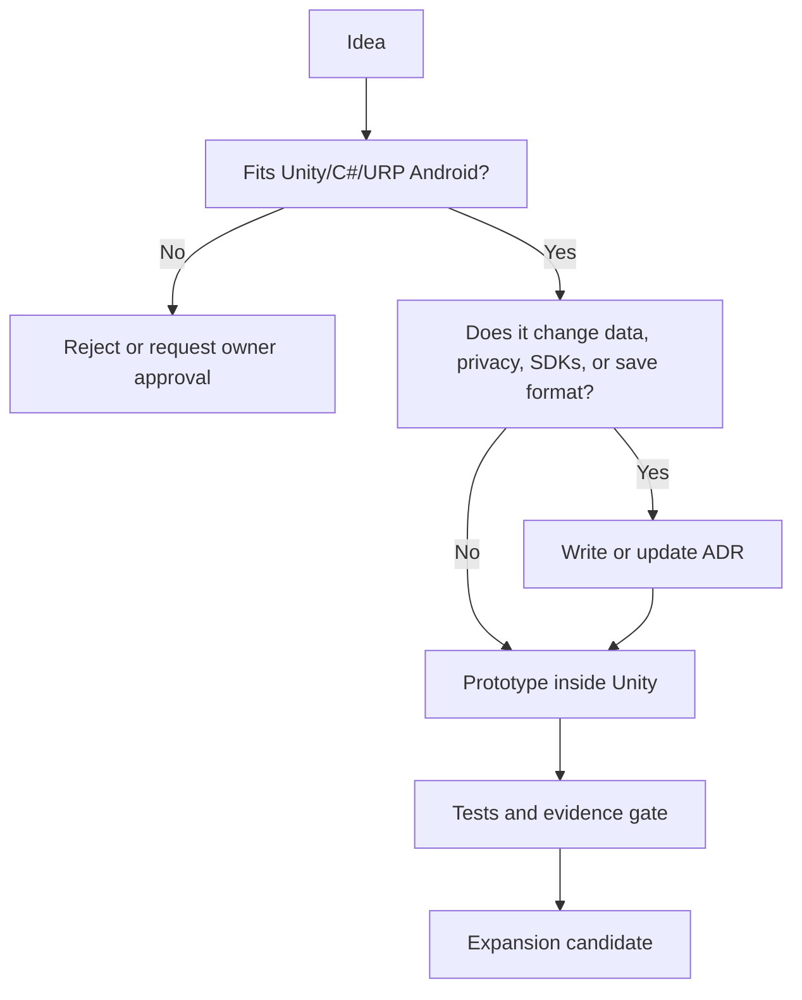

# Future Expansion

> **Last updated:** 2026-11-25  
> **Status:** Planned ideas only; nothing in this file is implemented, scheduled, or approved for v1.  
> **Authority:** [ADR-0003](../decisions/architecture-decisions.md). No engine switch without explicit owner approval.  
> **Scope:** Android-first Unity game; later ideas are separated from v1 commitments.

## 1. v1 boundary

The current target remains:

- Unity 6000.0.86f1 or newer 6000.0 LTS patch, C#, URP, Android.
- Genuine 3D railway chase with three lanes, swipe, jump, slide, trains, obstacles, coins, power-ups, procedural chunks, chapters, and results.
- Original Indian identity, original assets, original Hindi dialogue, and railway announcements.
- Offline-capable play.
- No monetization, telemetry, voice packs, or cloud services in the verified core.

## 2. Later ideas

| Area | Idea | Gate |
| --- | --- | --- |
| Story | More railway chapters and regional routes | Narrative review; asset capacity; tests. |
| Localisation | Additional Indian languages | ADR-0005-style content delivery decision. |
| Cosmetics | Character, train, and station themes | Monetization/asset provenance review. |
| Missions | Daily or weekly local challenges | Privacy review; save schema under ADR-0004. |
| Leaderboards | Local records first; online only later | New ADR for accounts/network/privacy. |
| Devices | Tablet layout and broader Android device tiers | Device profiling evidence. |
| Audio | More original region-specific announcements | Rights and mix verification. |
| Accessibility | Expanded text scaling, colour independence, reduced motion | PlayMode and device testing. |

## 3. Explicitly out of scope

- Kotlin gameplay, libGDX, Three.js, WebView gameplay, React Native, Flutter, or an unapproved engine switch.
- Copying Subway Surfers art, code, audio, characters, branding, or exact level patterns.
- Scraped meme audio, celebrity voice cloning, real-person imitation, or unlicensed music.
- Decompiling or unpacking protected games for content.
- Server-authoritative gameplay, online dependency for core play, or account-gated basic progression.
- Monetization before core stability and device verification.

## 4. Expansion decision path

## 5. Verification rule

An expansion remains Planned until it has source, tests, and evidence. A design idea, placeholder UI, or inactive flag does not make a feature implemented.
