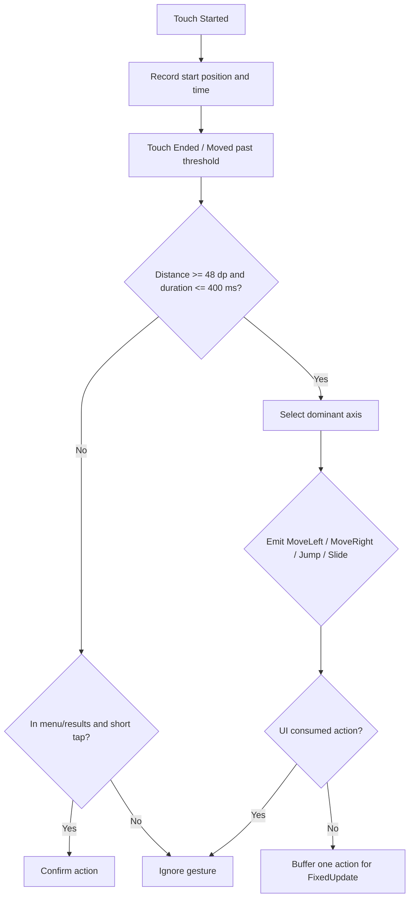
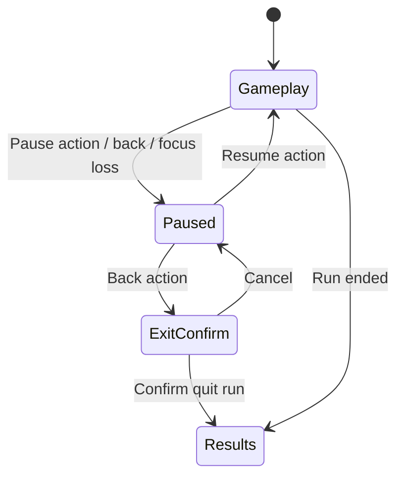

# Indian Subway Runner — Game Controls

> **Status:** Planned — design specification only. No input actions, bindings, scenes, or device captures are implemented or verified in this environment.
> **Last updated:** 2026-11-25
> **Authority:** [ADR-0003](decisions/architecture-decisions.md) is final/binding: Unity **6000.0.86f1+ LTS**, C#, URP, Android, with the **new Input System preferred**. Behaviour contracts are in [gameplay-mechanics.md](gameplay-mechanics.md); current tooling limits are in [environment-assessment.md](environment-assessment.md).

## 1. Unity input architecture (Planned)

| Item | Planned choice |
| --- | --- |
| Package | `com.unity.inputsystem` in `Packages/manifest.json` |
| Project setting | Active Input Handling set to **Input System Package (New)**; "Both" only as a temporary migration setting, never as the final state |
| Asset | `Assets/Input/Gameplay.inputactions` with maps `Gameplay` and `UI` |
| Generated API | Generated C# action wrapper consumed by `GameFlow` / `ActionArbiter`; no reflected per-frame lookup |
| Bindings | Touch screen gestures plus keyboard debug bindings |
| Legacy API | `UnityEngine.Input` is not used in new code; no legacy/GDX key-mapping layer |

`Gameplay` map actions: `MoveLeft`, `MoveRight`, `Jump`, `Slide`, `Pause`, `Confirm`. `UI` map actions: `Navigate`, `Submit`, `Cancel`. Only one action map is enabled at a time to avoid double handling.

Keyboard bindings are for Editor and development builds only, guarded by `#if UNITY_EDITOR || DEVELOPMENT_BUILD`. The shipping Android build does not expose keyboard controls as a advertised feature; if keys work on a connected keyboard, it is a debug affordance, not a separate control scheme.

## 2. Gesture recognizer (Planned)

The Input System reports touch positions; a project-owned recognizer converts a press/release pair into one gameplay action.

| Parameter | Proposed target | Status |
| --- | --- | --- |
| Minimum swipe distance | ~48 dp, converted with `Screen.dpi` | Proposed; playtest required |
| Maximum gesture duration | ~400 ms | Proposed; playtest required |
| Axis selection | Dominant displacement; horizontal wins ties above threshold | Proposed |
| Active pointer | First touch wins; additional touches ignored during a gesture | Proposed |
| UI exclusion | Reject gestures starting over UI via `EventSystem.current.IsPointerOverGameObject` | Planned |
| Gesture-to-action delivery | Buffered for the next `FixedUpdate` when possible | Planned |
| Multi-touch chords | Not in v1 | Explicitly out of scope |

A tap below the distance threshold maps to `Confirm` only in menu/results states; during an active run, a tap has no gameplay effect in v1. A swipe produces exactly one action. Rejected gestures at lane edges and rejected gestures during an active action give harmless feedback, never penalties. See [gameplay-mechanics.md](gameplay-mechanics.md) §3.

## 3. Control map

| Gesture / input | Gameplay action | Menu / pause action | Notes |
| --- | --- | --- | --- |
| Swipe left | Lane left | — | Rejected at left edge |
| Swipe right | Lane right | — | Rejected at right edge |
| Swipe up | Jump | — | No air control in v1 |
| Swipe down | Slide | — | Cannot cancel into jump |
| Tap | None during run | Confirm / select | Tap must start outside interactive UI |
| Pause button / Escape key | Pause | Pause / back | Escape is keyboard debug only |
| Android system back | Pause / close overlay | Back / exit confirmation | Wired through Unity lifecycle / Android integration, not a fake in-game key |
| Device volume keys | Unbound | Unbound | No hidden shortcuts in v1 |

## 4. Pause, back, and lifecycle

- Pause freezes fixed-step gameplay, Animator, power-up timers, and audio through `GameFlow`; it clears the input buffer so no gesture survives the pause.
- Android back is handled through the Unity application lifecycle plus an Android integration hook if needed. It closes the topmost overlay first; exit confirmation appears only when leaving a run.
- On `OnApplicationPause` / `OnApplicationFocus` loss, the run pauses automatically. Resume is always an explicit player action.
- Haptic feedback is reserved for significant events only and respects the accessibility setting.

## 5. Safe area and orientation

| Rule | Planned implementation |
| --- | --- |
| Orientation | Portrait locked in Player Settings |
| Canvas | `CanvasScaler` set to Scale With Screen Size against a defined reference resolution |
| Safe area | Root HUD panel constrained to `Screen.safeArea`; recomputed on resolution/orientation change |
| Notches/cutouts | Pause button and score display kept inside safe area; no controls under cutout |
| Touch targets | Proposed minimum ~48 dp with visible padding; playtest required |
| Localization | Text stays within safe area for Hindi and English strings |

No safe-area behaviour is verified here. Device checks on cutout devices are required before this section can move beyond Planned.

## 6. Accessibility (Planned)

| Setting | Effect |
| --- | --- |
| Gesture sensitivity | Adjusts effective swipe threshold within bounded min/max |
| Reduced motion | Dampens camera shake/parallax and non-essential animation; gameplay collision geometry unchanged |
| High contrast | Stronger outline/colour treatment on hazards and collectibles |
| Captions / dialogue text | Story dialogue readable as text; audio cue captions proposed, not implemented |
| Haptics toggle | Enables/disables `Handheld.Vibrate` or future Android haptic plugin |
| Text scale | Bounded UI text scaling that keeps safe-area compliance |

Colour alone never communicates a hazard state. Screen-reader support and full remappable controls are future work, not v1 claims.

## 7. Input latency budget

| Stage | Proposed budget |
| --- | --- |
| Touch event to recognizer | Minimal; no per-frame allocation in the gesture path |
| Recognizer to action buffer | Same frame as gesture completion |
| Buffer to fixed-step consumption | Next `FixedUpdate`, worst case one fixed step (~16.7 ms) |
| Fixed step to visible response | Interpolated `Update` presentation |
| End-to-end touch-to-visual target | < ~50 ms on target devices |

Evidence required to retire this target: Unity Profiler timeline (Input + Update + FixedUpdate) plus device-side capture on low-end and mainstream devices. Neither exists here.

## 8. Validation policy

All items are **Planned** per [PROJECT_STATUS.md](../PROJECT_STATUS.md). The Input System package and Editor are unavailable in this shell, so no binding asset, compile, or latency measurement is claimed. Gesture thresholds must be tuned through playtests and then recorded in this document with evidence before being finalized.
