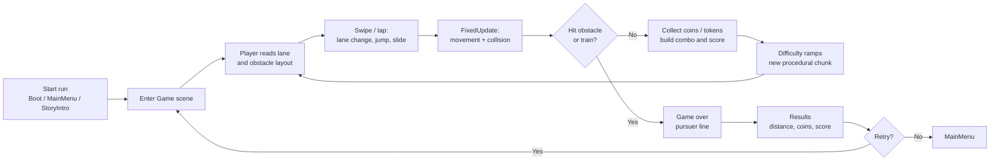
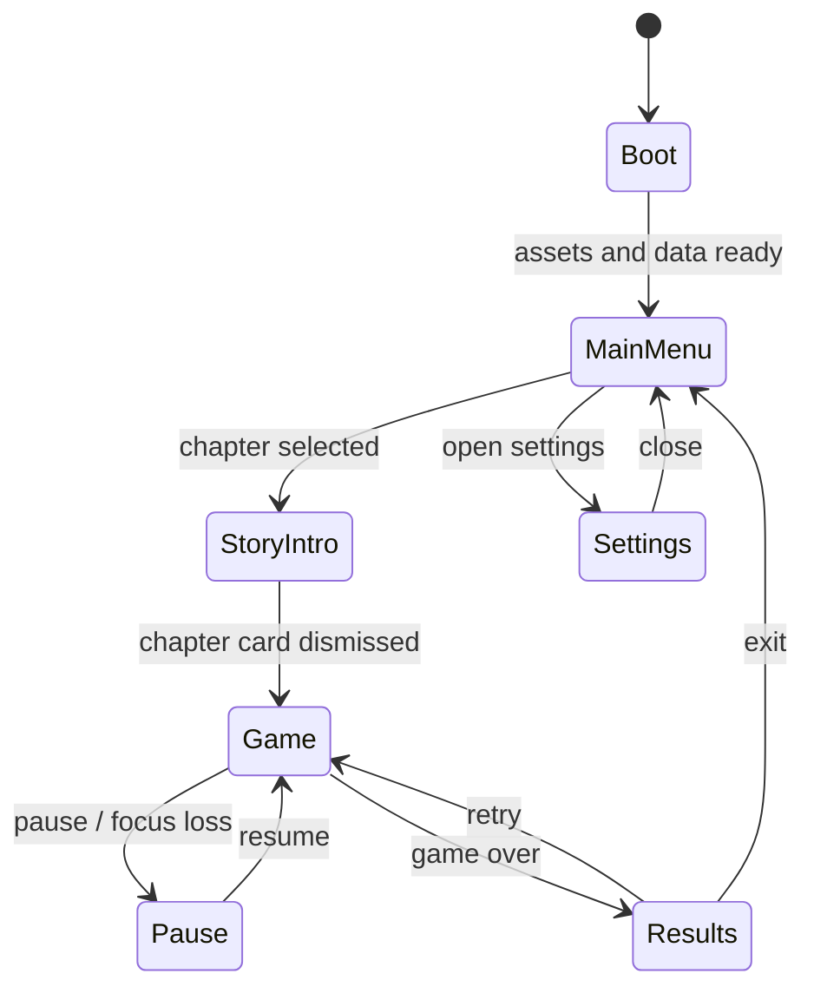

# Game Design Document

> **Status:** Planned — complete design outline for the final Unity stack. No gameplay, art, audio, or test is Unity-verified.
> **Last updated:** 2026-11-25
> **Authoritative decision:** [ADR-0003](./decisions/architecture-decisions.md) — Unity 6000.0.86f1+ LTS, C#, URP, Android.
> **Applies to:** Indian Subway Runner, all phases.

## 1. Vision and identity

An original, polished 3D Android endless-chase game. The player controls a criminal fleeing an ACP Pradyuman-inspired pursuer through Indian railway environments. The pursuer is always close, visibly determined, and **never permanently catches the criminal in v1**. Tension comes from near misses, narrow escapes, and the feeling of being pursued.

Core pillars:

1. **Readable speed** — the player can always see the next obstacle and the pursuer.
2. **Responsive feel** — lane changes, jumps, and slides feel immediate and fair.
3. **Indian railway atmosphere** — original environments, Hindi dialogue, railway announcements, and music.
4. **Honest craft** — original assets and writing; no copied IP, no voice cloning, no real-celebrity impersonation.
5. **Mobile discipline** — sustained 60 FPS on mainstream Android with graceful scaling.

## 2. Player fantasy and emotional beat

The player is the clever, uncatchable fugitive. The pursuer closes in, announcements crackle, and the track ahead fills with trains and obstacles. The player slips through at the last moment, hears a frustrated line from the pursuer, and pushes on. The fantasy is **escape**, not combat or capture.

## 3. Core loop

One run: start → chase → dodge/collect → escalate → game over → results → retry or exit. The criminal escapes at run end; the pursuer never wins in v1.

## 4. Controls

| Action | Input | Behaviour |
| --- | --- | --- |
| Move left | Swipe left / left tap zone | Target nearest lane to the left |
| Move right | Swipe right / right tap zone | Target nearest lane to the right |
| Jump | Swipe up / upper tap zone | Jump over low obstacles; short airborne window |
| Slide | Swipe down / lower tap zone | Slide under high obstacles; short grounded window |
| Pause | On-screen pause / Android pause signal | Freeze run, show pause overlay |

Rules:

- Exactly three lanes: **left, centre, right**.
- Input samples in `Update`; authoritative movement and collision resolve in `FixedUpdate`.
- Input is buffered briefly so a slightly early swipe feels fair.
- Lane changes are tweened visually but resolved atomically for collision.
- Jump and slide have distinct, non-overlapping states; a slide cannot be held indefinitely.
- Pause/resume never changes run state other than freezing and resuming simulation time.
- Keyboard may be used for desktop Editor testing but is not a shipping control promise.

## 5. Lane rules and collision model

- Lane identity is an integer 0/1/2; visual interpolation never changes authoritative lane identity.
- Obstacles and trains occupy lane cells with typed vertical profiles: low, high, or full.
- Jump clears low profile; slide clears high profile; neither clears full profile.
- Collision tolerance is forgiving by design; near misses are rewarded rather than punished.
- The pursuer occupies the lane behind the player and reacts through animation/audio, **not** by catching the player.
- All collision/tolerance values are ScriptableObject tuning targets, not hard-coded constants.

## 6. Obstacle taxonomy

| Class | Examples | Correct response |
| --- | --- | --- |
| Low | Track debris, crates, barriers | Jump |
| High | Overhead beams, low bridges, signage | Slide |
| Full | Stationed train carriage, parked rake | Change lane |
| Moving | Crossing train, shunting wagon | Change lane early |
| Hazard strip | Temporary track work | Change lane or jump if marked low |
| Fake-out | Decoy sign, shadow | Read and ignore |

Every obstacle must be legible from the follow camera at speed, with clear silhouette and consistent colour language. Impossible combinations are rejected by procedural validation.

## 7. Collectibles

| Collectible | Purpose |
| --- | --- |
| Coins | Run score and progression currency |
| Clue tokens | Chapter/story progression flavour and mission hooks |
| Score pickups | Immediate combo/score boosts |

Collection is a trigger event in `FixedUpdate`; pickups are pooled and never duplicated on restart. Coin placement must not force unsafe lane changes.

## 8. Power-ups

| Power-up | Planned effect | Design intent |
| --- | --- | --- |
| Sprint | Temporary speed increase with reward scaling | Higher risk, higher reward |
| Magnet | Pulls nearby coins toward the player | Reduces lane pressure briefly |
| Shield | Absorbs one otherwise fatal hit | One forgiving mistake |
| Slow-time | Briefly reduces apparent world speed | Recovery/readability window |

All durations, cooldowns, spawn rates, and stacking rules are **to be balanced later** through ScriptableObject data and PlayMode tests. No power-up is implemented or balanced yet.

## 9. Difficulty

Difficulty rises through:

- Track speed ramps.
- Spawn density increases.
- Shorter reaction windows, never below readability limits.
- New obstacle combinations after chapter gates.
- Chapter modifiers (station, yard, bridge, night).

Difficulty is deterministic per seed and run distance so tests can reproduce it. It must never create an unsolvable configuration.

## 10. Procedural generation rules

- Chunks are generated in fixed lengths from seeded selection.
- Every chunk contains **at least one guaranteed escape path**.
- Impossible combinations (e.g. all three lanes blocked with no jump/slide solution) are rejected before activation.
- Chunk pools are bounded; no unbounded instantiation during play.
- First N seconds of a run use a safe tutorial cadence.
- Chapter flavour changes skins and modifiers, not core solvability.

See [procedural-generation.md](./procedural-generation.md) for implementation detail.

## 11. Scoring

| Source | Contribution |
| --- | --- |
| Distance | Primary steady score |
| Coins | Additive score + progression currency |
| Near misses | Bonus with combo multiplier |
| Power-up windows | Optional multiplier scaling |

Score is shown in the HUD and summarized in Results. Best-result storage format is reserved for future ADR-0004; no save format is claimed here.

## 12. Progression and chapters

Progression is chapter-based. Each chapter is an **original story mission** with its own environment skin, dialogue set, and difficulty modifier.

| Chapter | Title | Planned focus |
| --- | --- | --- |
| 1 | The Great Railway Escape | Intro to lanes, jumps, slides; city platform |
| 2 | Platform Ka Hungama | Busy platforms, decoys, coin routing |
| 3 | Train Ke Peeche | Moving trains, tighter reaction windows |
| 4 | City Express Chase | Night city, high speed, mixed obstacles |
| 5 | Criminal Ka Masterplan | Combined systems, final escape fantasy |

Chapters unlock in order. No permanent capture, boss fight, or ending where the criminal is caught exists in v1.

## 13. Story delivery

- Story is delivered through short chapter cards in `StoryIntro`, in-run dialogue lines, and railway announcements.
- Dialogue is **original Hindi** with English subtitles where needed.
- The pursuer's lines are teasing and tense, never a claim of real celebrity likeness or voice.
- Dialogue selection uses cooldowns and priority metadata in ScriptableObjects.
- Nothing blocks gameplay; the run continues while lines play.
- Voice-pack licensing and delivery are reserved for **ADR-0005**; no voice pack is implemented.

## 14. UI flow

Screens/panels:

- **Boot** — initialization, no gameplay.
- **MainMenu** — start, chapter select, settings.
- **StoryIntro** — chapter card and objective.
- **HUD** — distance, coins, score, combo, power-up indicator, pause.
- **Pause** — resume, restart, exit.
- **Game over** — pursuer line and result transition.
- **Results** — distance, coins, score, best, retry/menu.
- **Settings** — quality tier, audio volumes, reduced motion.

HUD must remain readable at all supported aspect ratios and respect Android safe areas. See [game-controls.md](./game-controls.md).

## 15. Audio

| Category | Direction |
| --- | --- |
| Music | Original contemporary soundtrack with Indian railway flavour |
| SFX | Swipe, jump, slide, coin, near miss, collision, train horn |
| Dialogue | Original Hindi pursuer and story lines |
| Announcements | Diegetic railway station/train announcements |
| Mixing | AudioMixer groups: Music, Sfx, Voice, Announcements; ducking under key lines |

Reactive cues: tempo/intensity rises with difficulty; announcements respond to chapter context. Audio must not mask obstacle-reading cues. Original assets only; no copied recordings or cloned voices.

## 16. Accessibility

- Readable HUD contrast and scalable UI where feasible.
- Colour-independent obstacle/collectible language (shape + colour + icon).
- Reduced-motion option disables camera shake and heavy post-processing.
- Subtitles for dialogue and announcements.
- Input tolerance tuned to be forgiving; no failing based on reflex only.

## 17. Performance budget

- **60 FPS target** on mainstream Android; graceful scaling on lower-tier hardware.
- Pool all repeated entities; no allocation churn in frame-critical loops.
- URP tier gating, light limits, LODs, culling, atlas/compressed textures.
- Addressables load at scene/chapter boundaries, never mid-frame.
- Profiler and real-device thermal/battery/loading evidence required before Verified claims.
- See [rendering-engine.md](./rendering-engine.md) and [performance-optimization.md](./performance-optimization.md).

## 18. Monetization — deferred

No ads, IAP, or rewarded mechanics are active in v1. `Analytics` and `Monetization` assemblies are passive boundaries only, enabled by a future accepted ADR after core stability. See [monetization-architecture.md](./monetization-architecture.md).

## 19. Test matrix

| Area | EditMode | PlayMode | Device evidence needed |
| --- | --- | --- | --- |
| Lane rules and input buffering | Yes | Yes | Swipe feel on device |
| Jump/slide state machine | Yes | Yes | Timing and fairness |
| Collision and near miss | Yes | Yes | Trigger reliability |
| Procedural solvability | Yes | Yes | Long-run stress |
| Power-up timers | Yes | Yes | Balance pass |
| Score/combo | Yes | Yes | HUD accuracy |
| Scene flow Boot→Menu→Story→Game→Results | — | Yes | Transition smoothness |
| Audio/dialogue selection | Yes | Yes | Mix and subtitle sync |
| Quality tiers | — | Yes | Profiler + thermal |
| Android lifecycle/safe area | — | — | Device matrix |

No tests currently exist. Use Unity Test Framework; see [testing-strategy.md](./testing-strategy.md) and [TESTING.md](../TESTING.md).

## 20. Out of scope for v1

- Kotlin/libGDX/Three.js/WebView gameplay or any engine switch.
- React Native / Flutter wrapper apps.
- Copied assets, copied story, voice cloning, or real-celebrity impersonation.
- Permanent capture of the criminal.
- Network-dependent gameplay, cloud save, analytics, or monetization.
- Multiplayer, leaderboards, user-generated content.
- Any Implemented/Tested/Verified claim without evidence.

## 21. Cross-document index

- [technical-architecture.md](./technical-architecture.md) — assemblies, scenes, data, Android boundary
- [rendering-engine.md](./rendering-engine.md) — URP rendering
- [project-overview.md](./project-overview.md) — vision, stack, truthful status
- [gameplay-mechanics.md](./gameplay-mechanics.md) — mechanics deep-dive
- [story-and-narrative-design.md](./story-and-narrative-design.md) — chapter/story detail
- [audio-system.md](./audio-system.md) — sound direction
- [procedural-generation.md](./procedural-generation.md) — chunk rules
- [game-controls.md](./game-controls.md) — controls and HUD references
- [diagrams/gameplay-flow.md](./diagrams/gameplay-flow.md) — flow diagram
