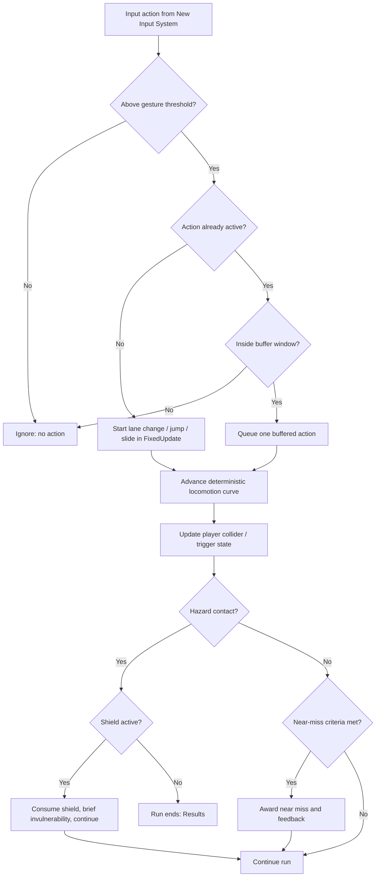
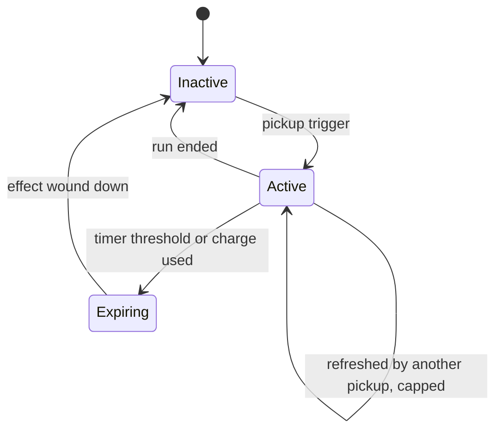
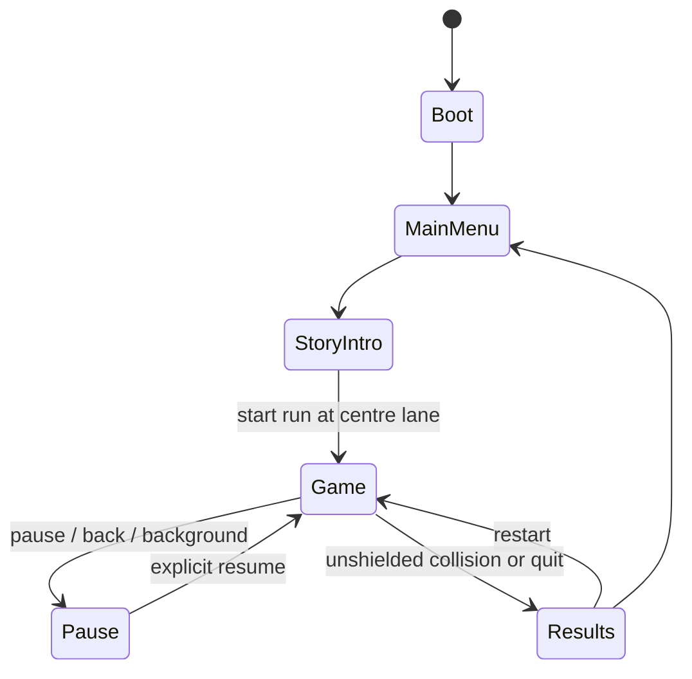

# Indian Subway Runner — Gameplay Mechanics

> **Status:** Planned — design specification only. No gameplay C#, scenes, prefabs, animation, audio, tests, or builds are implemented or verified in this environment.
> **Last updated:** 2026-11-25
> **Authority:** [ADR-0003](decisions/architecture-decisions.md) is the final binding decision: Unity **6000.0.86f1+ LTS**, C#, URP, Android. All legacy Kotlin/libGDX mechanics documentation is superseded. See [ARCHITECTURE.md](../ARCHITECTURE.md), [PROJECT_STATUS.md](../PROJECT_STATUS.md), and [environment-assessment.md](environment-assessment.md).

This document specifies the intended single-run gameplay design. Every number below is a **proposed tuning target**, not a measured result. A mechanic rises from Planned to Implemented only when C# exists and compiles in the pinned Unity Editor; to Tested only when Unity Test Framework evidence exists; to Verified only when device/Profiler evidence is recorded. The criminal is always ahead and is **never permanently caught** in v1.

## 1. Unity implementation shape (Planned)

| Concern | Planned Unity mechanism |
| --- | --- |
| Simulation rules | Pure C# models in `IndianSubwayRunner.Core` and `IndianSubwayRunner.Gameplay`; no scene or platform dependencies in `Core`. |
| Frame loop | Fixed-step gameplay at 60 Hz in `FixedUpdate` (`Time.fixedDeltaTime = 1/60`); presentation interpolation in `Update`. |
| Runtime entities | Prefabs under `Assets/Prefabs/` with URP materials; pooled, never instantiated per frame. |
| Tuning data | `ScriptableObject` assets under `Assets/Data/Config/` (for example `RunConfigSO`, `LocomotionConfigSO`, `PowerUpDefinitionSO`). |
| Action state | `Animator` controllers for run/jump/slide poses; Animator does not own collision truth. |
| Physics | Unity 3D Physics: Colliders, kinematic Rigidbodies for movers, triggers for pickups; see [collision-system.md](collision-system.md). |
| Audio | Unity Audio / AudioMixer for cues and reactive music; see [game-controls.md](game-controls.md) for accessibility. |
| Content delivery | Addressables for large or optional content; boot-time preload, no synchronous gameplay loads. |

Planned type names (design contracts, not existing code): `IRunState`, `RunController`, `LaneController`, `ActionArbiter`, `LocomotionState`, `ChunkNavigator`, `TrainMover`, `CollectibleTrigger`, `PowerUpStateMachine`, `ScoreAccumulator`. Tests reference `Core` plus the assembly under test.

## 2. Lane model

| Rule | Proposed value / behaviour |
| --- | --- |
| Lane count | 3 discrete lanes: left `-1`, centre `0`, right `+1` |
| Starting lane | Centre |
| Lane width | Equal spacing defined in `RunConfigSO`; no half-lane positions in v1 |
| Edge behaviour | Swipe toward outside at an edge lane is rejected with a light visual hint; no wrap-around |
| Occupancy | One player entity at rest in one lane; during a lane change the player collider covers both source and target lanes |
| Camera | Follow camera with modest look-ahead; camera never occludes a hazard |

The three lanes use identical collision geometry. Any visual asymmetry (for example station dressing on one side) is cosmetic only and must be checked in playtests for readability.

## 3. Actions and arbitration

| Gesture | Action | Notes |
| --- | --- | --- |
| Swipe left | Lane change left | Rejected at left edge |
| Swipe right | Lane change right | Rejected at right edge |
| Swipe up | Jump | Clears low obstacles |
| Swipe down | Slide | Clears high obstacles |
| Tap | Start / confirm / pause-menu selection | No gameplay action during an active run in v1 |
| Double-tap | Reserved, future | Must not fire two single-tap actions in v1 |

Arbitration rules (proposed): one locomotion action active at a time; one swipe produces at most one action; an early request is buffered for a short window and executed on completion, otherwise discarded. Air control, including jump-to-slide cancellation, is **future** and not in v1. A slide cannot be cancelled into a jump. Two lane changes are never chained from a single swipe. Rejected input gives feedback, never a penalty. Gesture thresholds and lifecycle handling are specified in [game-controls.md](game-controls.md).

## 4. Movement timing curves (proposed tuning targets)

| Parameter | Proposed range | Status |
| --- | --- | --- |
| Lane change duration | 120–160 ms | Proposed; playtest required |
| Jump total airtime | 600–750 ms | Proposed; playtest required |
| Jump apex | Roughly 40–45% of airtime | Proposed; playtest required |
| Slide duration | 500–650 ms | Proposed; playtest required |
| Slide transition in/out | 60–100 ms each | Proposed; playtest required |
| Input buffer window | 80–120 ms before action completion | Proposed; playtest required |
| Minimum reaction window between obstacles | ~250 ms design reference from public genre commentary; not a measured project fact | Proposed; playtest required |
| Touch-to-visual latency | < ~50 ms target | Proposed; device capture required |

Curves are authored as data (for example `AnimationCurve` fields in `LocomotionConfigSO`) so tuning does not require code changes. Collision uses the state derived from these curves in the fixed step, not the interpolated visual transform.

## 5. Action resolution flow

## 6. Collision model (Unity Physics)

- Colliders and triggers are attached to pooled prefabs; moving trains use kinematic Rigidbodies advanced in `FixedUpdate`.
- Player collider shape depends on state: standing, jumping (raised), sliding (lowered), lane transition (spans source and target lanes).
- Coins and power-ups are triggers; hazards are solid contact events. Power-up triggers do not apply forces.
- Hit handling is arbitrated in one deterministic pass: input → movement → physics contact collection → stable ordering → one outcome per candidate → rewards → feedback. Details, layers, and debug gizmos are in [collision-system.md](collision-system.md).
- A visually cleared obstacle must not register a hit. Hitbox mismatch is a release-blocking defect.
- Invulnerability exists only as the short window after shield consumption in v1.

## 7. Trains

- Trains are original 3D assets (Blender source → FBX/GLB) instantiated as pooled kinematic prefabs; no authored physics simulation of coach dynamics.
- Static trains occupy a declared lane volume. Moving trains advance on scripted paths at fixed-step speed with a validated gap.
- A placement must leave at least one traversable lane or a timed gap at the tier speed at which it is offered.
- Train-top landing is **future** and is not assumed by movement or collision in v1.

## 8. Collectibles

- Coins are pooled trigger objects arranged on parametric trails: straight, arc (jump reward), diagonal (lane-change reward).
- Score pickups and coins credit the run score ledger; coins additionally credit the local wallet. Ledgers are separate; see [scoring-and-rewards.md](scoring-and-rewards.md).
- Magnet pickup widens collection radius and pulls coins with a capped interpolation speed; pulled coins still use the same collection ledger.
- No collectible may require an impossible action at the offered speed; the chunk validator enforces this ([procedural-generation.md](procedural-generation.md)).

## 9. Power-up state machine (v1 subset)

| Power-up | v1 behaviour |
| --- | --- |
| Magnet | Timed attraction radius; refresh extends timer up to a cap |
| Score multiplier | Timed multiplier on score increments only; does not multiply wallet credit |
| Shield | Consumed on one otherwise fatal contact; short invulnerability; single charge |

Definitions are planned as immutable `PowerUpDefinitionSO` ScriptableObjects. Adding a future power-up must not require rewriting the core state machine.

## 10. Chase gap presentation

- The pursuing ACP officer and the fleeing criminal are presentation entities. The **gap** is a clamped scalar, not a health bar and not a catch mechanic.
- Clean play narrows the gap; non-fatal mistakes widen it. A collision ends the run in v1.
- Gap changes affect camera offset, emphasis, and banter triggers only. They never change speed, collision geometry, or spawn timing.
- The criminal never disappears and the pursuer never occludes obstacles.

## 11. Run lifecycle

| Event | Proposed behaviour |
| --- | --- |
| Unshielded collision | Immediate transition to Results; input locked after a short settle beat |
| Pause | Freeze fixed-step simulation, Animator, timers, and audio via GameFlow; no uncommanded movement |
| Resume | Explicit player action; proposed short grace period before hazards resume |
| Background / focus loss | Automatic pause through Unity application lifecycle; gesture buffer cleared |
| Restart | Full reset: centre lane, action state cleared, pools recycled, speed ramp reset, score committed per [scoring-and-rewards.md](scoring-and-rewards.md) |
| Revival | Future; not in v1 |

Scene order and lifecycle ownership are defined in [unity-project-setup.md](unity-project-setup.md) and [ARCHITECTURE.md](../ARCHITECTURE.md).

## 12. Parameter summary

| Parameter | Proposed value | Validation |
| --- | --- | --- |
| Lanes | 3; start centre | PlayMode test + playtest |
| Lane change duration | 120–160 ms | Playtest |
| Jump airtime | 600–750 ms | Playtest |
| Slide duration | 500–650 ms | Playtest |
| Input buffer | 80–120 ms | Device test |
| Reaction-window reference | ~250 ms, public commentary, not measured here | Playtest |
| Touch-to-visual latency | < ~50 ms target | Device capture |
| Sustained frame rate | 60 FPS target | Unity Profiler on device |
| Per-frame managed allocation | ~0 B target | Profiler allocation capture |
| Shield invulnerability | Short window, to tune | Playtest |

## 13. Validation policy

Every value and behaviour in this document is **Planned**. Playtests must record success rates, perceived fairness, and device-specific latency on low-end and mainstream devices before any value is finalized. Per [PROJECT_STATUS.md](../PROJECT_STATUS.md), no gameplay subsystem is Implemented, Tested, or Verified yet, and this shell has no Unity Editor with which to verify it.
