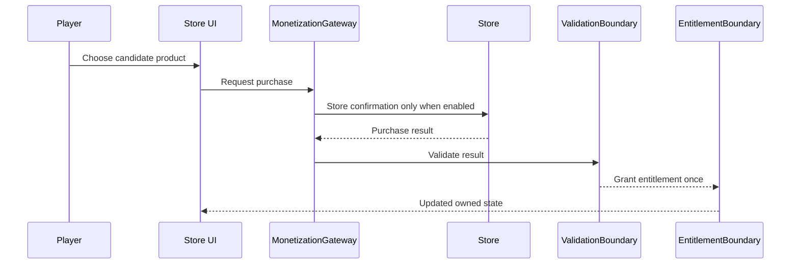

# In-App Purchases

> **Last updated:** 2026-11-25  
> **Status:** Planned; no product, SKU, price, store listing, receipt, validation service, purchase button, or entitlement is implemented.  
> **Authority:** subordinate to [ADR-0003](../decisions/architecture-decisions.md) and [monetization-architecture.md](monetization-architecture.md).  
> **Scope:** future optional purchases only.

## 1. Current truth

There is no live store catalogue and no purchasable content. Any purchase UI without product data, store confirmation, verified entitlement, and tests would be fake and must not be added.

## 2. Candidate catalogue

These are ideas only, not configured products:

| Candidate | Category | Constraint |
| --- | --- | --- |
| Cosmetic skin set | Non-gameplay cosmetic | No speed, collision, or score advantage. |
| Chapter cosmetic theme | Presentation only | Chapter access remains earned through play. |
| Coin bundle | Optional convenience | Cannot be required to finish a run. |
| Supporter pack | Bundled cosmetics | Requires entitlement and restore policy. |

No prices, currencies, promotions, subscription terms, or regional availability are approved.

## 3. Target flow

## 4. Required boundaries

- Store products must come from live store data; never hard-code fake ownership.
- Client-side booleans are not sufficient authority for paid entitlements.
- Receipt validation design must be accepted before any paid product is shipped.
- Entitlements need a save and migration contract under future ADR-0004.
- Restore, cancellation, refund, offline retry, and duplicate callback handling require tests.
- No secret, store credential, signing password, or private API key may be committed.

## 5. Unity/Android constraints

- Implement through Unity Android build support and approved plugins only.
- Every native plugin must be rebuilt for 16 KB page size.
- API 36 target compatibility is required before store submission.
- Unity-generated Gradle output remains a build artefact; gameplay and purchase orchestration stay in C# under `Assets/Scripts/`.

## 6. Verification gates

| Status | Requirement |
| --- | --- |
| Planned | Current state. |
| Implemented | Disabled product catalogue, C# contracts, and entitlement boundary exist; no live purchase is claimed. |
| Tested | Store sandbox tests cover success, cancel, failure, restore, refund, offline, and duplicate events. |
| Verified | Real-device store sandbox, receipt validation, entitlement persistence, privacy disclosure, and store metadata are recorded. |

## 7. Acceptance checklist

- [ ] No fake product, price, or purchase button.
- [ ] No gameplay advantage sold.
- [ ] Entitlement grants are idempotent.
- [ ] Restore and refund paths are tested.
- [ ] No committed credentials or secrets.
- [ ] Monetization ADR is accepted before launch.
