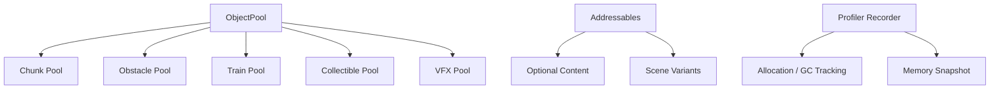

# Memory Management

> Status: Planned; no Profiler-verified memory budget exists.

## Goal

Run smoothly on mainstream Android devices without gradual memory growth, GC spikes, or loading hitches during an endless run.

## Rules

- Pool all frequently spawned objects: track chunks, obstacles, trains, collectibles, VFX, crowd, and pickups.
- Never call `Instantiate` or `Destroy` in the per-frame gameplay loop except during controlled scene transitions.
- Avoid closures, LINQ, boxing, and string concatenation in frame-critical paths.
- Cache component references during initialization.
- Reuse lists, arrays, and temporary vectors.
- Use object state reset methods on pool release.
- Destroy or unload assets only through a controlled lifecycle, not ad hoc per frame.
- Avoid per-frame allocation from Unity events and UI updates.

## Planned systems

## Object pool contract

Each pooled type must define:

- `OnAcquire`: reset transform, state, visuals, collider, and animation.
- `OnRelease`: stop timers, detach callbacks, clear references.
- `Capacity`: bounded by quality tier.
- `Validation`: ensure no active object is recycled twice.
- `Test`: PlayMode test proves repeated acquire/release does not grow active count.

## Addressables strategy

- Core menu/HUD/first chapter assets packed with the player build.
- Optional chapters, cosmetics, and voice packs delivered through Addressables.
- Preload during menu or loading screens.
- Release handles only when no scene or pool references remain.
- Track duplicate handle leaks in PlayMode tests.

## Texture and mesh memory

- Compress textures for Android.
- Use mipmaps only where they help.
- Strip unused mesh channels and rigs where possible.
- Use shared materials and URP-compatible shaders.
- LOD distant or background geometry.
- Avoid giant atlases that force unnecessary texture residency.

## Audio memory

- Stream long music tracks where appropriate.
- Keep short SFX decoded and pooled.
- Voice packs load by chapter and unload when no longer needed.
- AudioMixer snapshots must not create per-frame allocation.

## Profiler gates

No memory status may be called Verified until the following are recorded:

- Unity Profiler capture during a 10-minute uninterrupted run.
- GC allocation trend stable with no rising sawtooth caused by gameplay loops.
- Texture/mesh/audio memory within agreed budget.
- Addressable handle leak check.
- Real-device thermal and memory observation.
- Android low-memory interruption test.

Current environment cannot run Unity Profiler, so all memory items remain Planned.
