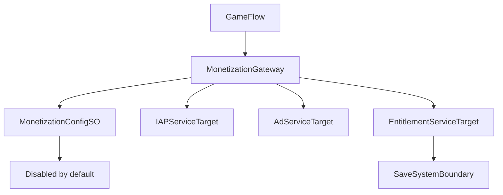

# Monetization Architecture

> **Last updated:** 2026-11-25  
> **Status:** Planned and deferred; no store product, SDK, ad network, purchase flow, subscription, price, receipt, or entitlement is implemented.  
> **Authority:** subordinate to [ADR-0003](../decisions/architecture-decisions.md). Monetization SDK integration is reserved by ADR-0006.  
> **Scope:** future commercial boundaries for a Unity 6 LTS / C# / URP Android game.

## 1. Position

Monetization is future work until the core game is stable, tested, and device-verified. Current repository status does not support a store-ready build, so no commercial subsystem is active.

The core run, chapter progression, rescue fantasy, and criminal-escapes story are not planned as paid gates.

## 2. Principles

- Offline core play remains complete and purchasable-free.
- No fake store buttons, fake prices, fake receipts, fake currency, or fake purchases.
- No pay-to-win power, no forced ads, and no manipulative scarcity timers.
- No advertising, purchase, subscription, or analytics SDK is included before an accepted ADR.
- No secret, API key, signing credential, store credential, or receipt secret is committed.
- All commercial content must respect asset provenance and child-friendly presentation.

## 3. Candidate options

| Option | Status | Notes |
| --- | --- | --- |
| Cosmetic unlocks | Deferred | Requires IAP design and entitlement storage. |
| Rewarded ads | Deferred | Requires ADR-0006, privacy review, and device verification. |
| Optional coin bundles | Deferred | Must not block core progression. |
| Premium membership | Deferred | See [premium-membership.md](premium-membership.md). |
| Personalised advertising | Not planned | Requires explicit owner approval and privacy review. |

## 4. Target boundary

`Assets/Scripts/Monetization/` may contain passive contracts and disabled configuration only. It must not call a store, network, or ad SDK until its ADR and tests exist.

## 5. Required decisions before implementation

- Accepted monetization ADR replacing ADR-0006 placeholder.
- Product catalogue, SKUs, prices, currencies, tax handling, refunds, and restore behaviour.
- Receipt validation and entitlement authority.
- Save/migration contract through ADR-0004.
- Privacy policy and Android Data safety declarations.
- Addressable packaging for cosmetic content.
- Unity plugin compatibility with API 36 and 16 KB page size.
- Test matrix covering offline, cancelled, failed, refunded, and restored states.

## 6. Verification gates

| Status | Requirement |
| --- | --- |
| Planned | Current state. |
| Implemented | Passive Unity contracts, configuration, and tested feature flags exist without live commercial SDK calls. |
| Tested | EditMode and PlayMode tests cover disabled defaults, error handling, idempotent grants, and offline fallback. |
| Verified | Store sandbox, privacy review, purchase/ad lifecycle, and real-device evidence are recorded. |

## 7. Acceptance checklist

- [ ] Core game is fully playable without monetization.
- [ ] No active SDK or product is claimed.
- [ ] No fake store UI or currency is present.
- [ ] No engine or platform stack changed.
- [ ] All commercial work is gated by accepted ADRs.
