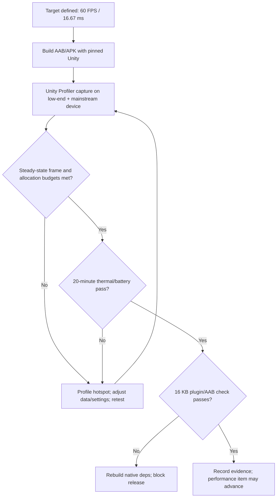

# Indian Subway Runner — Performance Optimization

> **Status:** Planned — design specification only. No Profiler capture, build report, device measurement, or 16 KB compatibility evidence exists in this environment.
> **Last updated:** 2026-11-25
> **Authority:** [ADR-0003](decisions/architecture-decisions.md) is final/binding: Unity **6000.0.86f1+ LTS**, C#, URP, Android. See [android-build-instructions.md](android-build-instructions.md) for Player Settings/target API facts and [testing-strategy.md](testing-strategy.md) for evidence rules.

## 1. Targets (proposed, unmeasured)

| Metric | Proposed target | Current evidence |
| --- | --- | --- |
| Sustained frame rate | 60 FPS on target devices | None |
| Frame budget | ~16.67 ms total | None |
| Active gameplay budget | ~10.8 ms to leave headroom | None |
| Per-frame managed allocation | ~0 B in steady state | None |
| Loading | No synchronous asset load during gameplay | None |
| Session stability | 20-minute run without leak or thermal collapse | None |

These are targets, not achievements. Per [PROJECT_STATUS.md](../PROJECT_STATUS.md), no build or gameplay exists to profile here.

## 2. URP configuration (Planned)

| Area | Planned approach |
| --- | --- |
| Render pipeline asset | Dedicated mobile URP asset; quality tiers data-driven |
| Renderer features | Minimal; no extra full-screen passes in v1 |
| Render scale | Tuned per device tier; verify on low-end hardware |
| MSAA | Off on mobile unless measured acceptable |
| Shadows | Limited realtime shadows; prefer baked where possible |
| Lighting | Mostly baked/static; few dynamic lights |
| Post-processing | Not part of v1 baseline |
| SRP batcher / GPU instancing | Enabled and verified in Frame Debugger/Profiler |
| Occlusion culling | Baked for dense station scenes where applicable |
| LOD | `LODGroup` on imported FBX/GLB-derived prefabs |
| Textures | ASTC/ETC2 compression, mipmaps, atlases; no oversized uncompressed textures |

Visual quality changes must not alter collision geometry or input timing.

## 3. Pooling, scenes, and Addressables

- Prewarm pools during Boot for active theme sets; cap active chunk count via `RunConfigSO`.
- No `Instantiate`/`Destroy` in gameplay frame paths; recycled objects reset transforms, trigger flags, and Animator state.
- Addressables groups are preloaded in Boot; handles released at scene/run teardown, never per frame.
- Scene count kept small; additive loading only at explicit lifecycle boundaries.
- No async asset load, shader compilation, or prefab instantiation triggered mid-run.

See [procedural-generation.md](procedural-generation.md) and [collision-system.md](collision-system.md) for the corresponding generator and physics rules.

## 4. GC discipline (Planned)

- Reuse lists/arrays in `ChunkDirector`, `ScoreAccumulator`, and contact arbitration.
- Use non-alloc physics query overloads; no LINQ, closure capture, or string formatting in `Update`/`FixedUpdate` hot paths.
- Avoid per-frame `GetComponent`; cache references on spawn/pool acquisition.
- Unsubscribe events on recycle/teardown; no leaked delegates holding pooled objects.
- Profiler allocation capture is the acceptance test: steady-state gameplay must show ~0 B/frame growth.

## 5. CPU / GPU / physics budget

| System | Planned guardrail |
| --- | --- |
| Fixed step | 1/60; gameplay logic in `FixedUpdate`, presentation in `Update` |
| Physics | Kinematic movers, non-alloc overlap/contact queries, fixed priority arbitration |
| Animation | Simple Animator graphs; no state-machine evaluation of gameplay truth |
| UI | Canvas rebuilt only on state change, not per frame |
| Audio | AudioMixer snapshots/cues; no per-frame AudioSource creation |
| Profiler markers | Named markers around director, contact resolution, and scoring commit |

Frame Debugger and Unity Profiler (CPU, GPU, Rendering, Memory) are required for any performance claim. No marker data exists here.

## 6. Battery and thermal (Planned)

- `Application.targetFrameRate = 60` with vsync behaviour verified per device.
- Quality tiers use hysteresis so a device does not oscillate between settings.
- Pause suspends gameplay, Animator, and audio; no background work loops.
- Validate with ~20-minute sessions on a low-end and a mainstream device; record thermal/frame drop notes.
- A native thermal API plugin is **future** and would require an explicit decision; no thermal telemetry is collected in v1.

## 7. Android / 16 KB readiness (Planned)

- Target API 36, minimum API 24 per [android-build-instructions.md](android-build-instructions.md).
- Any native plugin (for example Android integration/haptics) must be rebuilt/verified for **16 KB page-size** devices; AAB must contain compatible libraries.
- Do not rely on default `extractNativeLibs` behaviour as a substitute for compatible `.so` files.
- No native plugin is present or verified here; this is a release preflight item.

## 8. Evidence gates

| Gate | Required evidence | Current result |
| --- | --- | --- |
| Frame budget | Profiler timeline capture | Not captured |
| Allocation | Profiler allocation capture | Not captured |
| Pool health | PlayMode pool counters / dev overlay | Not implemented |
| Addressables | Build report + load timing | Not captured |
| Thermal/battery | Device session notes | Not captured |
| 16 KB | AAB/native library audit | Not performed |

## 9. Validation policy

All items are **Planned** per [PROJECT_STATUS.md](../PROJECT_STATUS.md). This shell has no Unity Editor, Android SDK/adb, build, or device, so no performance figure in this document is a measurement. Tuning targets must be replaced with recorded evidence before being treated as final.
