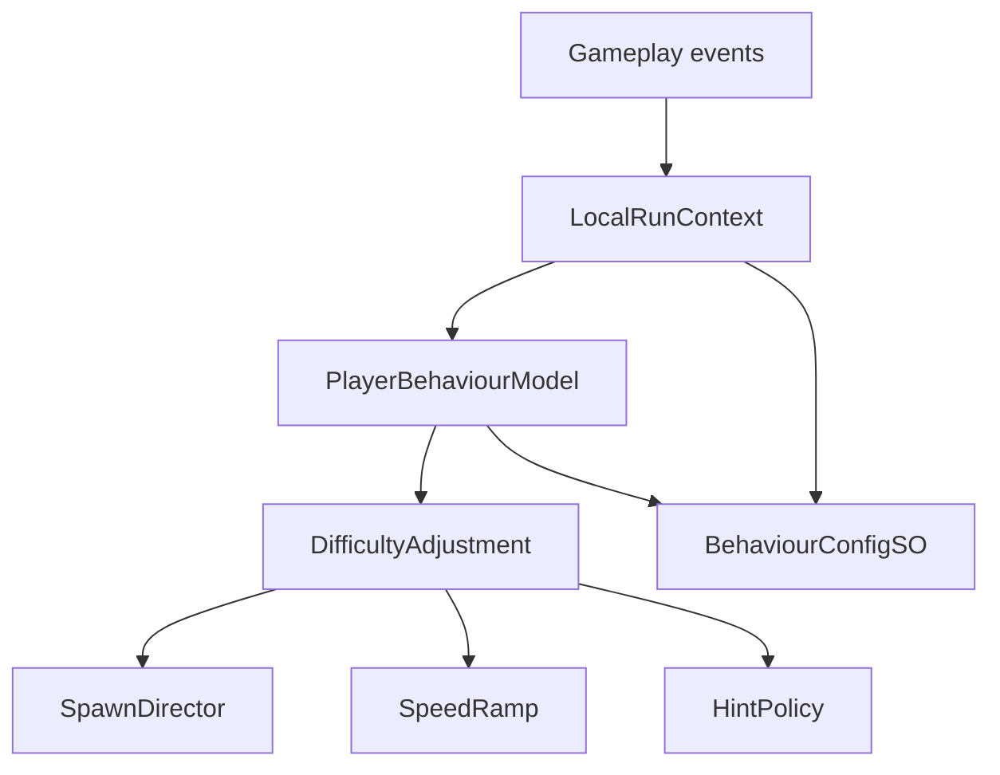

# Player Behaviour System

> **Last updated:** 2026-11-25  
> **Status:** Planned; no adaptive difficulty, analytics, telemetry, player profiling, or network collection is implemented.  
> **Authority:** subordinate to [ADR-0003](../decisions/architecture-decisions.md). Any analytics or telemetry decision requires a future ADR.  
> **Scope:** local, privacy-safe run pacing for a Unity 6 LTS / C# / URP Android game.

## 1. Purpose

This document defines how the game could adapt difficulty inside a single run using only local gameplay signals. The goal is fair pacing, not player profiling.

The player controls an ACP Pradyuman-inspired pursuer chasing an uncatchable criminal. The criminal always escapes in v1; adaptation must not change that story rule.

## 2. Privacy boundary

| Data | Use | Allowed now |
| --- | --- | --- |
| Current-run collisions | Local pacing only | Planned design input |
| Current-run near misses | Local pacing only | Planned design input |
| Coins and score in current run | Local pacing only | Planned design input |
| Current speed and distance | Local pacing only | Planned design input |
| Device identifiers | None | Prohibited |
| Location, contacts, photos, accounts | None | Prohibited |
| Network upload | None | Prohibited without future ADR |

No subsystem may claim telemetry, cloud analytics, behavioural profiles, or server-side adaptation. ADR-0007 reserves analytics and telemetry only; it is not accepted.

## 3. Target architecture

`PlayerBehaviourModel` belongs in `Assets/Scripts/Core/` and remains pure C# where possible. Unity-facing adapters translate gameplay events into local signals and apply adjustments through existing Gameplay systems.

## 4. Signals and outputs

| Signal | Source | Planned meaning |
| --- | --- | --- |
| `collisions` | Physics collision events | Reduce pressure after repeated hits |
| `nearMisses` | Collision proximity events | Preserve skilled-play challenge |
| `coinsCollected` | Collectibles | Reward engagement without pay-to-win |
| `distance` | Run state | Drive baseline difficulty curve |
| `reactionWindowMisses` | Input timing observation | Optional hint emphasis |

| Output | Range policy | Constraint |
| --- | --- | --- |
| Spawn density | Bounded by chapter config | Never create impossible chunks |
| Speed ramp | Bounded by chapter config | Maintain safe reaction windows |
| Hint emphasis | UI-only | Accessibility controls remain authoritative |
| Power-up weighting | Planned only | Must not depend on monetization |

## 5. Rule model

Target rules are deterministic and testable:

1. Start every run from the chapter baseline.
2. Accumulate only current-run signals.
3. Clamp all adjustments to configured minimum and maximum values.
4. Prefer safe-path preservation over pressure increase.
5. Recalculate only at chunk boundaries or explicit safe moments.
6. Never infer identity, intent, spending ability, or protected traits.
7. Never send data off-device.

## 6. Accessibility and fairness

- Reduced-motion and UI accessibility settings override hint emphasis.
- Adaptation must not secretly change controls or input mapping.
- Difficulty changes must not be used to push purchases.
- Failure states remain comprehensible and restartable.
- Tests must prove every procedural chunk retains an escape path.

## 7. Verification gates

| Status | Requirement |
| --- | --- |
| Planned | Current state. |
| Implemented | Pure C# model, ScriptableObject config, Unity adapters, and tests exist in Unity. |
| Tested | EditMode tests cover clamping, deterministic rules, and no-network invariants; PlayMode tests cover chunk-boundary application. |
| Verified | Real-device runs show stable frame pacing, fair difficulty, and no telemetry calls. |

## 8. Acceptance checklist

- [ ] No personal, device, location, or network data is collected.
- [ ] Only current-run signals affect pacing.
- [ ] All adjustments are bounded and deterministic.
- [ ] Safe paths are never removed.
- [ ] Accessibility settings win over adaptive hints.
- [ ] No monetization coupling.
- [ ] Analytics or telemetry requires a new accepted ADR.
