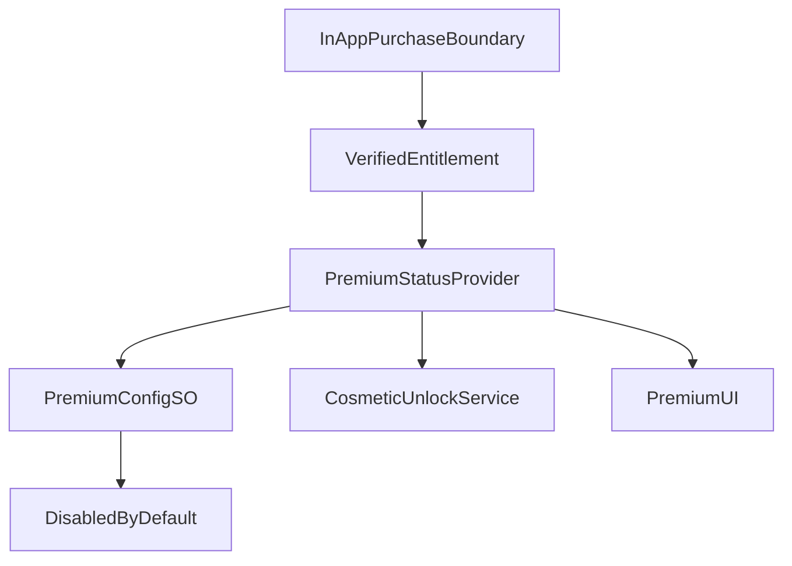

# Premium Membership

> **Last updated:** 2026-11-25  
> **Status:** Planned; no subscription, membership tier, recurring price, premium entitlement, or member-only content exists.  
> **Authority:** subordinate to [ADR-0003](../decisions/architecture-decisions.md) and [monetization-architecture.md](monetization-architecture.md).  
> **Scope:** future optional membership only.

## 1. Current truth

Premium membership is not implemented. No player is a member, no recurring charge exists, and no content is premium-gated.

## 2. Candidate benefits

Ideas only, not approved or shipped:

| Benefit | Constraint |
| --- | --- |
| Cosmetic packs | Presentation only; no gameplay advantage. |
| Extra subtitle/audio options | Accessibility benefit must also have a free baseline. |
| Supporter badge | Local cosmetic only; no social privileges. |
| Theme variations | No change to collision, speed, scoring, or chapter access. |

Core gameplay, story completion, and the criminal-escapes outcome remain available without membership.

## 3. Target architecture

`PremiumStatusProvider` reads entitlement state from the verified purchase boundary. It does not invent membership from local preferences, debug flags, or unvalidated receipts.

## 4. Required lifecycle handling

- Active, cancelled-but-valid, expired, refunded, restored, and offline states need tests.
- Grace periods must follow store policy once an SDK is approved.
- Entitlement persistence requires ADR-0004 save/migration rules.
- No premium state may be used to alter difficulty, collision, reward rates, or story access.
- UI must clearly state when a benefit is cosmetic.

## 5. Verification gates

| Status | Requirement |
| --- | --- |
| Planned | Current state. |
| Implemented | Passive provider, configuration, and cosmetic boundary exist with membership disabled. |
| Tested | Sandbox lifecycle tests cover all entitlement states and offline restore. |
| Verified | Store sandbox, real-device entitlement persistence, privacy review, and store metadata are recorded. |

## 6. Acceptance checklist

- [ ] No subscription or membership is live.
- [ ] No core gameplay content is locked.
- [ ] No fake member badge or fake entitlement.
- [ ] Premium status cannot be self-granted in shipped builds.
- [ ] Monetization ADR is accepted before launch.
