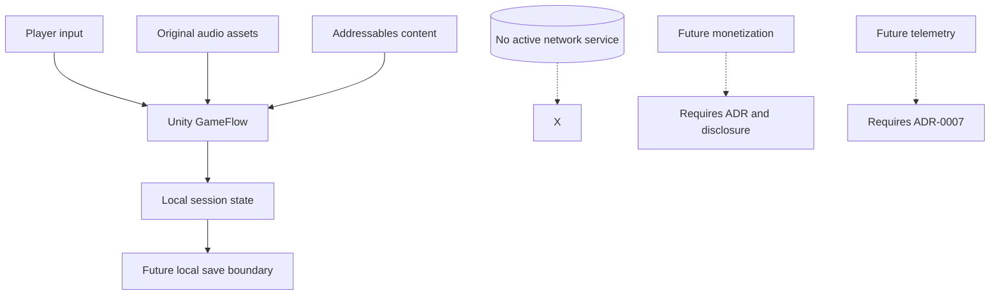

# Privacy and Security

> **Last updated:** 2026-11-25  
> **Status:** Policy in progress; privacy-sensitive runtime features are Planned and disabled.  
> **Authority:** [ADR-0003](../decisions/architecture-decisions.md). Future telemetry requires ADR-0007.  
> **Scope:** Unity 6 LTS / C# / URP Android project and repository material.

## 1. Current privacy position

The active design is local-first. No account, cloud save, device identifier, location, contact list, photo library, advertising identifier, behavioural profile, telemetry upload, or network gameplay service is implemented.

Repository files, Markdown, Mermaid, JSON, XML, and folder structure can be statically checked in this environment. Unity runtime behaviour, Android builds, and device network traffic are not verified here.

## 2. Data inventory

| Data | Current status | Rule |
| --- | --- | --- |
| Run score and distance | Planned local session state | No personal identity. |
| Save progression | Planned under ADR-0004 | Must define schema and migration before implementation. |
| Settings | Planned local preferences | No cloud sync. |
| Voice and audio assets | Planned | Must be original or licensed with provenance. |
| Crash/performance evidence | Planned developer evidence | Must not contain personal player data. |
| Purchases or ads | Disabled | Requires monetization ADR and store disclosures. |
| Analytics/telemetry | Disabled | Requires ADR-0007 and privacy review. |

## 3. Data flow boundary

## 4. Security rules

- Never commit `.keystore`, `debug.keystore`, signing passwords, tokens, API keys, credentials, or private service files.
- Debug keystores must remain outside the repository.
- GitHub remote work requires authentication on the developer machine, not committed tokens.
- No decompiled code, extracted textures, scraped audio, protected APK content, copied characters, copied branding, or celebrity voice clones may be added.
- Third-party packages require licence, provenance, Android compatibility, and 16 KB page-size review before adoption.
- Native plugins under `Assets/Plugins/Android/` must be rebuilt for 16 KB page size before store submission.
- Error messages and logs must not expose secrets or personal data.

## 5. Android permission policy

Minimal permissions only:

| Permission | Position |
| --- | --- |
| `INTERNET` | Not required by core offline play; may be required only after an approved SDK decision. |
| `VIBRATE` | Optional haptic feedback only if implemented and documented. |
| `READ_EXTERNAL_STORAGE` / `WRITE_EXTERNAL_STORAGE` | Not required. |
| Location, contacts, camera, microphone, phone state | Not required and prohibited for v1. |

## 6. Incident response

1. Remove the exposed file or dependency from working state.
2. Rotate credentials outside the repository.
3. Record affected files, commit range, and remediation in `CHANGELOG.md`.
4. Purge history only with owner approval and coordinated remote handling.
5. Add a static check or review checklist item to prevent recurrence.

## 7. Acceptance checklist

- [ ] No committed secret or signing material.
- [ ] No unlicensed or protected third-party asset.
- [ ] No active network or telemetry path.
- [ ] Minimal Android permissions.
- [ ] Every future SDK has an ADR and privacy review.
- [ ] Store disclosures exist before release.
