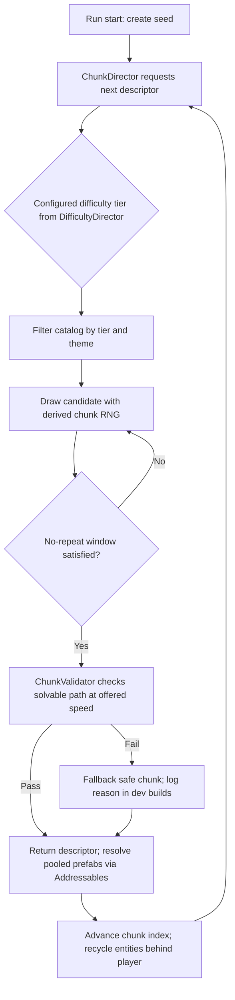

# Indian Subway Runner — Procedural Generation

> **Status:** Planned — design specification only. No generator C#, chunk prefabs, Addressables groups, or build artifacts are implemented or verified in this environment.
> **Last updated:** 2026-11-25
> **Authority:** [ADR-0003](decisions/architecture-decisions.md) is final/binding: Unity **6000.0.86f1+ LTS**, C#, URP, Android, Addressables for large/optional content. Gameplay contracts are in [gameplay-mechanics.md](gameplay-mechanics.md); difficulty inputs are in [difficulty-progression.md](difficulty-progression.md).

## 1. Unity implementation shape (Planned)

| Concern | Planned mechanism |
| --- | --- |
| Definitions | `ChunkPatternSO` and `BiomeThemeSO` ScriptableObjects under `Assets/Data/World/` |
| Catalog | `ChunkCatalogSO` listing pattern ids, difficulty tags, theme tags, and target prefab keys |
| Runtime director | Pure C# `ChunkDirector` with injected `IRng` and pool interface; no `UnityEngine.Random` in gameplay |
| Pools | `UnityEngine.Pool.ObjectPool<T>` or project `IPool<T>` wrapper; prewarmed at boot |
| Content | Addressables labels such as `chunk_core`, `chunk_theme_station`, `chunk_theme_bridge`; preloaded during Boot |
| Spawning | At chunk boundaries or in `FixedUpdate`; never `Instantiate`/`Destroy` in the frame loop |
| Debug | Editor window plus `OnDrawGizmosSelected` showing lane grids and validator decisions |

`Core` stays platform-independent: the generator decides an ordered list of chunk descriptors; a presentation adapter resolves descriptors to pooled URP prefabs. Tests exercise the descriptor stream without loading scenes.

## 2. Seeding and reproducibility

| Rule | Planned behaviour |
| --- | --- |
| Run seed | Single 64-bit seed created at run start and stored in the run record |
| Random source | `System.Random` behind `IRng`; no unseeded calls in gameplay or tests |
| Per-chunk seed | Derived deterministically from run seed + chunk index (for example mixed/hashed, not accumulated mutable state) |
| Rejection sampling | Failed candidate draws consume deterministic rng state and fall back predictably |
| Replay intent | Same seed + same input trace + same config → same chunk stream; replay UI is future work |
| Test determinism | `FixedRng` used in EditMode tests; no wall-clock or device id influences generation |

Seeding is also the basis for future score replay checks in [scoring-and-rewards.md](scoring-and-rewards.md); v1 does not claim replay or anti-cheat enforcement.

## 3. Chunk anatomy (Planned)

A chunk descriptor contains:

| Field | Meaning |
| --- | --- |
| `id` | Stable pattern id used in logs and tests |
| `length` | Forward length in world units, authored in data |
| `laneCells` | Ordered per-lane occupancy: empty / coin / low hazard / high hazard / train volume / power-up |
| `themeTags` | Cosmetic sets such as station, bridge, countryside |
| `difficultyTag` | Eligible tier band |
| `minReactionMs` | Design reference attached to the pattern |
| `safePath` | Declared traversable lane sequence or timed gap used by the validator |

Themes change materials, props, lights, and audio ambience only. A theme variant never changes collision geometry, hazard timing, or reward value without a new validated pattern id.

## 4. Generation flow

## 5. Safe-path validation (blocking rule)

A candidate is rejected unless it declares at least one of:

1. a continuous traversable lane at the offering speed, or
2. a timed gap that satisfies the minimum reaction reference and can be reached from the current lane, or
3. a jump/slide solution whose action timing fits the locomotion curves in [gameplay-mechanics.md](gameplay-mechanics.md).

Additional rejection rules (proposed):

- no pattern that requires two lane changes inside a single lane-change duration;
- no adjacent lane blocking that eliminates the only escape lane;
- no hazard placed inside the guaranteed landing zone of a required jump;
- maximum hazard density per chunk bounded by tier data;
- collectibles never require an impossible path to collect; a miss is allowed, an impossible requirement is not.

Validation runs in EditMode against every catalog entry and as a runtime guard before a descriptor is emitted. A failed runtime guard falls back to a safe straight chunk and logs a validation reason in development builds. The fallback must be a designed, dressed chunk, never an empty grey box.

## 6. Difficulty modulation

`DifficultyDirector` supplies tier, speed, spawn-density weights, and chapter modifiers from [difficulty-progression.md](difficulty-progression.md). The generator consumes **weights**, not mutation of prefabs:

| Input from difficulty | Generator effect |
| --- | --- |
| Speed band | Selects patterns whose reaction budget remains valid |
| Hazard density | Adjusts pattern weights and spacing between dangerous chunks |
| Chapter modifier | Changes theme weights and banned pattern tags |
| Power-up cadence | Adjusts spacing of power-up descriptors within safe limits |
| Warm-up state | Forces low-complexity patterns at run start |

The generator never raises difficulty by making a previously valid pattern unsolvable.

## 7. Pooling and allocation rules

- Prewarm pools for the active theme set during Boot; cap active chunk count in `RunConfigSO`.
- Recycle entity prefabs when the chunk exits the trailing boundary; reset transform, trigger flags, and Animator state on recycle.
- Reuse lists/arrays in `ChunkDirector`; avoid LINQ, closure allocation, and string formatting in hot paths.
- Physics queries in gameplay use non-alloc overloads; see [collision-system.md](collision-system.md).
- Addressables handles are released at scene/run teardown, not per frame.

## 8. Reserved tuning knobs (Planned)

| Knob | Proposed range | Validation |
| --- | --- | --- |
| Visible chunks ahead | ~3–5 chunks | Profiler + playtest |
| No-repeat window | ~2–3 chunks for hazard-heavy patterns | Playtest |
| Fallback frequency | Target 0 in normal play; any occurrence is a defect | EditMode + logs |
| Chunk recycle margin | Beyond trailing camera frustum | Playtest/Profiler |
| Per-chunk active entity cap | Data-defined | Profiler |

All values are proposals. No values are measured or verified in this shell.

## 9. Validation policy

Every item above is **Planned** per [PROJECT_STATUS.md](../PROJECT_STATUS.md). Required evidence before retirement: EditMode validation of all catalog patterns, PlayMode seeded-stream determinism, device Profiler capture showing stable allocation, and playtest notes confirming that no generated pattern produced an impossible action. None exists yet.
