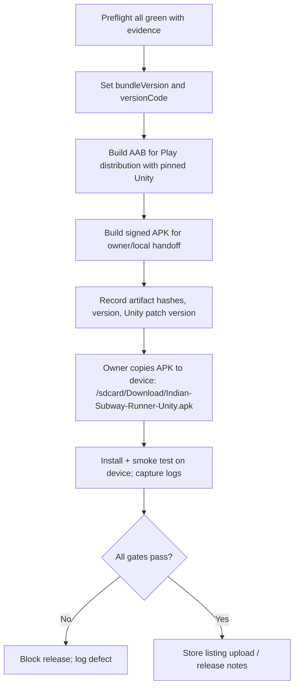

# Indian Subway Runner — Release Process

> **Status:** Planned — no release, signed build, AAB, APK, store listing, tag, or verified build hash exists in this environment. A GitHub Actions debug APK workflow is pushed but has not been run.
> **Last updated:** 2026-11-25
> **Authority:** [ADR-0003](decisions/architecture-decisions.md) is final/binding: Unity **6000.0.86f1+ LTS**, C#, URP, Android. See [android-build-instructions.md](android-build-instructions.md), [testing-strategy.md](testing-strategy.md), [performance-optimization.md](performance-optimization.md), and [PROJECT_STATUS.md](../PROJECT_STATUS.md).

## 1. Repository facts and boundaries

| Item | Fact / rule |
| --- | --- |
| Repository | Private GitHub repository `indian-subway-runner`; default branch `main` |
| GitHub auth here | Authenticated as `inzyhere` with repo scope via `gh` |
| Git state note | Local Git history initialized; `main` tracks `origin/main` on the private remote |
| Commits/tags | Foundation commits exist; release tagging is a separate, explicit action |
| Secrets | No tokens, passwords, keystores, signing keys, or service credentials in the repo or build artifacts |
| Signing | Signing material stays outside the repository and is supplied by the build environment/owner |

No release or tag is claimed here; the private remote has received the foundation commits only.

## 2. Release preflight (Planned)

| Check | Pass condition |
| --- | --- |
| ADR status | ADR-0003 is final; ADR-0002 is superseded; ADR-0004/0007 handled or explicitly deferred |
| Status truth | Every feature claim in docs matches [PROJECT_STATUS.md](../PROJECT_STATUS.md) status vocabulary |
| Tests | EditMode/PlayMode/build smoke/device gates recorded per [testing-strategy.md](testing-strategy.md) |
| Performance | Profiler/thermal/evidence gates met per [performance-optimization.md](performance-optimization.md) |
| Content | Original art/audio, no placeholder or licensed-material ambiguity, no fake buttons or dead menu items |
| Player Settings | Package `com.inzyhere.indiansubwayrunner` for the first debug APK, min API 24, target API 36, IL2CPP + ARM64 per build doc |
| 16 KB | Native libs rebuilt/verified; AAB audited |
| Privacy | No undeclared network/telemetry; storage boundary per [save-data.md](save-data.md) |
| Secrets scan | No credentials/keystores in assets, logs, or bundle |
| Build identity | Version, commit/tag, build hash recorded |

Any failed check blocks release; no "best effort" release is claimed.

## 2a. CI debug APK build (Planned)

`.github/workflows/build-android.yml` is a manual x64 GitHub Actions build path. It requires repository secrets `UNITY_LICENSE`, `UNITY_EMAIL`, and `UNITY_PASSWORD`. It produces artifact `IndianSubwayRunner-debug-apk` containing `Builds/IndianSubwayRunner.apk`. This artifact is for side-load testing only and is not a signed release or Play Store artifact.

## 3. Versioning (Planned)

| Field | Planned rule |
| --- | --- |
| Version scheme | SemVer `MAJOR.MINOR.PATCH` for human-readable release notes |
| Unity version | `PlayerSettings.bundleVersion` from SemVer |
| Android code | `PlayerSettings.Android.bundleVersionCode` monotonically increasing; never reused |
| Build name | `Indian-Subway-Runner-<version>-<variant>` |
| Records | Version, versionCode, Unity patch version, commit/tag, SHA-256 of artifacts recorded in [PROJECT_STATUS.md](../PROJECT_STATUS.md) |

No version number is asserted for a release that has not been built.

## 4. Build and handoff (Planned)

- AAB is the Play distribution artifact; APK is for local/owner handoff.
- The owner APK path `/sdcard/Download/Indian-Subway-Runner-Unity.apk` is a handoff location, **not a repository file** and not a claim that the file exists now.
- Signing is performed outside the repository. Keystores and credentials are never committed or documented in files.
- Build outputs are not committed. Release evidence (hash/version/date) is recorded in status docs, not the binaries themselves.

## 5. Store checklist (Planned)

| Item | Requirement |
| --- | --- |
| Data safety | Declare local-only storage; no account/cloud/telemetry in v1 |
| Permissions | Only permissions actually required; no network permission for scoring/save |
| Content | Original visual/audio assets; no placeholder store art |
| Monetization | No IAP/ads/economy claims in v1 |
| Compatibility | API 36 target, min API 24, 16 KB native library compatibility |
| Accessibility | Safe area and reduced-motion/caption notes where applicable |
| Release notes | Truthful; derived from [PROJECT_STATUS.md](../PROJECT_STATUS.md), not aspirational docs |
| Support path | Contact/issue path for save-corruption or crash reports |

## 6. Current blockers and status

This shell has no Unity Editor, `sdkmanager`, signed keystore, or connected device; `adb` and GitHub authentication are available. A CI workflow is pushed but needs Unity license secrets and a successful run. Per [PROJECT_STATUS.md](../PROJECT_STATUS.md), no Unity build or release is implemented, tested, or verified. This document is a release procedure only; do not treat any step above as completed.
