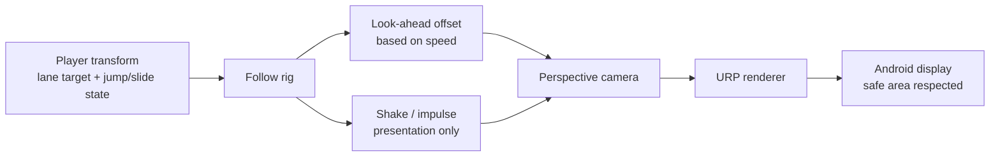

# Rendering Engine

> **Status:** Planned — design target for Unity URP. No URP asset, camera rig, material, or quality tier is Unity-verified.
> **Last updated:** 2026-11-25
> **Authoritative decision:** [ADR-0003](./decisions/architecture-decisions.md) — Unity 6000.0.86f1+ LTS, C#, **Universal Render Pipeline**.
> **Applies to:** All Android builds of Indian Subway Runner.

## 1. Decision and scope

Indian Subway Runner uses the **Universal Render Pipeline (URP)** inside Unity 6000.0.86f1+ LTS. Rendering is genuine real-time 3D: perspective camera, 3D meshes, lit materials, Unity Animator, Unity Physics, and URP post-processing.

**Prohibited:** libGDX `SpriteBatch`, Scene2D, Three.js, WebGL/WebView rendering, hand-rolled OpenGL/Vulkan, built-in-pipeline shaders, and any unapproved renderer switch. Kotlin/libGDX references in older docs are historical and superseded.

The target visual is a polished, readable chase through Indian railway environments: platforms, tracks, stations, trains, signs, and props, with clear lane readability and a strong sense of speed. See [asset-production-plan.md](./asset-production-plan.md), [asset-management.md](./asset-management.md), and [environment-design.md](./environment-design.md) for asset authoring rules.

## 2. URP asset settings

Create URP assets under `Assets/Settings/URP/`. The exact field names must be confirmed in the pinned Editor; the table below is the **design target**.

| Setting | Design target | Rationale |
| --- | --- | --- |
| Renderer | Forward renderer, URP Renderer Data | Predictable mobile path; no deferred cost |
| Render Scale | Tier-driven (see §3) | Primary resolution lever |
| HDR | Off on Low, optional on Medium/High | Bloom can be faked on Low |
| MSAA | Off on Low, 2x on Medium, 4x on High or disabled with SMAA | Edge quality vs. bandwidth |
| Depth Texture | On only if required by effects | Reduces bandwidth |
| Opaque Texture | Off on Low; on where needed for effects | Avoids extra copy |
| Shadow Distance | Short and tier-gated | Tracks/stations do not need long shadows |
| Shadow Resolution | Low/Medium per tier | Avoid large shadow maps |
| SRP Batcher | Enabled | Fewer draw-call state changes |
| GPU Instancing | Enabled on repeated props/track pieces | Batching for procedural chunks |
| Post Processing | Enabled per tier (§6) | Deferred deliberately |
| Adaptive Performance | Evaluate with Unity Adaptive Performance package | Thermal/frame-rate scaling |

## 3. Quality tiers

Quality is selected by device capability and can be reduced at runtime under memory or thermal pressure. No tier assumes a specific device model without Profiler evidence.

| Tier | Render Scale | Shadows | Post Processing | Particles / LOD | Target |
| --- | --- | --- | --- | --- | --- |
| Low | ~0.7–0.85 | Minimal or baked only | Off or vignette only | Fewer particles, shorter LOD distance, lower texture mip bias | Lower-tier devices |
| Medium | ~0.9–1.0 | Soft, short distance | Bloom + color grading, light vignette | Default particles and LODs | Mainstream Android |
| High | 1.0+ | Soft, moderate distance | Full tier with tonemapping, bloom, vignette, color adjustments | More particles, longer LOD distance | Flagship / capture |

Rules:

- Tier changes never change gameplay timing, lane identity, or collision outcomes.
- Tier selection is deterministic and logged as an opaque capability bucket, not personal device data.
- Quality must be re-evaluated after loading a new chapter only if memory pressure is detected.

## 4. Camera

- Perspective third-person follow camera, positioned behind and slightly above the criminal so the pursuer and the next obstacle are both visible.
- Smooth damping follows the **visual** player transform; authoritative lane movement stays in gameplay and `FixedUpdate`.
- Look-ahead increases with speed so reaction windows remain readable.
- Camera shake is short, capped, and disabled under reduced-motion preference or Low tier.
- Safe area and aspect-ratio handling belong to `UI` + `AndroidIntegration`; the camera does not crop critical lane information.
- Cinemachine is **optional** and must be checked against Unity 6000.0 LTS package compatibility before use; a plain Unity Camera rig is the fallback.

## 5. Lighting

- One primary directional light for sun/sky, with short, tier-gated shadows.
- Baked or mixed lighting where practical; real-time lights are limited to a small number of key accents.
- Light probes / reflection probes only where they materially improve character and train readability.
- Station interiors and night chapters use emissive materials and baked lighting rather than many real-time lights.
- No light count or shadow distance may be increased without a Profiler comparison recorded in [performance-optimization.md](./performance-optimization.md).

## 6. Materials and shaders

| Rule | Detail |
| --- | --- |
| Base shader | URP Lit for characters, trains, props, and environments; URP Unlit for UI and far scenery where appropriate |
| Shader Graph | Allowed only with URP target; no Built-in or HDRP shader dependencies |
| Textures | Compressed mobile formats (e.g. ASTC), mipmaps where appropriate, atlas repeated props |
| Materials | Shared materials for instanced props; avoid per-instance material duplication |
| Emissives | Used for signs, lamps, and far train lights; no expensive real-time glow on Low |
| Transparency | Minimized; alpha-clipped foliage/signs preferred over blended overdraw |
| Styling | Original palette and material language; no copied franchise assets |

## 7. Post-processing

Use a URP `Volume` profile with tier-gated overrides:

- Bloom — subtle, for lamps and signage; disabled or faked on Low.
- Vignette — light, for chase focus.
- Color Adjustments / Tonemapping — consistent grade across chapters.
- Motion blur — **off** by default; never used to hide low frame rate.
- Depth of field — **off** in gameplay because it harms obstacle readability.

Post-processing is presentation only; it must not obscure lane boundaries, collectibles, or the pursuer.

## 8. Mobile performance

- Target sustained **60 FPS** on mainstream Android with graceful scaling; never sacrifice collision clarity for effects.
- Pool trains, obstacles, collectibles, chunks, and VFX; no `Instantiate`/`Destroy` churn in frame-critical loops.
- Chunked procedural generation uses fixed chunk pools and frustum culling / occlusion culling / LODGroups.
- Atlasses and GPU instancing reduce draw calls for repeated track and station props.
- Addressables load large chapter content at boundaries, not during a frame.
- Track Profiler counters: frame time, GPU time, draw calls, batches, triangles, texture memory, GC allocations.
- Verify real-device thermal, battery, loading time, and 16 KB page-size compatibility before any Verified claim.
- See [performance-optimization.md](./performance-optimization.md) and [testing-strategy.md](./testing-strategy.md).

## 9. Verification gates

| Gate | Status | Evidence needed |
| --- | --- | --- |
| URP assets and Renderer Data created | Planned | Unity project opened, assets inspected |
| Quality tiers configured | Planned | Editor screenshots + Profiler comparison |
| Camera and lighting verified | Planned | PlayMode run on device |
| Materials/shaders compile | Planned | Editor console clean |
| 60 FPS target | Planned | Profiler and real-device recording |
| Visual review per chapter | Planned | Screenshot/video review log |

No rendering claim is Implemented, Tested, or Verified until the matching gate is met.
