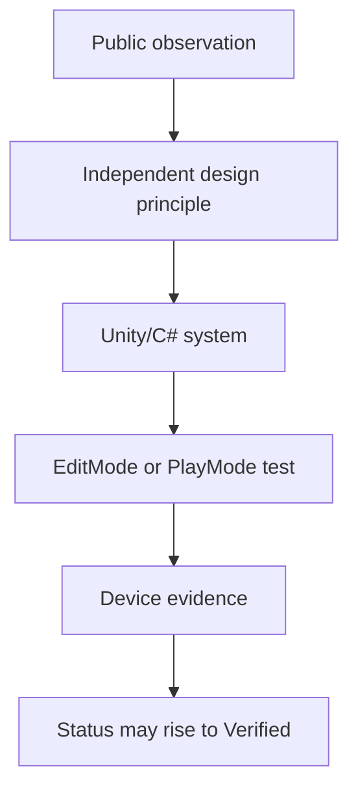

# Observable Gameplay Analysis

> **Last updated:** 2026-11-25  
> **Status:** In progress; research notes are engine-neutral and do not prove implementation.  
> **Authority:** subordinate to [ADR-0003](../decisions/architecture-decisions.md) for applicability only; this record must not adopt a different engine.  
> **Scope:** publicly observable endless-runner principles relevant to an original Indian railway chase game.

## 1. Purpose

This record separates publicly observable gameplay principles from protected game content. It informs independent design in Unity; it is not a specification copied from another product.

The project is an original 3D Android endless chase: an ACP-inspired pursuer chases a criminal through Indian railway environments. The criminal never remains caught in v1.

## 2. Evidence rules

Allowed:

- Public store descriptions, publisher pages, encyclopedic summaries, and public gameplay analyses.
- General engine and platform performance guidance.
- Independent design conclusions with confidence labels.

Prohibited and excluded:

- Decompiling, disassembling, or unpacking a protected APK or shipped game.
- Extracting textures, meshes, animations, audio, source code, or configuration from a shipped game.
- Using data-mined assemblies or extracted internal assets as evidence. A data-mined search result was encountered earlier and discarded; it is not part of this record.
- Scraping copyrighted meme audio or protected dialogue.
- Cloning a celebrity or real person's voice.
- Copying exact characters, branding, signage, lines, level layouts, or UI art.
- Using private APIs, protected telemetry, or account-restricted content.

## 3. Source register

| ID | Source | Use |
| --- | --- | --- |
| S1 | [Wikipedia — Subway Surfers](https://en.wikipedia.org/wiki/Subway_Surfers) | Core loop overview, swipe actions, trains, obstacles, pickups, progression. |
| S2 | [Apple App Store — Subway Surfers](https://apps.apple.com/us/app/subway-surfers/id512939461) | Publisher-facing description of lanes, controls, power-ups, and goals. |
| S3 | [Game Design Analysis: Subway Surfers](https://www.anuflora.com/game/?p=4740) | Control simplicity, speed pressure, feedback, portrait framing observations. |
| S4 | [Speedrun Wiki — Subway Surfers](https://www.speedrunwiki.com/Subway_Surfers) | High-level engine and 60 FPS observation; build differences noted as weak evidence. |
| S5 | [Orcun Nisli — Endless Runners: Procedural Map Generation and Difficulty Curves](https://www.orcunnisli.com/post/2015/11/22/endless-runners-procedural-map-generation-and-difficulty-curves) | Two-layer procedural design, pattern recognition, collision/air-control discussion. |
| S6 | [Coin reference (community wiki)](https://subwaysurf.fandom.com/wiki/Coin) | Coin trail shape, score relationship, and power-up interaction observations. |
| S7 | [Gameplay analysis — Game World Observer](https://gameworldobserver.com/2016/06/24/subway-surfers-gameplay-analysis) | Three-track novelty and obstacle diversity. |
| S8 | [Mechanics of Magic — MDA analysis](https://mechanicsofmagic.com/2022/04/10/mda-8-kinds-of-fun-subway-surfers/) | Responsiveness, animation flow, and increasing obstacle complexity. |
| S9 | [Android Developers — Frame Pacing library](https://developer.android.com/games/optimize/frame-pacing) | VSync, refresh-rate, and frame-pacing platform guidance. |
| S10 | [Android Developers — Games memory overview](https://developer.android.com/games/optimize/memory-overview) | Memory budgeting and graphics-resource platform guidance. |

S1–S8 are public gameplay/design observations. S9–S10 are platform engineering guidance, not evidence of any game's internals.

## 4. Observations

| Observation | Evidence | Confidence | Independent design conclusion |
| --- | --- | --- | --- |
| Three-lane movement with swipe left/right is a readable mobile control scheme. | S1, S2, S7 | High | Use three lanes, swipe/jump/slide, and immediate visual acknowledgement. |
| Obstacles and trains create timing pressure without complex control inputs. | S1, S2, S3, S7 | High | Use stationary, moving, and train hazards with readable silhouettes. |
| Coins guide movement and reinforce score feedback. | S1, S6 | Medium-high | Use coin trails and score feedback, with original shapes and audio. |
| Power-ups extend run variety. | S2, S6 | Medium | Planned candidates: magnet, shield, sprint, slow-time; balance later. |
| Difficulty rises through speed, density, and pattern complexity. | S3, S5, S8 | Medium-high | Use bounded chapter curves and guaranteed safe paths. |
| Procedural generation often uses chunk or pattern composition. | S5 | Medium | Use pooled chunks and explicit impossibility checks. |
| Smooth animation and responsive input are central to feel. | S3, S8 | Medium-high | Use Animator states, pooled effects, and frame-budget tests. |
| Mobile performance needs frame pacing and memory discipline. | S4, S9, S10 | Medium | Target 60 FPS with Profiler evidence; do not claim it before device tests. |

## 5. Unity applicability

| Principle | Unity target |
| --- | --- |
| Lane input | Input System actions and `PlayerController` |
| Hazards and trains | Prefabs, pooled spawn director, Unity Physics |
| Difficulty curve | ScriptableObject chapter config and bounded runtime rules |
| Procedural chunks | Chunk pools with validation tests |
| Coins and power-ups | Collectibles assembly and idempotent effect handlers |
| Feedback | AudioDirector, UI HUD, particle/VFX budget |
| Performance | URP settings, Addressables, Unity Profiler, real-device capture |

Mapping to Unity is a design application, not evidence that a subsystem is implemented.

## 6. Confidence policy

| Label | Meaning |
| --- | --- |
| High | Multiple public sources agree or publisher/engine documentation states it directly. |
| Medium | Public analyses or community sources converge but details may vary by version. |
| Low | Single weak observation, version-dependent claim, or inference. |

Do not convert research confidence into implementation status. Only Unity source, tests, builds, and device evidence can do that.

## 7. Open questions

- Which procedural chunk size gives the best readability at target speed?
- Which safe-path validator gives deterministic guarantees without over-constraining variety?
- What device tiers can sustain the target frame rate with URP?
- How should Hindi dialogue avoid overlapping critical SFX?
- Which power-ups are actually fun and fair after PlayMode testing?

## 8. Status gates

| Status | Requirement |
| --- | --- |
| In progress | Current state; engine-neutral observations and sources exist. |
| Complete research pass | All open questions either answered with cited public evidence or handed to Unity tests. |
| Implemented design | C# systems and Unity assets exist. |
| Verified behaviour | Device evidence supports performance, input, and lifecycle claims. |
