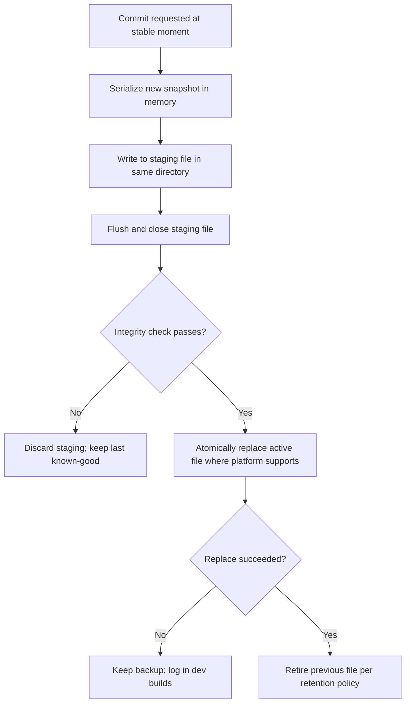

# Indian Subway Runner — Save Data

> **Status:** Planned — design specification only. No save format, version number, migration code, files, or device persistence tests exist or are verified in this environment.
> **Last updated:** 2026-11-25
> **Authority:** [ADR-0003](decisions/architecture-decisions.md) is final/binding: Unity **6000.0.86f1+ LTS**, C#, URP, Android. **ADR-0004 is reserved** for the save format/versioning/migration policy and has not been written. Related contracts: [scoring-and-rewards.md](scoring-and-rewards.md), [release-process.md](release-process.md).

## 1. Scope (Planned)

| Data | Intended persistence |
| --- | --- |
| Best score | Local |
| Coin wallet | Local |
| Challenge progress / badges | Local |
| Last visited chapter / tutorial seen | Local |
| Accessibility and display settings | Local |
| Run in progress | **Not persisted** in v1; background pauses, then resume or restart |
| Account, cloud, cross-device sync | **Not in v1** |
| Secrets, tokens, signing keys | Never saved by the game |

No network permission, account system, or cloud save is claimed. Any future online storage requires an explicit ADR covering privacy/network boundaries (referenced as ADR-0007 in [environment-assessment.md](environment-assessment.md)).

## 2. Critical constraint: ADR-0004 is open

The on-disk format is **not decided**. This document deliberately does not claim a JSON schema, version number, serialization library, or migration rule. Those choices are reserved for ADR-0004.

| Question | Owner |
| --- | --- |
| Binary vs JSON vs other encoding | ADR-0004 |
| Version header and compatibility range | ADR-0004 |
| Migration steps and backup retention | ADR-0004 |
| Checksum/integrity policy | ADR-0004 |
| Acceptance tests for migration | ADR-0004 |

The sections below describe **candidate engineering constraints** that ADR-0004 must resolve; they are not implemented behaviour.

## 3. Unity storage boundary (Planned)

- Use `Application.persistentDataPath` for app-private progress files on Android.
- Do not reuse legacy file names, legacy `filesDir` assumptions, or `PlayerPrefs` as the progress store. `PlayerPrefs` may hold non-critical settings only if ADR-0004 permits it; progress must not depend on it.
- No secrets, credentials, or signing material are stored. Signing stays outside the repository per [release-process.md](release-process.md).
- All reads/writes go through a single `SaveSystem`/`ISaveStore` boundary; gameplay code must not write files directly.

## 4. Candidate crash-safe write strategy (not decided)

ADR-0004 is expected to specify a strategy along these lines:

Constraints for ADR-0004 to settle:

- Never write directly into the active save file in a way that can leave a truncated record.
- Keep a last-known-good backup until the new file is proven readable.
- Serialize at stable moments only: run end, explicit settings change, or safe pause; never per frame.
- Reset volume/chain on recycle; no save event from a destroyed pooled object.

## 5. Versioning expectations (reserved for ADR-0004)

A future ADR must define:

1. how a version is stored and read before decoding the rest of the payload;
2. how older versions migrate forward, including missing fields;
3. how a newer-than-supported version is handled without overwriting it;
4. when a backup is retained or discarded;
5. how a corrupt record falls back without silently wiping the wallet;
6. EditMode acceptance tests for every supported migration path.

Until that ADR exists, no compatibility claim is made. A user-visible "save migrated" message must not be implemented before migration is actually specified and tested.

## 6. Corruption and failure handling (Planned constraints)

| Condition | Intended behaviour |
| --- | --- |
| Missing file | Initialize defaults; do not report corruption to the player |
| Unreadable/truncated active file | Try backup if present; otherwise defaults with dev-build log |
| Unknown/newer version | Refuse to overwrite; preserve file; surface a safe support path |
| Disk write failure | Keep in-memory progress for the session; retry at next stable moment |
| Device lost/backgrounded mid-run | Pause; no partial run write; commit only stable ledgers |

No silent reset of coin wallet or challenge progress is acceptable. Recovery behaviour must be covered by tests once the format ADR is written.

## 7. Validation policy

This subsystem is **Planned** and blocked on ADR-0004. Per [PROJECT_STATUS.md](../PROJECT_STATUS.md), no Unity Editor, device, or file evidence exists here. Do not infer a schema from illustrative fields in older documents; those documents were written for the superseded Kotlin/libGDX stack and are not authority.
