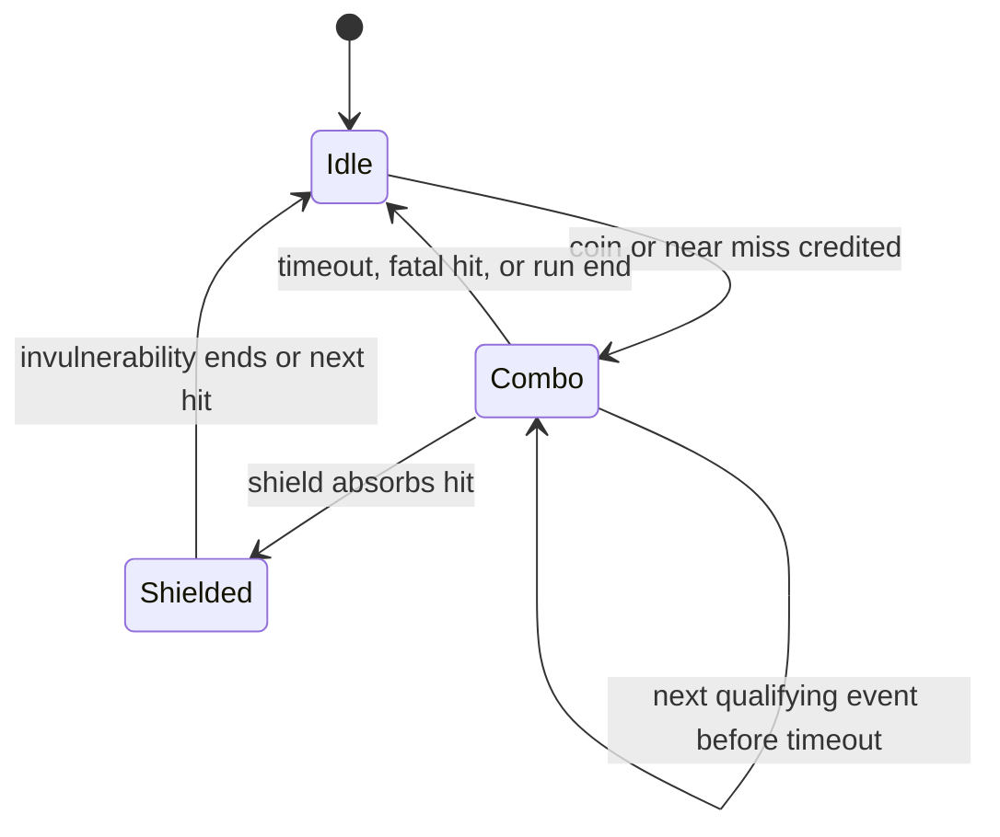
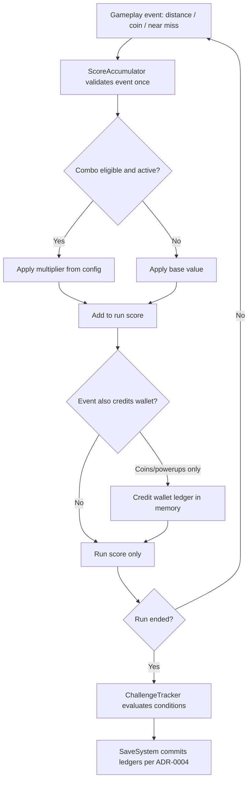

# Indian Subway Runner — Scoring and Rewards

> **Status:** Planned — design specification only. No scoring C#, ledgers, challenges, balances, or persistence are implemented or verified in this environment.
> **Last updated:** 2026-11-25
> **Authority:** [ADR-0003](decisions/architecture-decisions.md) is final/binding: Unity **6000.0.86f1+ LTS**, C#, URP, Android. Related contracts: [gameplay-mechanics.md](gameplay-mechanics.md), [collision-system.md](collision-system.md), [save-data.md](save-data.md).

## 1. Ledger separation (Planned)

| Ledger | Scope | Ownership |
| --- | --- | --- |
| Run score | Current run only; reset on restart | `ScoreAccumulator` in gameplay |
| Coin wallet | Local persistent total | `SaveSystem` via ADR-0004 format |
| Combo state | Current run only; reset on restart/hit | `ScoreAccumulator` |
| Challenge progress | Local persistent mission state | `ChallengeTracker` → `SaveSystem` |
| Best score | Local persistent record | `SaveSystem` |

Score and wallet are intentionally separate: a multiplier affects score increments, not coin credit. No ledger is written to disk every frame.

## 2. Score sources (proposed values)

| Source | Credit | Notes |
| --- | --- | --- |
| Distance | Points per metre progressed | Primary score source |
| Coin pickup | Fixed coin value to run score + one coin to wallet | One credit per trigger object |
| Score pickup | Fixed points to run score only | Does not add coin wallet credit |
| Near miss | Small bonus with cap per obstacle | One award per obstacle; see collision doc |
| Combo multiplier | Multiplies eligible score increments | Caps at a tuned maximum |
| Chapter/story completion | Bonus at run end if conditions met | Future/story-bound; not enabled in v1 by default |
| Challenge completion | Badge/progress, optional score bonus | Defined by challenge data, not hardcoded |

Every number in this table is a **proposed tuning target** to be set in a `ScoringConfigSO`. No balance has been playtested or verified.

## 3. Combo rules (Planned)

- Combo increases on consecutive qualifying events (coins, near misses) and decays after a short no-event timeout.
- A fatal hit ends the run and closes the combo; a shielded hit consumes the shield and then closes the combo after the invulnerability window.
- Combo never affects collision, movement speed, or generator fairness. It changes score increments only.
- Combo state is cleared on pause/resume and restart per [game-controls.md](game-controls.md).

## 4. Challenges (Planned)

Challenges are local missions defined as data, for example:

| Challenge type | Example | Reward |
| --- | --- | --- |
| Distance | Complete a run of N metres | Progress credit / badge |
| Coins | Collect N coins total | Progress credit / badge |
| Near misses | Achieve N near misses in one run | Progress credit / badge |
| Style | Complete a chapter condition | Story badge |

Challenge progress advances from gameplay events at run end, not from parse-time assumptions. Challenge rewards are cosmetic/local progress only. No IAP, ads, or store economy is part of v1.

## 5. Anti-cheat basics (Planned)

- A run record includes seed, config version, input trace reference, and final score; this makes future replay validation possible. Replay UI and enforcement are **future**, not v1 claims.
- Local save data is convenience state, not an authoritative server record. A user with device access can edit it; therefore no purchases, account progression, or public leaderboard trust is built on it in v1.
- Score is computed from gameplay events through `ScoreAccumulator`; UI never writes score directly.
- Any future online leaderboard or server-validated rewards require an explicit ADR covering privacy/network boundaries (see ADR-0007 reference in [environment-assessment.md](environment-assessment.md)).
- No hidden network calls or telemetry are part of scoring in v1.

## 6. Persistence boundaries (Planned)

| Moment | Planned write |
| --- | --- |
| Run end | Commit run score, best score, coins, challenge progress |
| Pause / background | Commit only if state is stable; otherwise defer to run end |
| Settings change | Non-critical settings may use lightweight storage; progress uses SaveSystem |
| Restart | Ensure previous run committed before reset |

The on-disk format, versioning, and migration policy are **reserved for ADR-0004**; see [save-data.md](save-data.md). No schema, cloud sync, or cross-device claim is made here.

## 7. Scoring flow

## 8. Validation policy

All items are **Planned** per [PROJECT_STATUS.md](../PROJECT_STATUS.md). Required evidence before values are finalized: EditMode tests for ledger separation/combo boundaries, PlayMode tests for one-credit-per-trigger, a device run confirming persistence at run end, and playnotes on reward pacing. None has been produced in this shell.
