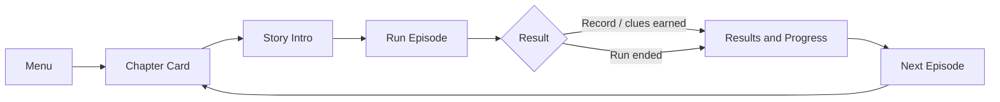

# Story and Narrative Design

> Status: Planned; no story scene, dialogue asset, or voice recording is implemented.

## Premise

ACP Pradyuman leads a relentless pursuit through Indian railways. The criminal is quick, clever, and always just ahead. Every run is an episode: the player can outrun trains, dodge Platform chaos, collect clues, and beat records, but the criminal escapes at the end. The chase continues in the next episode.

This creates an endless chase with narrative progress but no final capture in v1.

## Tone

- Indian, energetic, witty, family-friendly.
- Light slapstick and railway chaos rather than grim crime drama.
- Dialogue should feel recognizable in spirit without copying specific protected lines, voice performances, or exact mannerisms.
- Railway announcements provide comedy, pacing, and orientation.

## Narrative pillars

1. **The chase never ends.** Failure and success both feed the next episode.
2. **India is a character.** Stations, signage, food stalls, trains, announcements, and crowd life carry identity.
3. **Clues, not capture.** Rewards advance investigations and unlock chapters/cosmetics.
4. **Playful authority.** ACP dialogue is sharp and humorous, never violent or cynical.
5. **Public-domain-safe originality.** All text and audio must be original project work.

## Episode structure

## Planned chapters

### Chapter 1 — The Great Railway Escape

- Setting: early morning suburban platform.
- Introduces lanes, jump, slide, local trains, tea stalls, and first clue tokens.
- criminal escapes through a crowded station exit.

### Chapter 2 — Platform Ka Hungama

- Setting: busy daytime junction.
- Introduces moving obstacles, platform debris, and coordinated announcements.
- ACP deduces the next route from a dropped ticket.

### Chapter 3 — Train Ke Peeche

- Setting: express train yards and crossing loops.
- Introduces faster train sequences and tighter reaction windows.
- criminal leaves a misleading clue.

### Chapter 4 — City Express Chase

- Setting: elevated city rail and market-adjacent tracks.
- Introduces dynamic hazards and denser prop variety.
- ACP closes a gap but the criminal switches trains.

### Chapter 5 — Criminal Ka Masterplan

- Setting: large terminal and night express.
- Combines all mechanics with chapter modifiers.
- The criminal reveals a larger pattern and escapes again, setting endless replay.

## Dialogue system requirements

- Short one-liners triggered by events: start, near miss, power-up, clue, high speed, game over, chapter unlock.
- Subtitles always available; voice packs optional and locally stored.
- No generated audio from a real person’s voice without explicit licence.
- Dialogue text must be authored in `Assets/Data/Dialogue/` ScriptableObjects when Unity is available.
- Localization-ready string keys, even if Hindi/English is the initial content.

## Announcement system requirements

- Diegetic railway announcements should be original and context-aware.
- Announcements must not obscure critical audio cues.
- Include platform names, delays, “mind the gap” style warnings, and humorous chapter-specific lines.
- Mix through an AudioMixer snapshot so dialogue remains intelligible during high action.

## Prohibited narrative content

- Copied lines from commercial games, films, or real personalities.
- Celebrity voice cloning or impersonation.
- Scraped meme audio or copyrighted dialogue.
- Claiming the criminal is captured in v1.
- Documentation that presents planned chapters as implemented.
