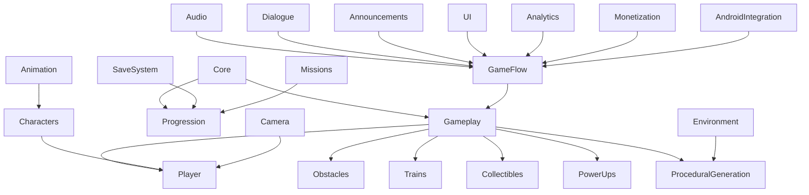
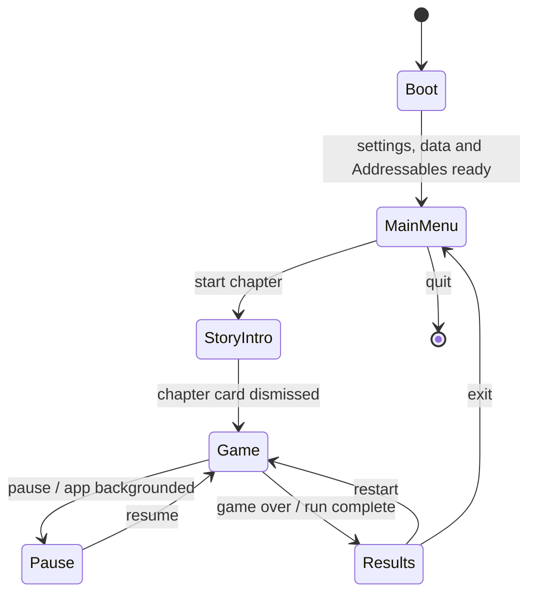
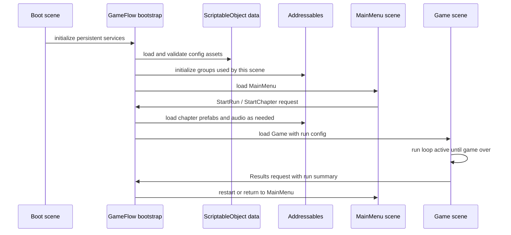
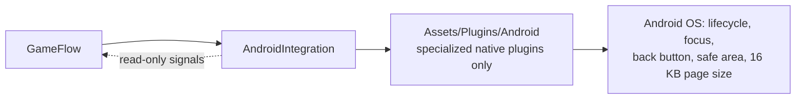

# Technical Architecture

> **Status:** In progress — final Unity stack design plus source implementation exist; gameplay code, generated assets, assembly definitions, and scene-generator source are not Unity-verified.
> **Last updated:** 2026-11-25
> **Authoritative decision:** [ADR-0003](./decisions/architecture-decisions.md) — Unity 6000.0.86f1+ LTS, C#, URP, Android.
> **Applies to:** Indian Subway Runner, all phases.

## 1. Purpose and scope

This document is the design specification for the runtime architecture of **Indian Subway Runner**, an original, offline-capable, genuine 3D Android endless-chase game. An ACP Pradyuman-inspired pursuer chases a criminal through Indian railway environments; the criminal is always ahead and is **never permanently caught in v1**.

It defines the Unity assembly layout, scene flow, data strategy, pooling strategy, the Android platform boundary, and the Unity Test Framework seams. It is subordinate to [ADR-0003](./decisions/architecture-decisions.md) and complements the top-level [ARCHITECTURE.md](../ARCHITECTURE.md). Subsystems below move beyond **Planned** only when matching source exists; none may be marked **Tested** or **Verified** without Unity/device evidence.

## 2. Engine and platform baseline

| Concern | Final choice |
| --- | --- |
| Engine | Unity **6000.0.86f1 or newer 6000.0 LTS patch** |
| Language | C# in `Assets/Scripts/**`, with `.asmdef` boundaries |
| Rendering | Universal Render Pipeline (URP) |
| Platform | Android, ARM64 primary, min API 24, target API 36 |
| Scripting backend | IL2CPP; 16 KB page-size compatible native plugins |
| Animation | Unity Animator / Animator Controllers |
| Physics | Unity Physics (colliders, triggers, fixed `FixedUpdate`) |
| Audio | Unity Audio System / AudioMixer |
| Data | ScriptableObjects; Addressables for large or optional content |
| Tests | Unity Test Framework — EditMode and PlayMode |
| Tooling | Git + GitHub; Markdown + Mermaid documentation |
| 3D source | Original Blender Python generation; desktop `.blend` and FBX/GLB target, current shell OBJ/MTL output |

**Prohibited for gameplay:** Kotlin, libGDX, Three.js, WebView gameplay, React Native, Flutter, and any unapproved engine switch. Kotlin is permitted **only** inside specialized Android-native Unity plugins under `Assets/Plugins/Android/` when genuinely required. Unity-generated Gradle output is a build artefact, never gameplay source.

## 3. Status vocabulary and evidence rule

| Status | Meaning |
| --- | --- |
| Planned | Specified here; not started. |
| In progress | Source or assets exist; not complete or Unity-verified. |
| Implemented | Compilable C# and Unity assets exist in the project. |
| Tested | EditMode or PlayMode tests exist and pass. |
| Verified | Device / Profiler / build evidence is recorded. |

No subsystem may be marked Implemented, Tested, or Verified without matching evidence. The current shell has **no Unity Editor, no `dotnet`/`csc`, no `sdkmanager`, and no connected device**; Blender 4.5.14 LTS and `adb` are installed; `gh` is authenticated with a private remote. It can author source, generate OBJ/MTL and WAV assets, and statically check text, but cannot compile or verify Unity content.

## 4. Unity project layout — source of truth

The source of truth is `Assets/`, `Packages/manifest.json`, and `ProjectSettings/`. This tree is the **target layout** described in [environment-assessment.md](./environment-assessment.md); its hand-authorable skeleton is present but must be created and verified in the pinned Editor. Empty Unity folders are represented by `README.md` files, not fake assets.

```text
indian-subway-runner/
├─ Assets/
│  ├─ Art/{Characters,Trains,Stations,Props,Environments,UI,Materials,Textures}/
│  ├─ Audio/{Music,Sfx,Voice,Announcements}/
│  ├─ Data/{Config,Dialogue,Missions,Progression}/
│  ├─ Editor/
│  ├─ Plugins/Android/
│  ├─ Prefabs/{Characters,Trains,Environment,Obstacles,Collectibles,UI}/
│  ├─ Scenes/{Boot,MainMenu,StoryIntro,Game,Results}.unity
│  ├─ Scripts/{Core,GameFlow,Gameplay,Player,Characters,Environment,
│  │          ProceduralGeneration,Obstacles,Trains,Collectibles,PowerUps,
│  │          Camera,Animation,Audio,Dialogue,Announcements,UI,Progression,
│  │          Missions,SaveSystem,Analytics,Monetization,AndroidIntegration}/
│  ├─ Settings/URP/
│  └─ Tests/{EditMode,PlayMode}/
├─ Packages/manifest.json
├─ ProjectSettings/
├─ Tools/Blender/
├─ docs/
└─ .github/
```

The legacy Gradle/Kotlin/libGDX skeleton (`:core`, `:game`, `:android`, `:desktop`) is **superseded and non-authoritative**. It is not part of the active Unity project and must not be used to make implementation choices.

## 5. Assemblies and dependency direction

Each isolated subsystem gets an assembly definition named `IndianSubwayRunner.<Area>`. Arrows below mean **"depends on"**; dependencies point toward stable, low-level contracts.



| Assembly (`IndianSubwayRunner.*`) | Responsibility |
| --- | --- |
| `Core` | Pure models, rules, RNG, pooling contracts, configuration types. No scene objects, platform SDKs, or UI. |
| `GameFlow` | Scene lifecycle, run state, bootstrap services, coordination between systems. No detailed gameplay math. |
| `Gameplay` | Lane rules, movement orchestration, collision outcomes, scoring, difficulty coordination. |
| `Player` | Player state, lane target, jump/slide state machine. |
| `Characters` | Character state definitions and prefab-facing data. |
| `Environment` | Track/station scenery definitions and chunk skin data. |
| `ProceduralGeneration` | Chunk descriptors, seeded selection, solvability validation, streaming. |
| `Obstacles` | Obstacle taxonomy, affordances, pooled entity definitions. |
| `Trains` | Train variants, deterministic paths, pooled instances. |
| `Collectibles` | Coins, clue tokens, score pickups and collection rules. |
| `PowerUps` | Sprint, magnet, shield, slow-time definitions and timers. |
| `Camera` | Follow rig, look-ahead, shake; presentation only. |
| `Animation` | Animator parameter selection from simulation state. |
| `Audio` | AudioMixer routing, SFX/music/announcement cues. |
| `Dialogue` | Hindi dialogue line selection and subtitles. |
| `Announcements` | Diegetic railway announcement selection. |
| `UI` | HUD and menu/screen presentation (Unity UI / UI Toolkit as verified). |
| `Progression` | Chapters, missions, unlocks, score/best-result rules. |
| `Missions` | Mission descriptors and completion tracking. |
| `SaveSystem` | Local persistence boundary; format reserved by future ADR-0004. |
| `Analytics` | Passive local counters; disabled until explicitly enabled. |
| `Monetization` | Passive integration boundary; deferred until core stability. |
| `AndroidIntegration` | Android plugin bridge; depends on `GameFlow`, never the reverse. |

Rules:

1. `Core` holds no Unity scene objects, platform SDKs, or UI references.
2. `GameFlow` owns scene lifecycle and coordinates systems; it does not own gameplay math.
3. `AndroidIntegration` is the only assembly allowed to touch Android-native plugin types.
4. `Analytics` and `Monetization` remain passive and disabled until explicitly enabled by an accepted ADR.
5. Test assemblies reference the assembly under test plus `Core`.

## 6. Scene flow and lifecycle

Scene-generator source exists, but scene assets are **not created or Unity-verified**. The target flow and Build Settings order match [ARCHITECTURE.md](../ARCHITECTURE.md) and [unity-project-setup.md](./unity-project-setup.md).



`Boot` initializes settings, ScriptableObject data, and Addressables; `MainMenu` starts a run, chapter selection, and settings; `StoryIntro` delivers chapter cards; `Game` hosts the 3-lane chase, HUD, and audio; `Results` reports distance, coins, and score and offers restart. The criminal always escapes; there is **no permanent capture state in v1**.



A persistent `GameFlow` bootstrap object (created in `Boot` and kept across scene loads) owns long-lived services. Per-scene managers own only scene-local state. Service resolution happens at scene/run setup, never during `Update` or `FixedUpdate`.

## 7. ScriptableObject data

Content and tuning are authored as **ScriptableObjects** under `Assets/Data/`, not hard-coded constants or hand-edited JSON.

| Asset group | Holds | Owner |
| --- | --- | --- |
| `Config/` | Speed ramps, lane-switch timing, jump/slide timing, collision tolerances, quality thresholds | `Core`, `Gameplay` |
| `Dialogue/` | Original Hindi lines, subtitle text, priority and cooldown metadata | `Dialogue` |
| `Missions/` | Mission descriptors, objectives, completion conditions | `Missions` |
| `Progression/` | Chapter definitions, difficulty modifiers, unlock rules | `Progression` |

Rules:

- Config assets are validated on load; out-of-range values are rejected before a run starts.
- Tuning is a data change, not a code change.
- Runtime systems read immutable snapshots and never mutate shared assets during play.
- Save format and migration policy are reserved for **ADR-0004**; no format is implemented or claimed.

## 8. Addressables

Large or optional content is delivered through **Addressables** groups to reduce startup time and memory pressure.

| Group | Contents | Load policy |
| --- | --- | --- |
| Core | Boot, HUD, and always-needed prefabs | Packaged with the player |
| Chapters | Chapter-specific environments, trains, props | Load on chapter start |
| Audio | Music, SFX, announcements, dialogue | Load on demand, release after use |
| Cosmetics | Future cosmetic variants | Deferred; not in v1 |

Rules:

- Frame-critical loops never perform synchronous Addressables loads.
- Pooled instances are acquired from already-loaded prefabs; loading happens at scene or chapter boundaries.
- Release policy is recorded per group; no asset is leaked across restarts.
- Voice-pack licensing and delivery are reserved for **ADR-0005**; no voice pack exists.

## 9. Pooling and frame-critical rules

Trains, obstacles, collectibles, chunks, and VFX use bounded object pools.

- No `Instantiate`/`Destroy` churn in frame-critical loops; pooled instances are acquired, activated, and returned.
- Chunked procedural generation uses fixed chunk pools with a guaranteed escape path; impossible combinations are rejected before activation.
- `FixedUpdate` handles authoritative movement and collision; `Update` handles presentation-only smoothing and input sampling.
- Visual-only smoothing (camera follow, coin spin) never changes authoritative lane identity or collision outcomes.
- Seeded RNG makes generation reproducible for tests.
- Performance targets require Unity Profiler and real-device evidence; see [performance-optimization.md](./performance-optimization.md).

## 10. AndroidIntegration boundary

`AndroidIntegration` is the single seam between gameplay and Android-native code.



- Kotlin may appear **only** in specialized Android-native Unity plugins when genuinely required; it is never gameplay code.
- Native plugins are rebuilt for 16 KB page-size compatibility before Play submission.
- Lifecycle, audio focus, orientation, safe area, back button, and interruptions are handled at this boundary and reported to `GameFlow`; they never mutate gameplay state directly.
- No network request, SDK, or entitlement call exists in v1. Analytics, monetization, and cloud sync are passive future boundaries requiring their own ADRs.
- Android build settings are specified in [android-build-instructions.md](./android-build-instructions.md).

## 11. Error handling and configuration

| Failure | Planned policy |
| --- | --- |
| Missing/invalid ScriptableObject config | Fail fast during `Boot` with a structured log; block run start. |
| Spawn request with no valid chunk | Reject and reselect a solvability-validated chunk. |
| Memory pressure | Reduce quality tier and release non-essential Addressables groups. |
| Android plugin unavailable | Degrade the feature gracefully; never crash the run loop. |
| Corrupt save | Enter recovery path defined by future ADR-0004; no format is claimed here. |

Logging is category-based (`Core`, `GameFlow`, `Gameplay`, `AndroidIntegration`), with verbose diagnostics compiled out of release builds. Logs must not include personal data or full save contents.

## 12. Testing seams

Because gameplay does not depend on platform UI or native SDKs, the following seams are planned with **Unity Test Framework**:

| Seam | Enables |
| --- | --- |
| Injectable seeded RNG | Reproducible procedural-generation tests |
| ScriptableObject configs supplied in-memory | EditMode boundary-value tests without scenes |
| Isolated `Core` rules | EditMode tests for lanes, scoring, difficulty, solvability |
| Scene-scoped managers | PlayMode tests for Boot → Menu → Story → Game → Results flow |
| Pooled entity factories | PlayMode tests for spawn/recycle balance and no leaked instances |
| Physics trigger hooks | PlayMode tests for collision, coin, and power-up outcomes |

Current test assembly definitions: `IndianSubwayRunner.Core.Tests` (EditMode) and `IndianSubwayRunner.PlayModeTests` (PlayMode). Only pure C# EditMode test source exists so far; no EditMode or PlayMode result exists yet; see [testing-strategy.md](./testing-strategy.md) and [TESTING.md](../TESTING.md).

## 13. Cross-document index

- [ARCHITECTURE.md](../ARCHITECTURE.md) — top-level system overview
- [ADR-0003](./decisions/architecture-decisions.md) — final binding engine decision
- [environment-assessment.md](./environment-assessment.md) — shell facts and folder structure
- [unity-project-setup.md](./unity-project-setup.md) — Editor, packages, assembly verification
- [android-build-instructions.md](./android-build-instructions.md) — Android build target
- [rendering-engine.md](./rendering-engine.md) — URP rendering and mobile performance
- [game-design-document.md](./game-design-document.md) — complete design outline
- [project-overview.md](./project-overview.md) — vision, stack, and truthful status
- [diagrams/system-architecture.md](./diagrams/system-architecture.md) — Unity system graph
- [diagrams/data-flow.md](./diagrams/data-flow.md) — runtime data flow
- [diagrams/gameplay-flow.md](./diagrams/gameplay-flow.md) — scene and run flow
- [research/observable-gameplay-analysis.md](./research/observable-gameplay-analysis.md) — engine-neutral public research
