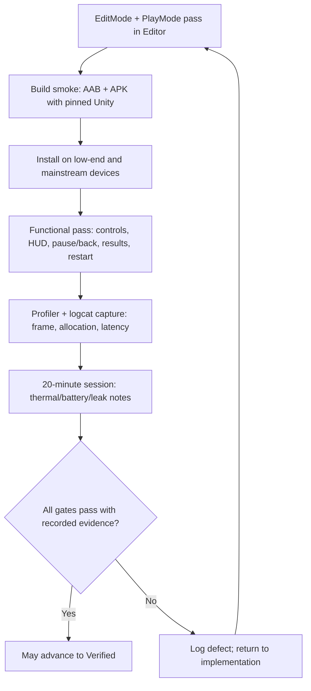

# Indian Subway Runner — Testing Strategy

> **Status:** Planned / Research in progress — no test assemblies, fixtures, results, builds, or device captures exist in this environment.
> **Last updated:** 2026-11-25
> **Authority:** [ADR-0003](decisions/architecture-decisions.md) is final/binding: Unity **6000.0.86f1+ LTS**, C#, URP, Android. Testing uses the **Unity Test Framework**. See [PROJECT_STATUS.md](../PROJECT_STATUS.md) for truthful status rules.

## 1. Test layers (Planned)

| Layer | Tool | Scope | Where evidence lives |
| --- | --- | --- | --- |
| EditMode | Unity Test Framework + NUnit | Pure rules: difficulty, generator, scoring, arbitration, config validation | Test runner report |
| PlayMode | Unity Test Framework + `[UnityTest]` | Lifecycle, input buffering, pooled prefabs, triggers, seeded determinism | Test runner report + dev logs |
| Build smoke | Unity build pipeline / CLI when available | Scene set, asmdefs, Addressables, Player Settings, no compile errors | Build report + hash |
| Device | Device + `adb`/logcat + Profiler | Input latency, safe area, thermal/battery, real build behaviour | Logs + Profiler captures |
| Performance | Unity Profiler / Profile Analyzer | Frame, allocation, render, audio budgets | Captures per [performance-optimization.md](performance-optimization.md) |
| Privacy/boundary | Static + runtime checks | No network/telemetry/secrets; storage boundary per [save-data.md](save-data.md) | Review + test report |

Legacy Kotlin/Gradle/JUnit test claims from the superseded stack are removed. No such tests are authority for the Unity project.

## 2. Unity assembly setup (Planned)

| Assembly | Purpose |
| --- | --- |
| `IndianSubwayRunner.Core` | Pure C# rules; testable without scenes |
| `IndianSubwayRunner.Gameplay` | Runtime controllers consuming `Core` |
| `IndianSubwayRunner.Tests.EditMode` | EditMode tests with `optionalUnityReferences: TestAssemblies` |
| `IndianSubwayRunner.Tests.PlayMode` | PlayMode tests with test fixtures/scenes |

Fixtures live under `Assets/Tests/Fixtures/` as ScriptableObjects/config files. Tests inject a fixed RNG and fixed distance/input sequences; no test depends on wall-clock time or a real device id.

## 3. Coverage map (Planned)

| Subsystem | EditMode | PlayMode | Evidence doc |
| --- | --- | --- | --- |
| Lanes / actions / lifecycle | Curve boundaries, arbitration, buffer expiry | Start→pause→resume→results→restart | [gameplay-mechanics.md](gameplay-mechanics.md) |
| Controls | Gesture threshold math / action map presence | Buffered gesture consumed once; back/pause path | [game-controls.md](game-controls.md) |
| Generation | Seeded determinism, catalog validation, fallback | Chunk stream under fixed seed; pool recycle | [procedural-generation.md](procedural-generation.md) |
| Collision | Priority/order, one-credit-per-id, layer matrix | Trigger/hit/shield/near-miss cases | [collision-system.md](collision-system.md) |
| Difficulty | Curve/tier/fairness functions | No banned pattern at tier | [difficulty-progression.md](difficulty-progression.md) |
| Scoring/combo | Ledger separation, combo boundaries | Run-end commit, no double credit | [scoring-and-rewards.md](scoring-and-rewards.md) |
| Save boundary | Serialization/migration once ADR-0004 exists | Commit at run end; recovery cases | [save-data.md](save-data.md) |
| Performance | Config bounds | Profiler capture on device | [performance-optimization.md](performance-optimization.md) |

ADR-0004 and ADR-0007 are referenced in [environment-assessment.md](environment-assessment.md); tests for their boundaries are written only after those ADRs exist.

## 4. Status vocabulary (binding)

| Status | Meaning |
| --- | --- |
| Planned | Specified here; no test exists |
| Implemented | Test/code compiles in pinned Unity Editor |
| Tested | Unity Test Framework report exists and passes |
| Verified | Tested plus device/build/Profiler evidence recorded |

No layer is currently beyond Planned/Research. In particular, no claim of "tests pass" is made without a test runner report.

## 5. Device and build protocol (Planned)

This shell has no Unity Editor, `adb`, `sdkmanager`, or device; `adb NOT_FOUND` is recorded in [environment-assessment.md](environment-assessment.md). Device steps are therefore future work, not completed checks.

## 6. Privacy and boundary checks (Planned)

- Verify no undeclared network calls from gameplay or scoring.
- Verify no secrets/keystores are embedded in assets or bundles; signing stays outside the repo ([release-process.md](release-process.md)).
- Verify progress writes go only through `SaveSystem` to app-private storage.
- Verify no telemetry is collected; any future telemetry requires an explicit ADR.

## 7. Current state

Per [PROJECT_STATUS.md](../PROJECT_STATUS.md): no gameplay code, scenes, prefabs, art, audio, tests, or builds are verified. This document defines the test plan only. Do not mark any test layer Implemented, Tested, or Verified until the corresponding Unity/device evidence exists.
