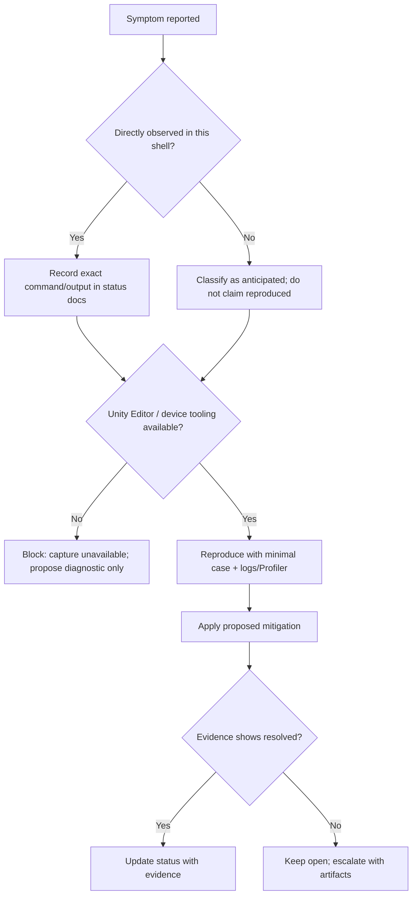

# Indian Subway Runner — Troubleshooting

> **Status:** Planned / Research in progress — no Unity Editor, Blender, `dotnet`, `adb`, device, or build is available in this shell, so no fix below is verified here.
> **Last updated:** 2026-11-25
> **Authority:** [ADR-0003](decisions/architecture-decisions.md) is final/binding: Unity **6000.0.86f1+ LTS**, C#, URP, Android. Observed shell facts are in [environment-assessment.md](environment-assessment.md); current project truth is in [PROJECT_STATUS.md](../PROJECT_STATUS.md).

This document separates **observed environment facts** from **anticipated symptoms and proposed diagnostics**. A proposed mitigation is not a verified fix. Never mark a problem resolved without recorded evidence.

## 1. Observed environment blockers (facts)

| Observation | Evidence / note | Implication |
| --- | --- | --- |
| Unity Editor NOT_FOUND | Recorded in [environment-assessment.md](environment-assessment.md) | No compile, scene, prefab, PlayMode, or build verification here |
| Blender NOT_FOUND | Same source | No asset authoring/import verification here |
| `dotnet` NOT_FOUND | Same source | No .NET CLI verification here |
| `adb` `NOT_FOUND` | Same source | No device install/logcat/screen capture here |
| `sdkmanager` `NOT_FOUND` | Same source | No SDK package management here |
| `ANDROID_HOME` / `ANDROID_SDK_ROOT` `UNSET` | Same source | Android tooling path not configured here |
| GitHub auth | Authenticated as `inzyhere` via `gh` | Private remote operations are available when explicitly requested |
| Git state | Local repo initialized and `main` tracks `origin/main` | Fetch remote history before any push |

Required environment to move beyond Planned: install the pinned Unity LTS version with Android/JDK/NDK modules, Blender for original assets (external to repo), and `adb`/SDK configured. GitHub auth and the private remote are already configured.

## 2. Triage rule

## 3. Anticipated Unity symptoms (not reproduced here)

| Symptom | Diagnostic when tooling exists | Proposed mitigation (unverified) |
| --- | --- | --- |
| Compile errors after opening project | Unity Console; confirm pinned Editor version and `Packages/manifest.json` | Restore expected packages; fix asmdef references; never patch by copying legacy Kotlin code |
| Input System package missing / legacy input active | Package Manager + Project Settings Active Input Handling | Pin `com.unity.inputsystem`; set Input System Package (New); see [game-controls.md](game-controls.md) |
| URP material pink / shader errors | Console + Frame Debugger | Reassign URP shaders; check pipeline asset/renderer features |
| Addressables asset not found | Addressables build report + runtime log in dev builds | Rebuild groups; preload in Boot; verify labels |
| Physics contact seems wrong | Collision gizmos + layer matrix test in [collision-system.md](collision-system.md) | Verify layers, state-dependent collider, and canonical arbitration; do not change solver order |
| Animator looks clear but hit registers | Profiler/gizmo overlay comparing visuals and collider state | Align collider timing with locomotion curve; defect is release-blocking |
| Pause/back behaves incorrectly | Device log + PlayMode lifecycle test | Clear gesture buffer; respect topmost overlay; explicit resume |
| Safe-area clipping on cutout device | Device screenshot on cutout phone | Recompute `Screen.safeArea`; keep HUD/pause inside safe area |
| Low FPS / allocation spikes | Unity Profiler capture per [performance-optimization.md](performance-optimization.md) | Pool/reuse, non-alloc queries, reduce URP cost; retest |
| Input lag | Profiler timeline + device capture | Check fixed-step buffer and UI interception; verify < ~50 ms target |
| Build fails at API 36 / JDK / NDK | Unity build log + Android module versions | Align Editor Android modules with [android-build-instructions.md](android-build-instructions.md); no ad-hoc downgrade |
| 16 KB device install/runtime issue | AAB native library audit + device log | Rebuild native plugins for 16 KB; block release until verified |
| Crash on resume/background | Device logcat + PlayMode lifecycle test | Pause on focus loss; clear buffer; defer unstable saves |
| Save file missing/corrupt | Dev-build log + file audit under `Application.persistentDataPath` | Follow ADR-0004 once written; do not invent a format now ([save-data.md](save-data.md)) |

## 4. What not to do

- Do not treat legacy Kotlin/libGDX/ADR-0002 logs or test names as evidence for the Unity project.
- Do not add hidden network calls, telemetry, or cloud claims as a workaround; ADR-0007 boundary applies ([environment-assessment.md](environment-assessment.md)).
- Do not commit keystores, tokens, APKs, AABs, or device logs containing secrets ([release-process.md](release-process.md)).
- Do not mark an issue Verified from a screenshot or a guess; use the status vocabulary in [testing-strategy.md](testing-strategy.md).
- Do not claim a mechanic works because a doc describes it; every gameplay doc here is Planned.

## 5. Escalation artifacts

When escalating an issue, include:

| Artifact | Purpose |
| --- | --- |
| Unity version + patch, project commit | Reproducibility |
| Exact Console/build error text | Root cause |
| Profiler capture | Performance/input claims |
| Device model/API + logcat | Android-specific behaviour |
| Repro steps + seed/input trace | Deterministic gameplay issues |
| Build hash + AAB/APK variant | Build identity |
| Status-doc update | Truthful record of Planned → Implemented → Tested → Verified |

## 6. Current status

All items in this document are **Planned / Research in progress**. Per [PROJECT_STATUS.md](../PROJECT_STATUS.md), no gameplay code, scenes, prefabs, art, audio, tests, or builds are verified, and this shell lacks the tools needed to verify them. Recorded blocker outputs in [environment-assessment.md](environment-assessment.md) are facts; all mitigations above are proposals only.
