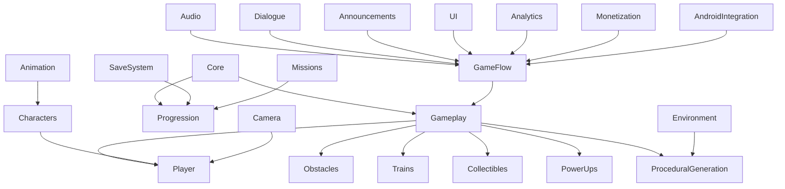

# Unity Project Setup

> Status: Planned for Editor verification; foundation files are Implemented but Unity-unverified.

This repository is a Unity project. The source of truth is `Assets/`, `Packages/manifest.json`, and `ProjectSettings/`. Never hand-edit Unity-generated Gradle output as gameplay source.

## Required Editor

- Unity **6000.0.86f1** or newer 6000.0 LTS patch.
- Modules: Android Build Support, Android SDK & NDK Tools, OpenJDK 17.
- Rendering: Universal Render Pipeline via `com.unity.render-pipelines.universal`.
- Tests: `com.unity.test-framework`.
- UI: Unity UI and/or UI Toolkit packages as verified by the Editor version.
- Optional: Addressables, Cinemachine, Input System, TextMeshPro — add only after verifying package compatibility.

## First run checklist

1. Open this directory as a Unity project in the pinned Editor.
2. Let Unity import packages and recompile assemblies.
3. Resolve any package or `.asmdef` errors before adding code.
4. Verify the active render pipeline is the URP asset under `Assets/Settings/URP/`.
5. Verify Android Player Settings:
   - Company/Product names set.
   - Package name `com.indiansubwayrunner.game` unless renamed by owner.
   - Minimum API 24.
   - Target API 36.
   - ARM64 enabled.
   - 16 KB page-size compatible native plugins only.
   - JDK 17, NDK r27c as supplied by the pinned Editor.
6. Verify assembly definitions compile:
   - `IndianSubwayRunner.Core`
   - `IndianSubwayRunner.GameFlow`
   - `IndianSubwayRunner.Gameplay`
   - `IndianSubwayRunner.Player`
   - `IndianSubwayRunner.Characters`
   - `IndianSubwayRunner.Environment`
   - `IndianSubwayRunner.ProceduralGeneration`
   - `IndianSubwayRunner.Obstacles`
   - `IndianSubwayRunner.Trains`
   - `IndianSubwayRunner.Collectibles`
   - `IndianSubwayRunner.PowerUps`
   - `IndianSubwayRunner.Camera`
   - `IndianSubwayRunner.Animation`
   - `IndianSubwayRunner.Audio`
   - `IndianSubwayRunner.Dialogue`
   - `IndianSubwayRunner.Announcements`
   - `IndianSubwayRunner.UI`
   - `IndianSubwayRunner.Progression`
   - `IndianSubwayRunner.Missions`
   - `IndianSubwayRunner.SaveSystem`
   - `IndianSubwayRunner.Analytics`
   - `IndianSubwayRunner.Monetization`
   - `IndianSubwayRunner.AndroidIntegration`
7. Run all EditMode tests.
8. Create or verify scenes under `Assets/Scenes/` and add them to Build Settings.
9. Run PlayMode smoke tests.
10. Record results in `PROJECT_STATUS.md`; change statuses only when evidence exists.

## Assembly dependency direction

Rules:

- `Core` must not depend on Unity scene objects or platform SDKs.
- `GameFlow` coordinates scenes and lifecycle; it does not own detailed gameplay math.
- `AndroidIntegration` depends on `GameFlow`, never the reverse.
- `Analytics` and `Monetization` are passive and remain disabled until explicitly enabled.
- Tests reference the assembly under test plus `Core`.

## Current environment limitation

This shell has no Unity Editor and no C# compiler. The project structure can be statically inspected, but import, compilation, scenes, and builds cannot be verified here. Do not mark any Unity setup item as Tested or Verified until it has passed in Unity.
